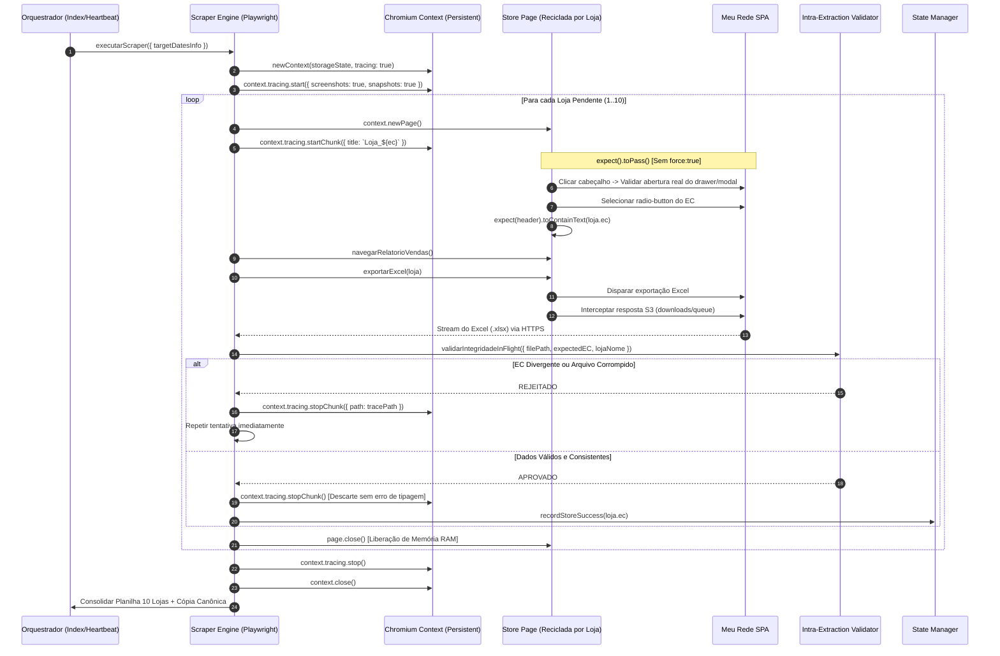

# Spec 031 — Documento de Design Técnico: Anti-Flakiness & Robustez Playwright (v2 Hardened)

> **ID da Spec:** `031-playwright-anti-flakiness-robustez-rede`  
> **Status:** PROPOSTA ATUALIZADA (COM AUDITORIA DAS 5 TRAVAS TÉCNICAS)  
> **Data:** 2026-10-23  

---

## 1. Fluxo Arquitetural Completo (Life Cycle do Scraper v2)



---

## 2. Detalhamento e Contratos por Agente Especializado

### Agente 1: Playwright Core Engine Specialist
**Módulos sob responsabilidade:** `src/scraper.js`

#### Padrão de Tracing por Chunk (Sem Erro de Tipagem):
```javascript
// Antes do loop das 10 lojas:
await context.tracing.start({ screenshots: true, snapshots: true });

for (const loja of pendingStores) {
  const page = await context.newPage();
  await context.tracing.startChunk({ title: `Loja_${loja.nomePlanilha}_${loja.ec}` });

  try {
    await processarLojaComRetry(page, loja);
    // Sucesso: stopChunk() SEM argumentos descarta o trace silenciosamente sem erro
    await context.tracing.stopChunk();
  } catch (err) {
    const tracePath = path.join(LOGS_DIR, `trace_${loja.ec}_tent${tent}.zip`);
    await context.tracing.stopChunk({ path: tracePath });
    throw err;
  } finally {
    await page.close().catch(() => {});
  }
}

await context.tracing.stop().catch(() => {});
```

#### Seleção de Estabelecimento com `expect().toPass()` (Sem `force: true`):
```javascript
// Espera ativa de auto-retry: clica no cabeçalho e confirma que o modal/drawer realmente abriu
await expect(async () => {
  const headerDropdown = page.locator('.c-header__button')
    .or(page.locator('.c-header__wrapper-establishment'))
    .or(page.locator('#nav-config'))
    .or(page.locator('a.icon_usuario_perfil'));

  await headerDropdown.first().click({ timeout: 5000 });

  const modalAberto = page.locator('.modal-stores-list')
    .or(page.locator('#c-header-drawer'))
    .or(page.locator('.changebrand-modal'))
    .or(page.locator(`[id*="${loja.ec}"]`));

  await expect(modalAberto.first()).toBeVisible({ timeout: 4000 });
}).toPass({ timeout: 25000, intervals: [1000, 2000, 3000] });
```

---

### Agente 2: In-Flight Validation & Intra-Lógica Specialist
**Módulos sob responsabilidade:** `src/intra_extraction_validator.js`

```javascript
const fs = require('fs');
const crypto = require('crypto');
const XLSX = require('xlsx');

const seenHashes = new Map(); // hash -> { ec, lojaNome }

/**
 * Validação intra-lógica do arquivo baixado antes de registrar o sucesso
 */
function validarIntegridadeInFlight({ filePath, expectedEC, lojaNome }) {
  if (!fs.existsSync(filePath)) {
    return { valid: false, error: `Arquivo físico não encontrado: ${filePath}` };
  }

  const buffer = fs.readFileSync(filePath);

  // 1. Zero-Byte / Assinatura ZIP-XLSX (PK\x03\x04)
  if (buffer.length < 100 || buffer.readUInt32LE(0) !== 0x04034b50) {
    return { valid: false, error: `Arquivo corrompido ou assinatura inválida para ${lojaNome}` };
  }

  // 2. Leitura síncrona em memória
  const workbook = XLSX.read(buffer, { type: 'buffer' });
  const sheet = workbook.Sheets[workbook.SheetNames[0]];
  const rows = XLSX.utils.sheet_to_json(sheet, { header: 1, defval: '' });

  // Busca o EC nas primeiras 15 linhas (cabeçalho ou primeiras vendas)
  const rawTextSample = rows.slice(0, 15).map(r => r.join(' ')).join(' ');
  const containsExpectedEC = rawTextSample.includes(String(expectedEC));

  if (!containsExpectedEC && rows.length > 2) {
    return {
      valid: false,
      actualEC: 'DIVERGENTE',
      error: `EC Mismatch: O arquivo baixado em ${lojaNome} NÃO contém o EC esperado (${expectedEC}). Provável falha na troca de loja no portal.`
    };
  }

  // 3. Anti-Duplicação (SHA-256) apenas para arquivos com dados reais
  const fileHash = crypto.createHash('sha256').update(buffer).digest('hex');
  if (rows.length > 5 && seenHashes.has(fileHash)) {
    const prev = seenHashes.get(fileHash);
    if (prev.ec !== expectedEC) {
      return {
        valid: false,
        error: `Duplicação detectada! Arquivo de ${lojaNome} (${expectedEC}) é idêntico ao de ${prev.lojaNome} (${prev.ec}).`
      };
    }
  }
  seenHashes.set(fileHash, { ec: expectedEC, lojaNome });

  return { valid: true, actualEC: expectedEC, transacoesCount: Math.max(0, rows.length - 2) };
}

function resetIntraValidator() {
  seenHashes.clear();
}

module.exports = {
  validarIntegridadeInFlight,
  resetIntraValidator
};
```

---

### Agente 3: Burn-in Test & Stress Harness Specialist
**Módulos sob responsabilidade:** `scripts/run_rede_burnin.js`

#### CLI e Estrutura de Execução:
- **Argumentos Suportados:**
  - `--cycles=10`: Número de execuções completas em loop contínuo.
  - `--store=<slug|ec>`: Filtro de loja única para teste isolado de estresse.
  - `--isolated-state`: Utiliza `data/state_burnin_test.json` sem poluir produção.
- **Relatório Final no Console:**
  - Taxa de Sucesso: `X/Y ciclos (100% de confiabilidade)`.
  - Latência Média por Loja e Desvio Padrão.
  - Consumo Máximo de RAM (RSS) registrado no processo.

---

### Agente 4: Evening Heartbeat & Cron Orchestrator Specialist
**Módulos sob responsabilidade:** `src/run_evening_heartbeat.js`, gates de stale data

#### Harmonização do Stale Data Gate (16 Horas):
No `run_unified_morning_dispatch.js` e `run_group_balloon_dispatch.js`, a tolerância de frescor dos arquivos de conciliação e juros é ajustada de 12h para **16 horas**:
```javascript
// Exemplo no gate matinal:
const diffHoras = (Date.now() - fileStat.mtimeMs) / (1000 * 60 * 60);
if (diffHoras > 16) {
  // Apenas arquivos anteriores às 16:00 do dia anterior são considerados obsoletos
}
```

#### Nomenclatura Determinística pela Data-Alvo Contábil:
```javascript
// O nome do estado NUNCA usa new Date() da máquina:
const targetDatesInfo = resolveTargetDates(targetDate, cliData);
const dateTag = targetDatesInfo.targetDatesISO.length === 1 
  ? targetDatesInfo.targetDatesISO[0] 
  : `${targetDatesInfo.targetDatesISO[0]}_a_${targetDatesInfo.targetDatesISO[targetDatesInfo.targetDatesISO.length - 1]}`;

const statePath = path.join(DATA_DIR, `state_${dateTag}.json`);
```

---

### Agente 5: Local Windows Emergency Runner Specialist
**Módulos sob responsabilidade:** `scripts/run_local_emergency.bat`, `scripts/run_local_emergency.js`

#### Script Batch com Sincronização Quádrupla:
```bat
@echo off
chcp 65001 >nul
echo ========================================================
echo [HYDRA REDE] MODO DE EMERGENCIA LOCAL (CHROME VISIVEL)
echo ========================================================

cd /d "%~dp0.."
node scripts/run_local_emergency.js --build-only --now
if %ERRORLEVEL% NEQ 0 (
    echo [ERRO] Falha na extracao local. Verifique a janela do navegador.
    pause
    exit /b 1
)

echo [SCP] Enviando planilhas, auditoria e checkpoints para a VPS...
scp -P 22 output/Juros*.xlsx operacional@100.126.50.101:/home/operacional/hydra-rede/output/
scp -P 22 output/relatorios/Conciliacao*.xlsx operacional@100.126.50.101:/home/operacional/hydra-rede/output/relatorios/
scp -P 22 logs/audit_*.json operacional@100.126.50.101:/home/operacional/hydra-rede/logs/
scp -P 22 data/state_*.json operacional@100.126.50.101:/home/operacional/hydra-rede/data/

echo [OK] Arquivos sincronizados com sucesso na VPS!
pause
```
