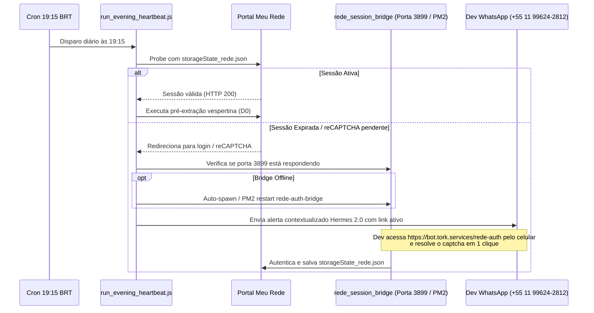

# Design Técnico: Resiliência do Heartbeat da Rede, Auto-Start da Ponte Web e Correção de Alertas

**Spec ID:** `039-hydra-rede-heartbeat-auth-bridge-resilience`  
**Data:** 27/10/2026  
**Status:** Planejamento (SDD Proposal)  

---

## 1. Fluxo de Dados & Arquitetura de Contingência



---

## 2. Refatoração de `enviarAlertaDev` (`src/whatsapp_patio_dispatcher.js`)

### 2.1 Assinatura e Interface Tipada
Atualmente, `enviarAlertaDev(errorMessage, logsContext)` usa cabeçalho fixo. A nova assinatura aceita objeto estruturado com fallback retrocompatível:

```javascript
/**
 * Tipos de origem de alerta dev
 * @typedef {'HEARTBEAT_REDE' | 'PATIO_MATINAL' | 'ESTEIRA_NOTURNA' | 'WATCHDOG_0600' | 'GENERICO'} OrigemAlerta
 */

async function enviarAlertaDev(param, logsContext = '') {
  let errorMessage = '';
  let origem = 'GENERICO';
  let contextLogs = logsContext;

  if (typeof param === 'object' && param !== null) {
    errorMessage = param.errorMessage || param.mensagem || '';
    origem = param.origem || 'GENERICO';
    contextLogs = param.logsContext || logsContext || '';
  } else {
    errorMessage = String(param || '');
    // Inferência contextual de legado para evitar falsos positivos
    if (errorMessage.includes('HEARTBEAT') || errorMessage.includes('19:15') || errorMessage.includes('rede-auth')) {
      origem = 'HEARTBEAT_REDE';
    } else if (errorMessage.includes('pátio') || errorMessage.includes('patio')) {
      origem = 'PATIO_MATINAL';
    }
  }

  const now = new Date().toLocaleString('pt-BR', { timeZone: 'America/Sao_Paulo' });
  const hora = new Date().toLocaleTimeString('pt-BR', { hour: '2-digit', minute: '2-digit', timeZone: 'America/Sao_Paulo' });
  const data = new Date().toLocaleDateString('pt-BR', { timeZone: 'America/Sao_Paulo' });

  let text = '';

  if (origem === 'HEARTBEAT_REDE') {
    text = [
      `*HYDRA | Heartbeat Preventivo Meu Rede*\n\n*${data} · ${hora}*`,
      `> *Diagnóstico de Sessão*\n` +
      `- *Status:* ⚠️ Sessão expirada no portal Meu Rede\n` +
      `- *Causa:* Desafio reCAPTCHA v2 pendente\n` +
      `- *Impacto operacional:* Nenhum relatório da diretoria afetado neste horário`,
      `> *Ação Rápida Recomendada*\n` +
      `Acesse a ponte interativa no link abaixo pelo celular para reautenticar antes das 23h:\n` +
      `https://bot.tork.services/rede-auth`,
      `> *Detalhes Técnicos*\n` +
      `- *Erro:* ${errorMessage}`
    ].join('\n\n');
  } else {
    // Layout padrão de contingência operacional
    text = [
      `*HYDRA | Alerta de Contingência | Operação*\n\n*${data} · ${hora}*`,
      `> *Diagnóstico da Ocorrência*\n` +
      `- *Origem:* ${origem}\n` +
      `- *Detalhe:* ${errorMessage}`,
      `> *Medida Preventiva*\n` +
      `- *Diretoria (+55 11 94066-7032):* Envios bloqueados até validação dos dados`
    ].join('\n\n');
  }

  if (contextLogs) {
    const truncated = contextLogs.length > 500 ? contextLogs.slice(-500) : contextLogs;
    text += `\n\n> *Últimos Logs*\n\`\`\`\n${truncated}\n\`\`\``;
  }

  return await sendText(text, DEV_NUMBER);
}
```

---

## 3. Configuração do Daemon PM2 para o Bridge na VPS

Para garantir que `https://bot.tork.services/rede-auth` esteja sempre respondendo:

### 3.1 Definição do Arquivo de Configuração (`ecosystem.config.js`)
No diretório `/home/operacional/hydra-rede/`:
```javascript
module.exports = {
  apps: [
    {
      name: 'rede-auth-bridge',
      script: 'src/rede_session_bridge.js',
      cwd: '/home/operacional/hydra-rede',
      instances: 1,
      autorestart: true,
      watch: false,
      max_memory_restart: '500M',
      env: {
        NODE_ENV: 'production',
        REDE_AUTH_PORT: 3899
      }
    }
  ]
};
```

### 3.2 Comandos de Ativação no Host:
```bash
pm2 start /home/operacional/hydra-rede/ecosystem.config.js
pm2 save
```

---

## 4. Ajustes em `src/run_evening_heartbeat.js`

1. Chamar `enviarAlertaDev` com `{ origem: 'HEARTBEAT_REDE', errorMessage: errSessao.message }`.
2. Incluir verificação prévia da porta 3899:
   - Se a porta 3899 não estiver respondendo via `http.get('http://127.0.0.1:3899/api/status')`, disparar `pm2 restart rede-auth-bridge` automaticamente para que a URL esteja 100% acessível quando a notificação chegar no WhatsApp do desenvolvedor.
