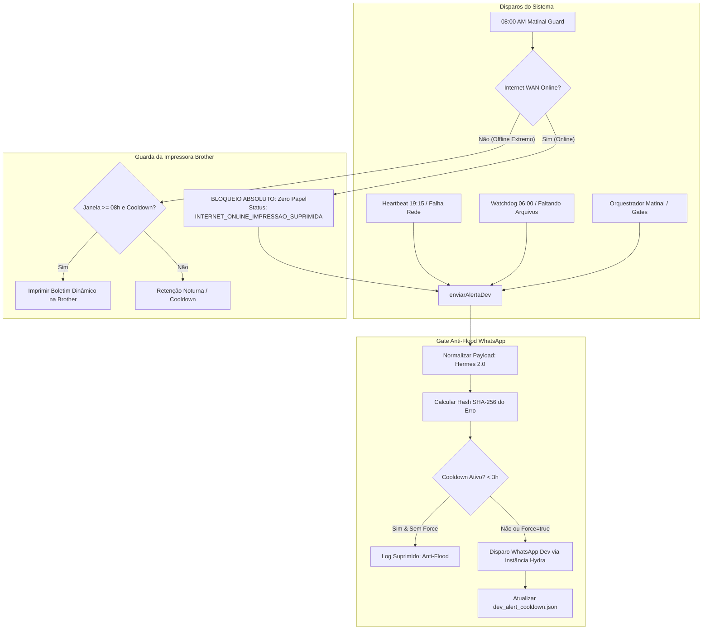

# Design Técnico — Spec 040: Resiliência Hydra, Hardware Guard & Alertas Hermes 2.0

## 1. Arquitetura da Solução



---

## 2. Detalhamento dos Componentes

### 2.1. Trava Absoluta de Hardware (`hydra_printer_alert.js`)

#### A. Condição Inviolável de Impressão
A impressão física na Brother DCP-B7535DW é um recurso de contingência final para perda física de link WAN. Se a rede externa estiver ativa, **é proibido emitir papel**.

```javascript
async function checarStatusMatinal08h(options = {}) {
  // 1. Checa conectividade WAN real
  const { probeWanConnectivity } = require('./hydra_network_watchdog');
  const wanProbe = await probeWanConnectivity();

  // REGRA DE OURO: Se a internet estiver online, NUNCA imprime na Brother!
  if (wanProbe.isOnline) {
    if (lockSucessoExiste) {
      console.log(`🎉 [08:00 AM OK] Despacho matinal concluído com sucesso e internet online! Zero impressões necessárias.`);
      return { status: 'SUCESSO_SEM_IMPRESSAO', dateTagBR };
    }

    console.warn(`⚠️ [08:00 AM FALHA DE ROTINA] Lock matinal ausente, porém INTERNET WAN ESTÁ 100% ONLINE.`);
    console.warn(`🖨️ [Hardware Guard] Impressão física SUPRIMIDA. Notificando desenvolvedor exclusivamente via WhatsApp.`);
    
    // Alerta digital imediato para o desenvolvedor
    const { enviarAlertaDev } = require('./whatsapp_patio_dispatcher');
    await enviarAlertaDev({
      subsistema: 'WATCHDOG',
      titulo: 'Lock Matinal das 08h Ausente',
      causaRaiz: 'O despacho oficial das 08:00 AM não gerou o lock de sucesso no disco/VPS.',
      impacto: 'A diretoria pode não ter recebido os relatórios matinais oficiais.',
      acaoRecomendada: 'Inspecione os logs em /home/operacional/hydra-data/logs/matinal-trio.log e rode com --force se necessário.',
      bloqueouDiretoria: true
    }).catch(() => {});

    return {
      status: 'INTERNET_ONLINE_IMPRESSAO_SUPRIMIDA',
      dateTagBR,
      motivo: 'Internet WAN online. Falhas de software são comunicadas digitalmente.'
    };
  }

  // Se chegou aqui, a internet está estritamente OFFLINE
  console.log(`🚨 [08:00 AM QUEDA WAN CONFIRMADA] Internet offline. Acionando Boletim Físico na Brother...`);
  return await emitirAlertaImpresso({
    ...options,
    reason: 'QUEDA DE CONEXÃO WAN (VIVO FIBRA) CONFIRMADA PELO WATCHDOG',
    force: true
  });
}
```

#### B. Dinamização de `emitirAlertaImpresso`
Mesmo no método direto `emitirAlertaImpresso(options)`:
- Adicionar verificação de segurança: a menos que `options.testHardware === true` (teste explícito de spooler solicitado pelo operador), se `wanProbe.isOnline === true`, abortar o envio para a impressora.

---

### 2.2. Motor Hermes 2.0 e Normalizador de Alertas (`whatsapp_patio_dispatcher.js`)

#### A. Interface Estruturada do Alerta
```typescript
interface AlertaDevPayload {
  subsistema: 'MEU REDE' | 'PÁTIO' | 'CONCILIAÇÃO' | 'CMV GERENTES' | 'WATCHDOG' | 'FINANCEIRO' | 'INFRA';
  titulo: string;
  causaRaiz: string;
  impacto?: string;
  acaoRecomendada: string;
  detalhesTecnicos?: string;
  bloqueouDiretoria?: boolean;
  force?: boolean;
}
```

#### B. Normalizador Inteligente (Retrocompatibilidade)
Se o chamador passar strings antigas `enviarAlertaDev(errorMessage, logsContext)`:
1. Detecta padrões conhecidos via Regex:
   - Contém `HEARTBEAT` ou `SESSÃO REDE` ou `rede-auth` -> Subsistema: `MEU REDE`, Título: `Sessão do Portal Expirada / Captcha`, Impacto: `Teste preventivo das 19:15`, Ação: `Acesse https://bot.tork.services/rede-auth para reautenticar antes das 23h!`.
   - Contém `CMV` ou `Serviço Prestado` -> Subsistema: `CMV GERENTES`, Título: `Instância Offline ou Erro de Envio`, Impacto: `Disparo aos gerentes retido`.
   - Contém `06:00 AM` ou `Pendências identificadas` -> Subsistema: `WATCHDOG 06:00`, Título: `Atenção Antecipada`, Impacto: `Arquivos pendentes para a esteira matinal`.
   - Contém `Totalidade` ou `BLOQUEIO DE SEGURANÇA` -> Subsistema: `MATINAL`, Título: `Relatórios Faltantes`, Impacto: `Envio para diretoria retido preventivamente`, Bloqueou Diretoria: `true`.
2. Remove blocos duplicados de cabeçalhos redundantes e ícones repetidos.

#### C. Layout Hermes 2.0 Formatado
```text
🚨 *[HYDRA {SUBSISTEMA} — {TITULO}]*

> *Diagnóstico Rápido*
• *Causa:* {causaRaiz}
• *Impacto:* {impacto || 'Operação monitorada pelo sistema'}
• *Horário:* {timestampBR}

> *Ação Necessária*
👉 {acaoRecomendada}

{se bloqueouDiretoria: 🛡️ *Segurança:* O envio para a diretoria (+55 11 94066-7032) foi bloqueado preventivamente.}
{se detalhesTecnicos: 📋 *Detalhes / Logs:*
```
{detalhesTecnicosTruncados}
```}
```

---

### 2.3. Gate Anti-Flood & Deduplicação de Alertas

#### A. Arquivo de Estado
- Caminho: `/home/operacional/hydra-data/locks/dev_alert_cooldown.json` (Linux) ou `%USERPROFILE%/.hydra/dev_alert_cooldown.json` (Windows).
- Estrutura JSON:
```json
{
  "alerts": {
    "meu_rede_captcha": {
      "subsistema": "MEU REDE",
      "hash": "e3b0c44298fc1c149afbf4c8996fb92427ae41e4649b934ca495991b7852b855",
      "primeiraOcorrencia": "2026-10-28T19:15:00.000Z",
      "ultimaOcorrencia": "2026-10-28T19:15:00.000Z",
      "ocorrencias": 1,
      "ultimoDisparoWpp": "2026-10-28T19:15:00.000Z"
    }
  }
}
```

#### B. Regra de Cooldown (180 Minutos / 3 Horas)
1. Hash do erro: `crypto.createHash('sha256').update(`${subsistema}:${causaRaizNorm}`).digest('hex')`.
2. Se `alertKey` existir no cache:
   - Se decorrido `< 180 min` e `force !== true`:
     - Incrementa `ocorrencias`.
     - Atualiza `ultimaOcorrencia`.
     - Retorna `{ enviar: false, motivo: 'Cooldown ativo (restam X min)', ocorrencias }`.
   - Se decorrido `>= 180 min`:
     - Libera reenvio com anotação no Impacto: `(Erro persistente há X horas — ocorrência #N)`.
     - Atualiza `ultimoDisparoWpp`.
3. Se `alertKey` não existir:
   - Registra no cache e envia imediatamente.

#### C. Auto-Clear de Sucesso (`registrarSucessoDev`)
Quando uma rotina que antes falhou agora roda com sucesso (ex: login efetuado com sucesso no Meu Rede ou despacho matinal entregue com êxito), a função `registrarSucessoDev(subsistema)` limpa as chaves daquele subsistema no arquivo de cooldown.
Assim, se uma falha nova ocorrer horas ou dias depois, o alerta será entregue sem qualquer atraso.

---

## 3. Segurança & Isolamento

1. **Restrição de Remetente (Regra Inviolável):**
   - Os envios para o Dev continuam restritos à instância `hydra` (ou `atendimento`), jamais instâncias de gerentes.
2. **Resiliência a Falhas de I/O de Lock:**
   - Se o arquivo `dev_alert_cooldown.json` falhar na leitura/escrita (ex: permissão ou disco cheio), a função faz fallback seguro para a memória do processo ou libera o envio para garantir que o Dev nunca fique sem saber de um erro real por falha no anti-flood.
