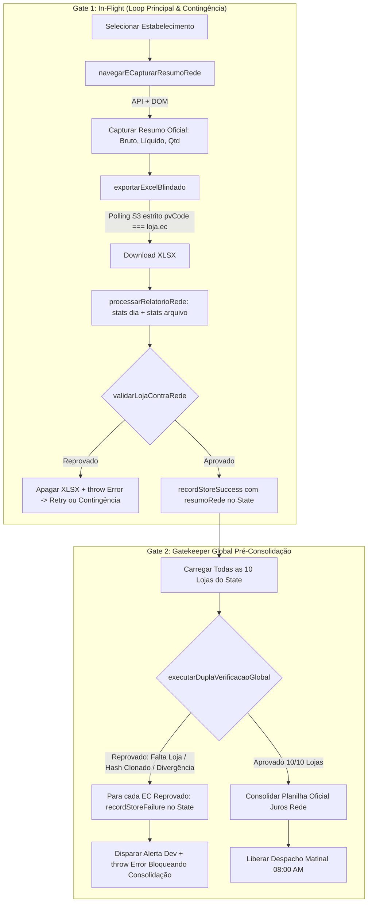

# Design Técnico — Spec 042: Hydra Rede Dupla Verificação Anti-Cascata e Blindagem S3

## 1. Visão Geral da Arquitetura & Fluxo Refinado



---

## 2. Refinamentos Técnicos Detalhados

### 2.1. Invalidação de Checkpoint no Gate 2 (Anti-Trava de Resume)
No `scraper.js`, imediatamente após rodar `executarDuplaVerificacaoGlobal`:
```javascript
const auditGlobal = executarDuplaVerificacaoGlobal({
  catalogoLojas: LOJAS,
  state,
  todasLojasDados,
  dateTag
});

if (!auditGlobal.aprovado) {
  log(`⛔ DUPLA VERIFICAÇÃO GLOBAL REPROVADA:`);
  auditGlobal.falhasCriticas.forEach(f => log(`  - ${f}`));

  // Invalida individualmente os checkpoints de cada loja reprovada no disco
  for (const ecReprovado of auditGlobal.lojasReprovadasECs) {
    recordStoreFailure(state, ecReprovado, 'Reprovado na Dupla Verificação Global');
  }

  throw new Error(`Consolidação bloqueada pela Dupla Verificação Global: ${auditGlobal.falhasCriticas.join('; ')}`);
}
```

### 2.2. Unificação no Loop Principal e na Segunda Passada de Contingência
Tanto no loop principal (`for (const loja of pendingStores)`) quanto no de contingência (`for (const loja of stillPending)`):
```javascript
recordStoreAttempt(state, loja.ec);
await selecionarEstabelecimento(page, loja);
const resumoRede = await navegarECapturarResumoRede(page, loja, targetDatesInfo);
const filePath = await exportarExcelBlindado(page, loja, targetDatesInfo);

const { dados, stats } = processarRelatorioRede(filePath, targetDatesInfo, loja.nomePlanilha);

// DUPLA CHECAGEM IN-FLIGHT
const auditInFlight = validarLojaContraRede({ loja, filePath, dados, stats, resumoRede });
if (!auditInFlight.ok) {
  try { fs.unlinkSync(filePath); } catch (_) {}
  throw new Error(`Falha na Dupla Verificação In-Flight: ${auditInFlight.erros.join(' | ')}`);
}

recordStoreSuccess(state, loja.ec, { filePath, stats, dados, resumoRede });
```

No final do `scraper.js`, preservação de retrocompatibilidade:
```javascript
module.exports = {
  executarScraper,
  selecionarEstabelecimento,
  navegarRelatorioVendas: navegarECapturarResumoRede, // alias de compatibilidade
  exportarExcel: exportarExcelBlindado,              // alias de compatibilidade
  navegarECapturarResumoRede,
  exportarExcelBlindado,
  verificarOuLogar
};
```

### 2.3. Resolução do Período da Rede vs. Filtro do `processarRelatorioRede`
1. Em `excel_processor.js` (`processarRelatorioRede`):
   - Além de `totalBruto` e `totalLiquido` (filtrados para `targetDatesInfo`), computar:
     - `totalBrutoArquivo`: soma de todas as transações válidas (não canceladas/estornadas) do arquivo Excel inteiro, independentemente da data.
     - `totalLiquidoArquivo`: soma líquida de todas as transações válidas do arquivo.
     - `transacoesArquivo`: contagem total de linhas de venda válidas do arquivo.
2. Em `double_check_auditor.js` (`validarLojaContraRede`):
   - Comparação flexível e à prova de descasamento de tela:
     - Se `|stats.totalBruto - resumoRede.brutoEsperado| <= TOLERANCIA_CENTAVOS`: aprovado direto (tela da Rede estava filtrada para o dia alvo).
     - Se não, verifica contra o total do arquivo completo: se `|stats.totalBrutoArquivo - resumoRede.brutoEsperado| <= TOLERANCIA_CENTAVOS`: aprovado (tela da Rede estava exibindo o range completo exportado no Excel).
     - Se divergir de ambos: reprovação legítima por truncamento ou arquivo de terceiros.
     - Mesma regra espelhada para o total líquido.

---

## 3. Contratos de Dados & Interfaces

### 3.1. Stats Estendidos do `processarRelatorioRede`
```typescript
interface ExtractedStats {
  totalBruto: number;                // Filtrado por targetDatesInfo
  totalLiquido: number;              // Filtrado por targetDatesInfo
  totalVendaJuros: number;           // Filtrado por targetDatesInfo
  totalBrutoArquivo: number;         // Arquivo completo
  totalLiquidoArquivo: number;       // Arquivo completo
  transacoesArquivo: number;         // Total de transações válidas no arquivo
}
```

### 3.2. Módulo `double_check_auditor.js`
- `calcularHashArquivo(filePath): string`
- `extrairECsDoExcelBruto(filePath): string[]`
- `gerarAssinaturaTransacoes(dados): string`
- `validarLojaContraRede({ loja, filePath, dados, stats, resumoRede }): AuditLojaResult`
- `executarDuplaVerificacaoGlobal({ catalogoLojas, state, todasLojasDados, dateTag }): GlobalAuditResult`
