# Design Técnico — Spec 043: Bateria Exaustiva de Testes de Caos, E2E e Resiliência da Dupla Verificação

## 1. Arquitetura da Suíte de Testes

```mermaid
flowchart TD
    Runner[run_all_tests.js - Orquestrador Central] --> T1[test_playwright_chaos_s3.js]
    Runner --> T2[test_financial_edge_cases.js]
    Runner --> T3[test_spreadsheet_integrity.js]
    Runner --> T4[test_smoke_vps_history.js]

    subgraph Pilar1_2["Pilares 1 & 2: Caos & Interceptação Playwright"]
        T1 --> M1[Mock Route: downloads/queue com baseline & timing]
        T1 --> M2[Mock Route: /api/sales JSON oficial]
        T1 --> M3[DOM Fixture: Cards HTML formatados & Desincronização de EC]
    end

    subgraph Pilar3_4["Pilares 3 & 4: Finanças & Estado"]
        T2 --> F1[Tolerância MDR 0.04/0.05 vs 0.06]
        T2 --> F2[Compatibilidade Dual: Range Acumulado vs Dia Alvo]
        T2 --> F3[Anti-Colisão de SEM_VENDAS em Domingos/Feriados]
        T2 --> F4[Agulha no Palheiro: Injeção de 1 linha de EC intruso]
        T2 --> F5[Invalidação Gate 2: recordStoreFailure apenas nos reprovados]
        T2 --> F6[Bloqueio Total de Consolidação Parcial]
    end

    subgraph Pilar5["Pilar 5: Integridade de Planilha"]
        T3 --> S1[Consolidação com 10 Lojas Reais]
        T3 --> S2[Preservação de Fórmulas contarFormulasPlanilha]
        T3 --> S3[Geração da Cópia Canônica Oficial]
    end

    subgraph Pilar6["Pilar 6: Smoke VPS"]
        T4 --> V1[Varredura de downloads/ reais na VPS]
        T4 --> V2[Validação contra layout real da Rede]
    end
```



---

## 2. Detalhamento dos Módulos de Teste

### 2.1. `tests/test_playwright_chaos_s3.js` (Pilares 1 e 2)
Utiliza o `chromium` do Playwright em modo headless com mock de rotas (`page.route` e `page.setContent`):
- **Mock de Fila S3 (`**/downloads/queue**`):**
  - Mantém estado em memória das chamadas (`callCount`, timestamps).
  - Simula item pré-existente `DONE` (ID: `item-antigo-123`) para testar rejeição do baseline.
  - No clique de "gerar arquivo", adiciona à fila um item com `pvCode` de outra loja (para validar rejeição de loja atrasada) e após 2 segundos adiciona o item legítimo da loja (`pvCode === loja.ec`).
  - Simula falha intermitente: retorna status 500 nas 2 primeiras chamadas e 200 na terceira.
  - Mocka download S3 retornando um buffer XLSX válido gerado em memória.
- **Mock de Tela e Resumo de Vendas:**
  - Mocka endpoint `/sales` retornando `{ totalGrossAmount: 15400.50, totalNetAmount: 14800.00, totalTransactions: 35 }`.
  - Mocka página HTML sem API, porém contendo elementos DOM com `valor bruto R$ 14.520,80`, `valor líquido R$ 13.990,15` e `42 transações`.
  - Mocka cabeçalho desincronizado (exibe `EC 71854878` quando a loja esperada é `47712201`) e valida se `navegarECapturarResumoRede` lança exceção imediata.

### 2.2. `tests/test_financial_edge_cases.js` (Pilares 3 e 4)
- **Tolerância Centavos MDR:**
  - Mock com `brutoEsperado: 1000.00`, gerando arquivos com `999.96` (diff 0.04), `999.95` (diff 0.05) e `999.94` (diff 0.06).
  - Afere aprovação nos dois primeiros e reprovação imediata no terceiro.
- **Compatibilidade Dual de Range:**
  - Cria Excel com transações de 3 datas distintas (`totalBrutoArquivo: 3000.00`).
  - `targetDatesInfo` filtrando apenas a data central (`totalBruto: 1000.00`).
  - `resumoRede` configurado com `brutoEsperado: 3000.00` (tela em range semanal).
  - Afere aprovação sem falso-positivo.
- **Domingos / Feriados (Multi-Lojas `SEM_VENDAS`):**
  - Cria 4 arquivos vazios (sem transações) porém com binários diferentes (gerados independentemente por loja com metadados únicos).
  - Executa a Dupla Verificação Global e valida aprovação (não colide assinatura `SEM_VENDAS`).
  - Em seguida, clona o binário de uma loja vazia para outra e valida reprovação por arquivo clonado (`fileHash`).
- **Agulha no Palheiro (EC Intruso):**
  - Cria Excel com 200 linhas de vendas: 199 com EC `47712201` e a linha 150 com EC `63304449`.
  - Afere se `validarLojaContraRede` extrai o EC invasor e rejeita o lote com erro explícito de `[LOJA X LOJA]`.
- **Invalidação e Resume no Gate 2:**
  - Monta `state` com 10 lojas em `SUCCESS`.
  - Injeta colisão de hash entre as lojas JB e DP no Gate 2.
  - Valida se `recordStoreFailure` é invocado para JB e DP, gravando `status: 'FAILED'` no arquivo de estado em disco.
  - Executa `getPendingStores(state, LOJAS)` e confirma que apenas `[JB, DP]` constam como pendentes para re-extração.

### 2.3. `tests/test_spreadsheet_integrity.js` (Pilar 5)
- Executa fluxo simulado gerando as 10 lojas no catálogo `LOJAS`.
- Chama `consolidarTodasLojasNaPlanilha` em arquivo temporário `output/Juros Rede - TESTE.xlsx`.
- Utiliza `contarFormulasPlanilha` para atestar a contagem e integridade estrutural das fórmulas nas abas executivas.
- Confere criação da cópia canônica.

### 2.4. `tests/test_smoke_vps_history.js` (Pilar 6)
- Script executável localmente (com conexão SSH remota à VPS) ou nativamente na VPS.
- Varre os arquivos reais em `/home/operacional/hydra-rede/downloads/` e estados em `/home/operacional/hydra-rede/data/`.
- Abre cada arquivo com `extrairECsDoExcelBruto` e `processarRelatorioRede`.
- Prova que as planilhas reais de produção da Rede são compatíveis com o novo parser e não disparam erros de cabeçalho.

### 2.5. `tests/run_all_tests.js` (Orquestrador Unificado)
- Executa sequencialmente:
  1. `test_dupla_verificacao.js --unit` (Testes base da Spec 042).
  2. `test_financial_edge_cases.js` (Casos de borda financeiros & estado).
  3. `test_playwright_chaos_s3.js` (Caos de rede, S3 e Playwright routes).
  4. `test_spreadsheet_integrity.js` (Planilha e fórmulas).
  5. `test_smoke_vps_history.js` (se a flag `--with-vps` for fornecida ou se estiver rodando na VPS).
- Apresenta sumário com total de testes executados, tempo de execução e status final.

---

## 3. Interfaces de Teste

```typescript
interface TestReport {
  suite: string;
  total: number;
  passed: number;
  failed: number;
  durationMs: number;
  errors: Array<{ test: string; error: string }>;
}

interface ChaosQueueItem {
  id: string;
  status: 'PROCESSING' | 'DONE';
  pvCode: string | null;
  fileName: string;
  url: string;
  createdAt: string;
}
```
