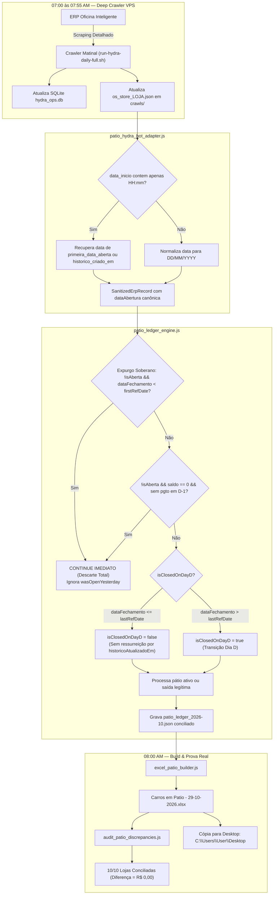

# Design Técnico — Spec 049: Hydra Pátio — Reconciliação Cirúrgica, Expurgo Soberano de Fantasmas e Sincronização Matinal

## 1. Fluxo de Dados e Ciclo de Vida da Conciliação



---

## 2. Contratos de Dados e Regras de Negócio

### 2.1 Interface de Entrada Sanitizada do Adapter

```typescript
export interface SanitizedErpRecord {
  osNumber: number;
  dataAbertura: string; // DD/MM/YYYY garantido (nunca HH:mm isolado)
  cliente: string;
  placa: string;
  veiculo: string;
  valorTotal: number;
  restanteERP: number; // Centavos exatos
  totalPagoERP: number;
  statusERP: string;
  isAberta: 0 | 1;
  dataFechamento: string | null;
  historicoAtualizadoEm: string;
  dataSaidaPatio: string | null;
  ultimaDataAbertaPatio?: string | null;
  primeiraDataAberta?: string | null;
  pagamentos: Array<{ forma: string; valor: number; vencimento?: string }>;
}
```

---

## 3. Implementação Detalhada das 4 Correções Cirúrgicas

### 3.1 Correção 1: Expurgo Soberano Independente de `wasOpenYesterday` (`patio_ledger_engine.js`)

**Arquivo:** `projects/hydra-rede/src/patio_ledger_engine.js` (linhas 339–355):

```javascript
      // 1. EXPURGO DETERMINÍSTICO SOBERANO:
      // Se a OS já estava fechada antes do período de referência (D-1),
      // ela é terminantemente descartada, MESMO que wasOpenYesterday seja true por erro anterior.
      const firstRefDateBR = refDatesList[0];
      if (!isAbertaNow && dataFechamentoBR && isDateBefore(dataFechamentoBR, firstRefDateBR)) {
        continue;
      }

      // 1.1 Extração rigorosa de pagamentos com Multiconjunto
      const pagamentosD1 = extractPaymentsForReferenceDay(rec, refDatesList, seenRegistry, storeKey, !isBuildOnly);
      const tevePagamentoOntem = pagamentosD1.length > 0;

      // 1.2 EXPURGO DE OS QUITADA: Se a OS não está aberta, possui saldo restante zerado,
      // não teve pagamento em D-1 e a data de fechamento não pertence a refDatesList,
      // ela NUNCA deve ser ressuscitada nem como aberta nem como saída falsa.
      const saldoRestanteReal = typeof rec.restanteERP === 'number' ? rec.restanteERP : (Number(rec.valor_restante) || Number(rec.saldoRestante) || 0);
      if (!isAbertaNow && saldoRestanteReal === 0 && !tevePagamentoOntem && (!dataFechamentoBR || !refDatesList.includes(dataFechamentoBR))) {
        continue;
      }
```

---

### 3.2 Correção 2: Remoção de `historicoAtualizadoEm` e Trava de Fechamento Passado em `isClosedOnDayD`

**Arquivo:** `projects/hydra-rede/src/patio_ledger_engine.js` (linhas 370–385):

```javascript
      // Se a OS possui data de fechamento no passado (<= lastRefDateBR), ela JAMAIS pode ser isClosedOnDayD
      const isPastClosure = Boolean(dataFechamentoBR && !isDateAfter(dataFechamentoBR, lastRefDateBR));

      const isClosedOnDayD = !isAbertaNow && !isPastClosure && (
        hasPaymentInDayD ||
        (dataFechamentoBR && isDateAfter(dataFechamentoBR, lastRefDateBR)) ||
        (dataSaidaBR && isDateAfter(dataSaidaBR, lastRefDateBR))
      );
```

> [!IMPORTANT]
> A cláusula `(historicoBR && isDateAfter(historicoBR, lastRefDateBR) ...)` é 100% removida. Toques de leitura matinal da esteira não configuram encerramento de veículo no Dia D.

---

### 3.3 Correção 3: Resolução de Horário Isolado (`HH:mm`) e Null-Safety em Datas

**Arquivo 1:** `projects/hydra-rede/src/patio_hydra_bot_adapter.js`:
```javascript
function parseBotDateToBR(dateStr, fallbackStr = null) {
  if (!dateStr) return fallbackStr ? parseBotDateToBR(fallbackStr) : '';
  const clean = String(dateStr).trim();

  // Se veio apenas hora isolada (ex: "11:13" ou "11:13:00")
  if (/^\d{1,2}:\d{2}(:\d{2})?$/.test(clean)) {
    return fallbackStr ? parseBotDateToBR(fallbackStr) : '';
  }

  // Demais parses normais (serial Excel, DD/MM/YYYY, ISO)...
  // ...
}

// Na extração da OS:
const rawDataInicio = doc.data_inicio;
let dataEntradaBR = parseBotDateToBR(rawDataInicio, doc.primeira_data_aberta || doc.historico_criado_em);
if (!dataEntradaBR && doc.historico_criado_em) {
  dataEntradaBR = parseBotDateToBR(doc.historico_criado_em);
}
```

**Arquivo 2:** `projects/hydra-rede/src/patio_ledger_engine.js`:
```javascript
function normalizeToBRDate(dateInput) {
  if (!dateInput) return '';
  const str = String(dateInput).trim().split(' ')[0];

  // Se veio apenas formato de hora isolada
  if (/^\d{1,2}:\d{2}(:\d{2})?$/.test(str)) {
    return '';
  }

  // Demais conversões...
  return str;
}

function parseBRToDateObj(brDateStr) {
  if (!brDateStr) return null;
  const parts = String(brDateStr).split('/').map(Number);
  if (parts.length !== 3 || parts.some(isNaN)) return null;
  return new Date(parts[2], parts[1] - 1, parts[0], 12, 0, 0);
}

function isDateAfter(d1BR, d2BR) {
  if (!d1BR || !d2BR) return false;
  const o1 = parseBRToDateObj(d1BR);
  const o2 = parseBRToDateObj(d2BR);
  if (!o1 || !o2) return false;
  return o1.getTime() > o2.getTime();
}

function isDateBefore(d1BR, d2BR) {
  if (!d1BR || !d2BR) return false;
  const o1 = parseBRToDateObj(d1BR);
  const o2 = parseBRToDateObj(d2BR);
  if (!o1 || !o2) return false;
  return o1.getTime() < o2.getTime();
}
```

---

### 3.4 Correção 4: Reconstrução do Ledger, Planilha e Auditoria Prova Real

1. **Limpeza do Ledger Contaminado:**
   - Remoção das entradas zumbis/fantasmas remanescentes no nó de `ordens` em `data/patio_ledger_2026-10.json`.
2. **Deploy na VPS e Rebuild:**
   - Envio dos arquivos via SSH/SCP para `operacional@100.126.50.101:/home/operacional/hydra-rede/src/`.
   - Execução de `node src/run_patio_daily.js --build-only --date=2026-10-29` na VPS e sincronização local.
3. **Auditoria de Prova Real:**
   - Execução de `node scripts/audit_patio_discrepancies.js`.
   - Verificação determinística da coluna `Dif Plan-Banco == 0.00` em todas as 10 lojas.
4. **Entrega no Desktop:**
   - Cópia do arquivo final gerado `projects/hydra-rede/output/relatorios/Carros em Patio - 29-10-2026.xlsx` para `C:\Users\User\Desktop\Carros em Patio - 29-10-2026.xlsx`.
