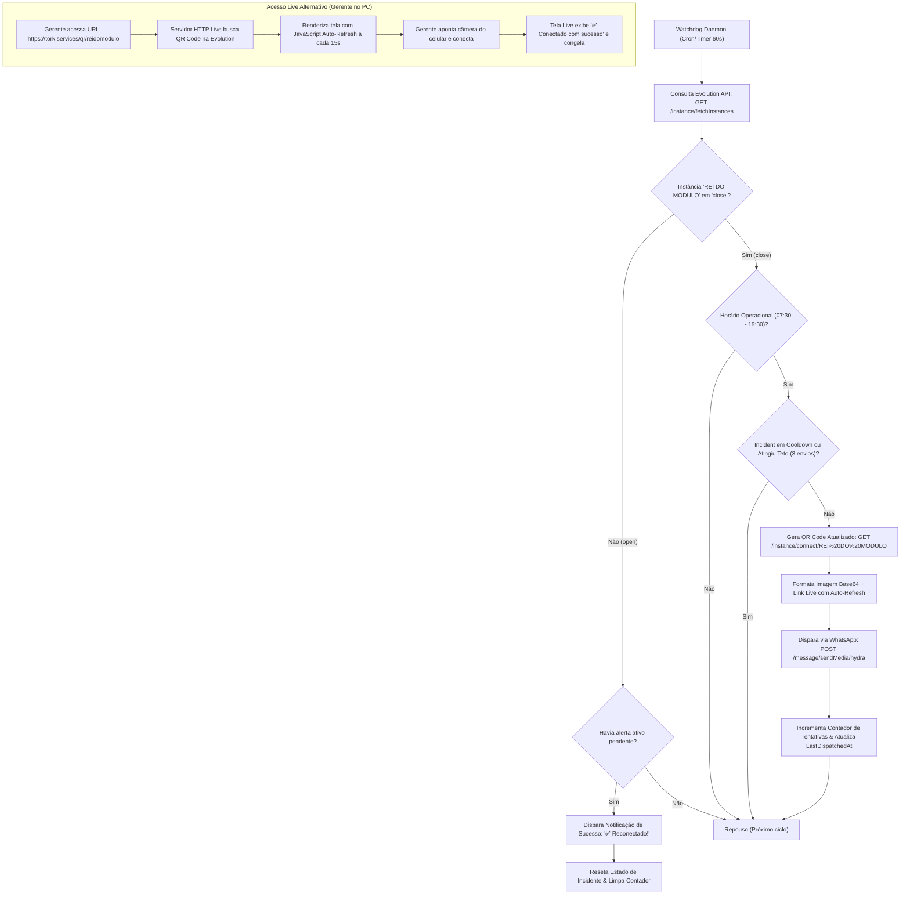

# Design Técnico: Watchdog Autônomo de Reconexão de Instâncias Evolution

**ID da Spec:** `050-hydra-evolution-instance-reconnect-watchdog`  
**Data:** 29/10/2026  
**Status:** ESPECIFICAÇÃO DE DESIGN  
**Target:** Node.js 22 LTS / Evolution API v2 / PM2 VPS (`100.126.50.101`)  

---

## 1. Diagrama de Fluxo e Ciclo de Vida



---

## 2. Estrutura de Arquivos e Módulos

```
projects/hydra-rede/
├── src/
│   └── reconnect_watchdog/
│       ├── evolution_qr_service.js      # Integração com Evolution API (/connect e /fetchInstances)
│       ├── qr_web_page.js               # Gerador de página HTML live ultra-leve com auto-refresh
│       ├── instance_watchdog_daemon.js  # Daemon com máquina de estados e anti-spam
│       └── run_reconnect_cli.js         # CLI de acionamento manual ou sob demanda
```

---

## 3. Contratos de Dados e Interfaces

### 3.1. Estado de Incidente da Instância (`InstanceIncidentState`)
```typescript
export interface InstanceIncidentState {
  instanceName: string;
  storeSlug: string;
  targetPhone: string;
  status: 'open' | 'close' | 'connecting';
  incidentStartedAt: string | null;
  attemptsCount: number;
  lastDispatchedAt: string | null;
  lastQrCodeLength: number;
  isResolved: boolean;
}
```

### 3.2. Regras de Disparo e Cooldown
```javascript
const WATCHDOG_CONFIG = {
  checkIntervalMs: 60 * 1000,          // 60 segundos por checagem
  cooldownBetweenAlertsMs: 180 * 1000, // 3 minutos de intervalo mínimo entre envios de imagem
  maxAutomatedAttempts: 3,             // Máximo de 3 imagens automáticas por incidente
  operationalHours: {
    start: '07:30',
    end: '19:30'
  },
  monitoredInstances: [
    {
      name: 'REI DO MODULO',
      slug: 'ReiDoModulo',
      recipientPhone: '5511950614929',
      managerName: 'Central Rei do Módulo'
    }
  ]
};
```

---

## 4. Página Web Live (`qr_web_page.js`)

A página servida para visualização no computador possui o seguinte script embarcado sem dependências externas:
```html
<!DOCTYPE html>
<html>
<head>
  <meta charset="utf-8">
  <title>Reconexão WhatsApp — Rei do Módulo</title>
  <meta name="viewport" content="width=device-width, initial-scale=1">
  <style>
    body { font-family: -apple-system, BlinkMacSystemFont, 'Segoe UI', Roboto, sans-serif; background: #0f172a; color: #fff; display: flex; flex-direction: column; align-items: center; justify-content: center; min-height: 100vh; margin: 0; padding: 20px; text-align: center; }
    .card { background: #1e293b; border-radius: 16px; padding: 32px; box-shadow: 0 10px 25px rgba(0,0,0,0.5); max-width: 420px; width: 100%; }
    .qr-box { background: #fff; border-radius: 12px; padding: 16px; margin: 20px 0; display: inline-block; }
    .qr-box img { width: 280px; height: 280px; display: block; }
    .timer { font-size: 14px; color: #94a3b8; }
    .success { display: none; color: #22c55e; font-size: 24px; font-weight: bold; }
  </style>
</head>
<body>
  <div class="card">
    <h2>Rei do Módulo</h2>
    <p>Aponte o WhatsApp do celular para este QR Code</p>
    <div class="qr-box" id="qrContainer">
      
    </div>
    <div id="successMsg" class="success">✅ Conectado com sucesso!</div>
    <div class="timer" id="timerInfo">Atualiza em <span id="secs">15</span>s</div>
  </div>
  <script>
    // Polls /api/qr/reidomodulo every 15s to refresh QR or show success
  </script>
</body>
</html>
```

---

## 5. Medidas Estritas de Segurança

1. **Trava Remetente:** Qualquer envio pelo WhatsApp obriga `instance = 'hydra'`. A chamada falha com `Error` se qualquer outra instância for passada.
2. **Anti-Loop:** Arquivo de persistência de estado em `/home/operacional/hydra-data/reconnect_state.json` para que reinicializações do processo não percam o histórico de tentativas.
3. **Graceful Recovery:** Reconexão comprovada dispara notificação para o gestor e suspende temporizadores.
