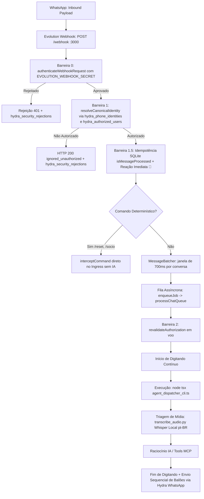

# Spec 058 — Baseline e Inventário Operacional (Fase 0)

Data: 02/11/2026.  
Status: **FASE 0 CONCLUÍDA COM SUCESSO** (Evidências colhidas diretamente na VPS `operacional-01` via SSH sem mutação de estado).

---

## 1. Ambiente, Processos e Versões

| Componente | Observado em Produção |
|---|---|
| **Host / SO** | `operacional-01` — Linux 6.8.0-45-generic x86_64 |
| **Usuário do SO** | `operacional` (UID 1000, sem privilégios sudo livres) |
| **Node.js** | `v22.23.2` (`/usr/bin/node`) |
| **Python** | `Python 3.13.7` (`/usr/bin/python3`) |
| **Processo PM2 Ativo** | `hydra-bot` (PM2 ID: 2, PID: 2454, Uptime: 4+ dias) |
| **Entrypoint Ativo** | `/home/operacional/hydra/webhook-listener.js` |
| **Release Atual** | `/home/operacional/hydra-deploy/releases/e9f5b3e0bff7f077d645c422250253b58b9df1c7` |
| **Caminho do Código** | `/home/operacional/hydra-deploy/current/src/hydra-sync/` |
| **Banco de Dados** | SQLite WAL em `/home/operacional/hydra-data/hydra_ops.db` |

---

## 2. Mapa do Fluxo da Mensagem (Ingress -> Egress)



---

## 3. Transcrição de Áudio Existente (R03 & R09)

- **Script:** `/home/operacional/hydra-deploy/current/src/hydra-sync/scripts/transcribe_audio.py`
- **Motor:** OpenAI Whisper Local (`import whisper; model = whisper.load_model("base")`)
- **Configurações:** Idioma `pt`, CPU `torch.set_num_threads(min(2, os.cpu_count() or 1))`, precisão `fp16=False`.
- **Validação com Fixture:** Execução controlada via `ffmpeg` + `transcribe_audio.py tiny` concluída com exit code 0 e retorno estruturado:
  ```json
  {"transcript": "", "segments": [], "language": "pt"}
  ```
- **Custo de API:** **Zero.** Execução 100% local no CPU da VPS, sem chamadas externas a serviços de terceiros.

---

## 4. Cadastro Canônico de Usuários e Owner (R01, R05, R06)

Extraído da tabela `hydra_authorized_users` e `hydra_phone_identities` em `hydra_ops.db`:

| Nome | Telefone Canônico | Papel Atual | Identidade WhatsApp (JID) | Status |
|---|---|---|---|---|
| **Davi (Owner)** | `5511996242812` | `socio` (Promover para `owner`) | `5511996242812@s.whatsapp.net` & `271077481652389@lid` | Ativo (`1`) |
| **Marcos** | `5511970671717` | `socio` | `5511970671717@s.whatsapp.net` | Ativo (`1`) |
| **Joacir Barros** | `5511947645967` | `socio` | `5511947645967@s.whatsapp.net` | Ativo (`1`) |
| **Davi Gerente** | `5511999990001` | `gerente` (Legado) | N/D | Ativo (Sem acesso à IA) |

- **Isolamento de Alertas vs IA:** Os gerentes das 10 lojas físicas recebem notificações de infração e SLA, mas **não constam** em `hydra_authorized_users` com permissão conversacional, sendo rejeitados com status `ignored_unauthorized` pelo guard.

---

## 5. Telemetria e Baseline de Recursos

Medição realizada em 02/11/2026 12:47 BRT em carga habitual:

| Métrica | Valor Observado | Avaliação |
|---|---|---|
| **Memória RAM** | 3.555 MiB usada / 3.798 MiB disponível (Total: 7.353 MiB) | Saudável (49.4% uso) |
| **Swap** | 2.359 MiB usada / 1.736 MiB livre (Total: 4.095 MiB) | Estável |
| **Disco (`/`)** | 143 GiB usado / 275 GiB livre (35% de ocupação) | Amplo |
| **Carga de CPU (Load Avg)** | `0.14, 0.30, 0.30` | Ocioso (>95% idle) |
| **Event Loop Latency** | `0.42 ms` (p95: `1.39 ms`) | Excelente responsividade |
| **Latência HTTP PM2** | `4 ms` (p95: `5 ms`) | Rápido |

---

## 6. Plano de Rollback e Segurança

1. **Backup da Release:** Manter `/home/operacional/hydra-deploy/releases/e9f5b3e0bff7f077d645c422250253b58b9df1c7` intacto como ponto de restauração instantâneo via symlink.
2. **Snapshot do Banco:** Antes de aplicar qualquer migration na Fase 1 (`hydra_authorized_users`), executar:
   ```bash
   cp /home/operacional/hydra-data/hydra_ops.db /home/operacional/hydra-data/hydra_ops.db.bak_spec058_phase0
   ```
3. **Rollback de Emergência:** Caso ocorra qualquer instabilidade, apontar o symlink `/home/operacional/hydra-deploy/current` de volta para a release `e9f5b3e0...` e reiniciar `pm2 restart hydra-bot`.
