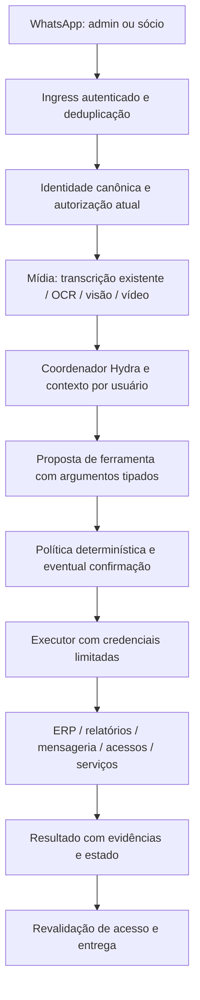

# Spec 058 — Arquitetura e contratos

## 1. Ambiente observado e limites

Inspeção somente leitura em 02/11/2026: VPS `operacional-01`, 4 CPUs, 7,2 GiB de RAM, aproximadamente 3,4 GiB disponíveis e 2,2 GiB de swap em uso. `nvidia-smi` não foi encontrado no PATH; isso não prova ausência física de GPU. Não dimensionar modelo visual residente sem benchmark.

Existem `identity_access_guard.ts`, `media_analyzer.ts`, `media_fetcher.ts`, `mcp_lead_tools.ts` e contratos de acesso em `/home/operacional/hydra/src/hydra-sync`. O contrato observado contém `socio | gerente | operador`. O guard possui caminho de compatibilidade que aceita webhook sem segredo configurado; não foi verificado se esse caminho está ativo em produção.

O script de transcrição observado usa Whisper local em português, limita threads e carrega o modelo por invocação. O usuário confirmou que a transcrição já funciona na análise das conversas. A etapa inicial deverá localizar o caminho efetivamente usado pelo serviço ativo, pois a existência de um fonte não prova seu uso em produção. `ffmpeg` e `tesseract` estão instalados. A implementação de imagem/vídeo inspecionada contém OCR e extração de quadros; entendimento semântico deve ser validado separadamente.

## 2. Fluxo de confiança

O modelo não define quem é admin. Identidade e permissões chegam em contexto confiável gerado pelo servidor. Texto, transcrição, OCR, páginas web e respostas de ferramentas não podem alterar esse contexto.

## 3. Identidade e isolamento de sessões

- Ingress exige autenticação do provedor e validação do envelope; eliminar modo compatível para os endpoints desta IA. Validar formato, tamanho, instância, origem e idempotência do evento.
- Resolver PN/LID canônico somente por associação confiável do provedor. Nome de exibição, número escrito no texto e áudio “sou o Davi” não autenticam ninguém.
- Acesso por conversa privada autenticada nesta primeira versão. Grupos não podem ampliar permissões por conterem um admin.
- `owner` é uma atribuição inicial protegida, fora do controle do modelo. `admin` e `socio` são papéis persistidos; a persona de apresentação nunca muda o papel efetivo.
- Revalidar autorização no ingresso, antes de cada ferramenta com efeito e na entrega. Revogação invalida tarefas pendentes e cache de permissões.
- Cada job mantém ator original, escopo, versão da política e canal. Subagentes e serviços não recebem mais autoridade que o ator e a tarefa.
- Memória separada por usuário e escopo, com fatos compartilhados da rede apenas onde autorizado. Simulação de persona não dá acesso administrativo.

## 4. Matriz de operações

| Operação | Sócio | Admin delegado | Davi/owner | Condição |
|---|---|---|---|---|
| Conversar por texto/áudio/imagem/vídeo | Sim | Sim | Sim | Identidade ativa |
| Consultar rede e gerar relatório | Escopo autorizado | Escopo autorizado | Rede | Fonte autorizada e período explícito |
| Pesquisa web e resumo | Sim | Sim | Sim | Conteúdo externo não autoriza ações |
| Enviar mensagem a terceiro | Não | Capacidade delegada | Sim | Pedido explícito, destino resolvido e texto validado |
| Ativar/revogar sócio | Não | Capacidade delegada | Sim | Confirmação da mudança de acesso |
| Criar/promover admin | Não | Não por padrão | Sim | Autenticação adicional e confirmação vinculada à operação |
| Alterar/remover owner | Não | Não | Fora do chat | Recuperação administrativa externa |
| Ler saúde/logs operacionais | Não por padrão | Sim | Sim | Dados redigidos, sem segredos |
| Reexecutar coleta/relatório | Não por padrão | Capacidade delegada | Sim | Lock, limites e idempotência |
| Reiniciar serviço | Não | Allowlist específica | Allowlist específica | Impacto mostrado e confirmação; sem argumentos livres |
| Editar código/deploy/pacotes/cron bruto | Não | Não | Não pela IA | Fluxo de desenvolvimento separado |

Concessões são subconjuntos de capacidades: um administrador não pode conceder mais do que sua política permite. Usuários existentes como gerentes permanecem sem chat; transição para sócio/admin é explícita, não inferida de cargo.

## 5. Ferramentas tipadas e executor

Nomes propostos, não APIs existentes comprovadas:

| Ferramenta | Entrada central | Resultado |
|---|---|---|
| `reports.generate` | tipo, lojas, período, política de atualização | arquivo/referência, origem, intervalo de captura, cobertura |
| `research.search` | consulta, fontes permitidas, orçamento | fontes e trechos com proveniência |
| `messages.send` | destinatário canônico, texto/artefato, chave de operação | ID do provedor, estado aceito/entregue/falhou |
| `users.grant` | número canônico, papel, capacidades, expiração opcional | registro auditado e versão |
| `users.revoke` | identidade, motivo | revogação e cancelamentos relacionados |
| `infra.health` | serviço de catálogo | estado observado e horário |
| `jobs.run` / `jobs.status` / `jobs.cancel` | job de catálogo e parâmetros limitados | ID e ciclo de vida |
| `media.inspect` | anexo interno autorizado e pergunta | transcrição/OCR/observações, timecodes e limites |

Cada chamada carrega `actorId`, `requestId`, `conversationId`, `policyVersion`, `capability`, `resourceScope`, `deadline` e `idempotencyKey`. O servidor injeta esses campos; o modelo fornece apenas argumentos de negócio validados por schema.

Credenciais de Evolution, ERP e infraestrutura ficam no executor, ausentes do ambiente do modelo. Comunicação interna autenticada. Serviço de acesso com conta limitada à gestão de usuários; sem SQL arbitrário. Ferramenta de consulta não aceita SQL livre, caminho de arquivo livre ou comando shell.

## 6. Proibição efetiva de edição de código

- Usuário de sistema exclusivo, sem sudo, sem socket Docker e sem associação a grupos privilegiados.
- Código, configuração de segurança e diretórios executáveis protegidos por permissões do SO e mounts read-only quando aplicável.
- Escrita apenas em workspace de artefatos, spool de mídia e memória própria. Diretórios graváveis não podem estar em caminhos de importação, plugins, hooks ou scripts executados por serviços privilegiados.
- Sem ferramentas de terminal geral, edição de arquivo arbitrário, SSH genérico ou instalação de skills. Também bloquear equivalentes indiretos: APIs de CI/deploy, tarefas com comandos livres, alterações em unidades systemd e parâmetros de execução.
- Acesso de rede por destinos e portas necessários; consultas web não podem alcançar metadata, loopback ou serviços internos. Acesso interno operacional ocorre por APIs específicas.
- Testar symlink, path traversal, arquivos de configuração carregados dinamicamente e abuso de endpoints de manutenção. Não basta uma instrução no prompt dizendo “não edite código”.

## 7. Mensageria e gestão de acessos

### Envio

Pedido explícito com destinatário e conteúdo inequívocos autoriza o envio único. Pedidos como “manda para o João” com múltiplos contatos exigem desambiguação. Composição sensível, anexos confidenciais, novos grupos ou lote exigem revisão concreta conforme política.

Antes do envio, conferir autorização, destinatário, bloqueios existentes e escopo do conteúdo. Remetente exclusivo Hydra. Registrar chave única de ação; repetição de webhook não duplica mensagem. Timeout com estado desconhecido exige reconciliação com o provedor antes de repetir. “Aceito pelo provedor” não é “entregue”; cada estado é comunicado corretamente.

### Acesso

Criar proposta persistida contendo ator, alvo, papel anterior/novo, capacidades, expiração e hash dos argumentos. Confirmação referencia essa proposta, tem prazo e só pode ser consumida uma vez. “Sim” em outra conversa não aprova outra concessão.

Promoção a admin exige autenticação adicional em canal/controlador já cadastrado para o owner, por exemplo desafio TOTP validado fora do LLM. A escolha final do fator depende do que existe no ambiente; sem fator provisionado, promoção não é liberada. Pedido por áudio é permitido, mas o número/identidade transcrito precisa ser explicitamente conferido antes da concessão.

Gravar transação, auditoria antes/depois e conferir leitura final. Revogação imediata invalida sessão e tarefas. Impedir autopromoção, troca do owner e revogação do último mecanismo de recuperação. O modelo não acessa seed TOTP nem segredos.

## 8. Mídia para admin e sócios

### Áudio

Reutilizar exatamente o serviço de transcrição da análise das conversas após confirmar seu contrato e caminho ativo. Adaptador recebe referência de mídia, retorna texto, segmentos, idioma e estado. Não criar um segundo motor por padrão.

Fila com concorrência inicial 1, limites de duração/tamanho e prioridade que preserve o processamento atual. Cache por hash e versão do transcritor, com controle de acesso na recuperação; não compartilhar resultados privados entre usuários apenas por terem o mesmo hash. Downloads controlados e retenção configurada. Medir latência antes de escolher otimizações.

O ator vem do canal, nunca da voz. Áudio encaminhado de terceiro é evidência; não autoriza o terceiro a dar ordens. Números, valores e negações ambíguos devem gerar pergunta antes de ação sensível. Não prometer zero custo total: transcrição local evita tarifa de STT, mas usa infraestrutura; a interpretação pelo LLM pode ter custo.

### Imagem

OCR para texto e tabelas; modelo visual para descrever objetos/cenas. Saída distingue texto extraído de interpretação. Comprovante em imagem não atualiza automaticamente o ERP nem comprova liquidação. Validar formato real, pixels, tamanho, orientação e erros de OCR.

### Vídeo

FFmpeg extrai áudio e quadros por tempo/cena; transcritor existente processa áudio; OCR/modelo visual analisa quadros selecionados. Relatório inclui timecodes e cobertura. Amostragem não garante detecção de todos os eventos. Perguntas sobre evento rápido exigem inspeção adicional do trecho ou resposta de evidência insuficiente.

Decoders executam com limites de CPU, memória, tempo e rede. Não aceitar URLs arbitrárias como autorização para acessar a rede interna. Validar redirects e endereço resolvido, evitar SSRF, remover temporários após a retenção.

### Modelo visual e custos

Adaptador permite backend local ou remoto aprovado. Benchmark de modelo visual pequeno em máquina separada é preferível a competir com produção nesta VPS. Qwen3-VL é candidato de pesquisa, não seleção final. Se a exigência for zero tarifa externa para visão, usar hardware próprio compatível e aceitar latência medida; não ativar fallback pago silencioso. OCR e extração de quadros locais não substituem compreensão visual.

## 9. Coordenação, memória e fontes

Um coordenador recebe o pedido e aciona workers existentes por APIs/filas: relatórios, coleta ERP, mídia, pesquisa, mensagens e administração. Não manter agentes conversando indefinidamente. Jobs têm orçamento, timeout, cancelamento e resultado estruturado. Limites iniciais propostos: 12 chamadas de ferramenta por pedido interativo e 30 por relatório complexo; calibrar por avaliação, sem ciclo infinito.

Memória guarda preferências e fatos com origem/data; permissões nunca são fatos editáveis da memória. Skills operacionais são versionadas e revisadas por desenvolvimento. O agente pode sugerir melhorias e registrar lições, mas não instalar/executar skills novas automaticamente.

Conteúdo de web, áudio, imagem, vídeo e documentos é tratado como dado não confiável. Detectores de prompt injection auxiliam, mas a proteção principal é política externa, isolamento e autoridade mínima.

Relatórios usam ferramentas determinísticas para valores, com origem, período e timestamp real da coleta. Aplicar contratos da Spec 057 quando pertinentes; não renovar frescor ao copiar cache. Se houver falha ou cobertura incompleta, informar isso em vez de inventar valor completo.

## 10. Observabilidade e recuperação

Estados de jobs: `QUEUED`, `RUNNING`, `AWAITING_CONFIRMATION`, `SUCCEEDED`, `FAILED`, `CANCELLED`, `UNKNOWN_EXTERNAL_STATE`. Auditoria registra ator, ação, alvo, política, decisão, resultado e correlação; omite segredos e minimiza conteúdo pessoal.

Feature flags independentes: chat admin, chat sócio, ações administrativas, envios, visão e vídeo. Kill switch desativa ferramentas com efeito sem perder diagnóstico. Restaurar versão anterior e flags não reverte mensagens já enviadas: reverter efeitos externos exige compensação específica. Revogações de segurança nunca são desfeitas automaticamente por rollback de código.
