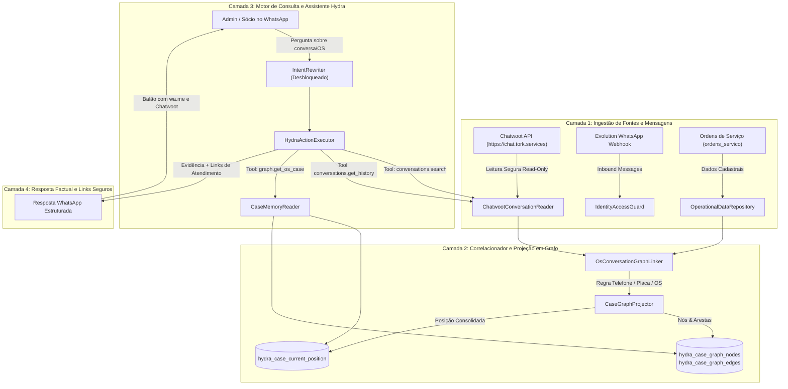

# Spec 059 — Arquitetura, Contratos e Design Técnico

**ID da Spec:** `059-hydra-chat-conversas-grafo-os`  
**Data:** 02/11/2026  
**Status:** ESPECIFICAÇÃO DE DESIGN  
**Target:** Node.js 22 LTS / TypeScript Strict / SQLite WAL (`hydra_ops.db`) / Chatwoot API v1 / Evolution API v2 (`100.126.50.101`)

---

## 1. Diagrama de Arquitetura e Fluxo de Dados



---

## 2. Contratos e Interfaces TypeScript (Strict Mode)

### 2.1 Tipos de Nós e Arestas do Grafo

```typescript
export type GraphNodeType =
  | 'CONVERSA'
  | 'ORDEM_SERVICO'
  | 'VEICULO'
  | 'CLIENTE'
  | 'ANALISE'
  | 'FATO';

export type GraphRelationType =
  | 'TREATS_ORDER'        // Fato ou Conversa trata daquela OS
  | 'BELONGS_TO_VEHICLE'  // OS ou Conversa pertence àquele veículo/placa
  | 'TALKS_TO_CLIENT'     // Conversa ou OS vinculada àquele cliente
  | 'COVERS_SEGMENT'      // Conversa cobre segmento analisado
  | 'CONTAINS_STATEMENT'  // Análise contém afirmação/fato
  | 'SUPERSEDES_FACT';    // Fato recente corrige fato anterior

export interface CaseGraphNode {
  readonly nodeId: string;
  readonly entityType: GraphNodeType;
  readonly label: string;
  readonly accountId: string;
  readonly lojaSlug: string;
  readonly attributes: Record<string, string | number | boolean | null>;
  readonly createdAt: string;
  readonly updatedAt: string;
}

export interface CaseGraphEdge {
  readonly edgeId: string;
  readonly fromNodeId: string;
  readonly toNodeId: string;
  readonly relationType: GraphRelationType;
  readonly status: 'ACTIVE' | 'SUPERSEDED' | 'INVALIDATED';
  readonly version: number;
  readonly linkMethod: 'PHONE_MATCH' | 'PLATE_MATCH' | 'OS_MENTION' | 'STRUCTURAL';
  readonly confidence: 'HIGH' | 'MEDIUM' | 'LOW';
  readonly lojaSlug: string;
  readonly evidenceRef?: string;
  readonly createdAt: string;
}
```

### 2.2 Contratos de Consulta de Conversas

```typescript
export interface SanitizedChatMessage {
  readonly messageId: number;
  readonly conversationId: number;
  readonly senderType: 'client' | 'agent' | 'bot' | 'system';
  readonly senderName?: string;
  readonly content: string;
  readonly isPrivate: boolean;
  readonly hasAttachments: boolean;
  readonly attachmentUrls?: readonly string[];
  readonly createdAt: string;
}

export interface ChatwootConversationSummary {
  readonly conversationId: number;
  readonly inboxId: number;
  readonly storeSlug: string;
  readonly contactId: number;
  readonly contactName: string;
  readonly contactPhone?: string;
  readonly status: 'open' | 'resolved' | 'pending';
  readonly unreadCount: number;
  readonly lastMessageSnippet?: string;
  readonly lastMessageAt?: string;
  readonly chatwootUrl: string;
  readonly waLink?: string;
}

export interface ConversationHistoryQueryOptions {
  readonly conversationId: number;
  readonly limit?: number;
  readonly beforeMessageId?: number;
  readonly includePrivateNotes?: boolean;
}
```

### 2.3 Contratos de Resposta das Novas Ferramentas

```typescript
export interface ToolConversationSearchResult {
  readonly success: boolean;
  readonly query: string;
  readonly totalMatches: number;
  readonly conversations: readonly ChatwootConversationSummary[];
  readonly linkedOrders: readonly {
    readonly osId: number;
    readonly plate?: string;
    readonly vehicle?: string;
    readonly storeSlug: string;
  }[];
  readonly source: 'CHATWOOT_API' | 'LOCAL_INDEX';
  readonly timestamp: string;
}

export interface ToolConversationHistoryResult {
  readonly success: boolean;
  readonly conversationId: number;
  readonly storeSlug: string;
  readonly contactPhone?: string;
  readonly messages: readonly SanitizedChatMessage[];
  readonly chatwootUrl: string;
  readonly waLink?: string;
  readonly limitationDeclared?: string;
  readonly timestamp: string;
}

export interface ToolOsCaseGraphResult {
  readonly success: boolean;
  readonly osId: number;
  readonly storeSlug: string;
  readonly vehiclePlate?: string;
  readonly vehicleModel?: string;
  readonly erpStatus: string;
  readonly delayReason?: string;
  readonly nextPromisedStep?: string;
  readonly linkedConversations: readonly ChatwootConversationSummary[];
  readonly recentFacts: readonly {
    readonly subject: string;
    readonly excerpt: string;
    readonly author: string;
    readonly date: string;
  }[];
  readonly timestamp: string;
}
```

---

## 3. Esquema Físico no SQLite (`hydra_ops.db`)

Para garantir a ativação do Grafo sem impactar o banco existente, o boot de `db_repository.ts` executará as migrações idempotentes:

```sql
-- 1. Nós do Grafo Relacional
CREATE TABLE IF NOT EXISTS hydra_case_graph_nodes (
  node_id TEXT PRIMARY KEY,
  entity_type TEXT NOT NULL,
  label TEXT NOT NULL,
  account_id TEXT NOT NULL DEFAULT '1',
  loja_slug TEXT NOT NULL,
  attributes_json TEXT,
  created_at TEXT NOT NULL DEFAULT (datetime('now')),
  updated_at TEXT NOT NULL DEFAULT (datetime('now'))
);
CREATE INDEX IF NOT EXISTS idx_graph_nodes_type_loja ON hydra_case_graph_nodes(entity_type, loja_slug);

-- 2. Arestas do Grafo Relacional
CREATE TABLE IF NOT EXISTS hydra_case_graph_edges (
  edge_id TEXT PRIMARY KEY,
  from_node_id TEXT NOT NULL,
  to_node_id TEXT NOT NULL,
  relation_type TEXT NOT NULL,
  status TEXT NOT NULL DEFAULT 'ACTIVE',
  version INTEGER NOT NULL DEFAULT 1,
  link_method TEXT NOT NULL,
  confidence TEXT NOT NULL DEFAULT 'HIGH',
  loja_slug TEXT NOT NULL,
  evidence_ref TEXT,
  created_at TEXT NOT NULL DEFAULT (datetime('now')),
  FOREIGN KEY (from_node_id) REFERENCES hydra_case_graph_nodes(node_id) ON DELETE CASCADE,
  FOREIGN KEY (to_node_id) REFERENCES hydra_case_graph_nodes(node_id) ON DELETE CASCADE
);
CREATE INDEX IF NOT EXISTS idx_graph_edges_from ON hydra_case_graph_edges(from_node_id, status);
CREATE INDEX IF NOT EXISTS idx_graph_edges_to ON hydra_case_graph_edges(to_node_id, status);

-- 3. Posição Atual Consolidada da OS
CREATE TABLE IF NOT EXISTS hydra_case_current_position (
  loja_slug TEXT NOT NULL,
  os_id INTEGER NOT NULL,
  source_id TEXT NOT NULL DEFAULT 'chatwoot',
  account_id TEXT NOT NULL DEFAULT '1',
  vehicle_plate TEXT,
  vehicle_model TEXT,
  customer_name TEXT,
  customer_phone TEXT,
  current_erp_status TEXT,
  reported_delay_cause TEXT,
  reported_delay_author TEXT,
  reported_delay_role TEXT,
  reported_delay_at TEXT,
  reported_delay_raw TEXT,
  next_promised_step TEXT,
  part_dependencies_json TEXT,
  commitments_summary TEXT,
  active_gaps_json TEXT,
  last_covered_timestamp TEXT,
  projection_version INTEGER NOT NULL DEFAULT 1,
  updated_at TEXT NOT NULL DEFAULT (datetime('now')),
  PRIMARY KEY (loja_slug, os_id)
);
CREATE INDEX IF NOT EXISTS idx_case_position_plate ON hydra_case_current_position(vehicle_plate);
CREATE INDEX IF NOT EXISTS idx_case_position_phone ON hydra_case_current_position(customer_phone);

-- 4. Índice de Correlação de Conversa e OS
CREATE TABLE IF NOT EXISTS hydra_conversation_os_links (
  conversation_id INTEGER NOT NULL,
  os_id INTEGER NOT NULL,
  loja_slug TEXT NOT NULL,
  link_method TEXT NOT NULL, -- 'PHONE_MATCH' | 'PLATE_MATCH' | 'OS_MENTION'
  confidence TEXT NOT NULL DEFAULT 'HIGH',
  created_at TEXT NOT NULL DEFAULT (datetime('now')),
  PRIMARY KEY (conversation_id, os_id, loja_slug)
);
CREATE INDEX IF NOT EXISTS idx_conv_os_links_os ON hydra_conversation_os_links(os_id, loja_slug);
CREATE INDEX IF NOT EXISTS idx_conv_os_links_conv ON hydra_conversation_os_links(conversation_id);
```

---

## 4. Módulos a Criar e Modificar

1. **`src/hydra-sync/chatwoot_conversation_reader.ts` (Novo):**
   - Consome a API REST local do Chatwoot (`https://chat.tork.services/api/v1/accounts/1/`).
   - Busca conversas por telefone (busca em `/contacts/search`), por placa ou por query.
   - Retorna mensagens limpas (`SanitizedChatMessage[]`) com sanitização anti-vazamento de dados privados.
2. **`src/hydra-sync/os_conversation_graph_linker.ts` (Novo):**
   - Executa a interligação de OSs ativas com as conversas do Chatwoot.
   - Aplica os 3 critérios de vinculação: Telefone, Placa e Menção explícita de OS.
   - Atualiza `hydra_case_graph_nodes`, `hydra_case_graph_edges` e `hydra_case_current_position`.
3. **`src/hydra-sync/db_repository.ts` (Modificado):**
   - Injeta a criação das tabelas de grafo na rotina de boot do banco.
4. **`src/hydra-sync/hydra_action_executor.ts` (Modificado):**
   - Registra as 3 novas ferramentas tipadas:
     - `conversations.search`
     - `conversations.get_history`
     - `graph.get_os_case`
   - Valida autorização: Somente `owner`, `admin` e `socio` podem consultar conversas e histórico de casos da rede.
5. **`src/hydra-sync/intent_rewriter.ts` (Modificado):**
   - Remove o bloqueio rígido L977–L983 que recusava Chatwoot.
   - Adiciona classificação de intenção para `os_case_history` e `customer_conversation_inquiry`.
