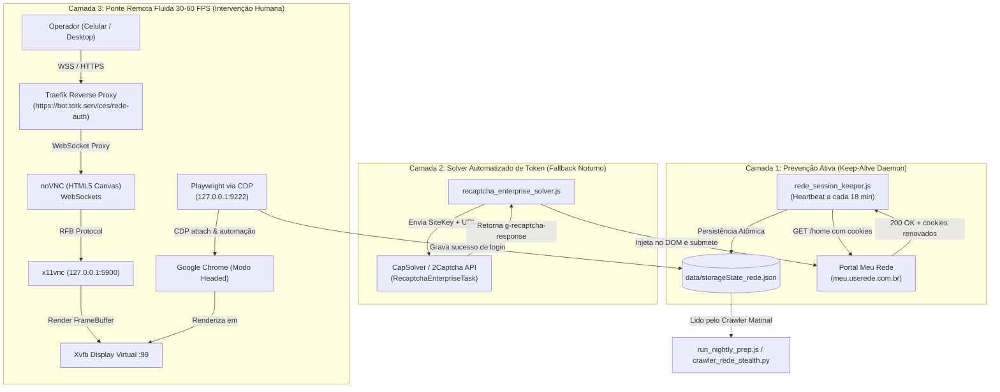

# Spec 060 — Arquitetura e Design Técnico: Resolução de Captcha e Live Auth

**ID da Spec:** `060-hydra-rede-captcha-bypass-live-auth`  
**Data:** 03/11/2026  
**Status:** ESPECIFICAÇÃO DE DESIGN TÉCNICO

---

## 1. Visão Geral da Arquitetura

O sistema adota uma arquitetura em 3 camadas complementares para garantir que o crawler nunca fique inoperante:



---

## 2. Componentes e Responsabilidades

### 2.1. `src/rede_session_keeper.js` (Daemon de Manutenção Ativa)
- **Objetivo:** Impedir que o token JWT / cookies de sessão da Rede expirem.
- **Funcionamento:**
  1. Carrega os cookies de `data/storageState_rede.json`.
  2. A cada 18 minutos (com jitter aleatório de ± 3 minutos), realiza uma requisição leve de verificação de cabeçalho ou `/home`.
  3. Se a resposta for 200 OK, atualiza os novos cookies recebidos no `storageState_rede.json` e escreve telemetria em `data/session_keeper_status.json`.
  4. Se receber 401 ou 403, sinaliza o estado `EXPIRED` e dispara um alerta silencioso no WhatsApp via instância `hydra` para o administrador.
- **Isolamento:** Executado no PM2 como processo background independente (`rede-session-keeper`).

### 2.2. `src/reconnect_system/rede_live_auth_hub.js` (Orquestrador do noVNC e CDP)
Substitui completamente `rede_interactive_auth.py` e `rede_session_bridge.js`.
- **Funcionamento:**
  1. Inicia um display virtual `Xvfb :99 -screen 0 1366x768x24`.
  2. Inicia `x11vnc` escutando **exclusivamente em `127.0.0.1:5900`**.
  3. Inicia o proxy `websockify` / `noVNC` expondo a porta HTTP/WS interna `3899` para o Traefik.
  4. Lança o Google Chrome em **modo headed** no display `:99`, com `--remote-debugging-port=9222` restrito a `127.0.0.1`.
  5. Conecta o Playwright via `chromium.connectOverCDP('http://127.0.0.1:9222')`.
  6. Navega até `https://meu.userede.com.br` e preenche as credenciais automaticamente.
  7. Serve uma interface limpa onde o operador visualiza o navegador em tempo real com **taxa de quadros de 30 a 60 FPS**, podendo clicar, digitar e arrastar sem qualquer atraso.
  8. O Playwright monitora a transição de rota. Ao detectar `#nav-config` ou `/home`, salva o `storageState_rede.json` atualizado, emite confirmação visual na tela e encerra o Chrome/Xvfb de forma limpa.

### 2.3. `src/recaptcha_enterprise_solver.js` (Adaptador de Solver de Token)
- **Objetivo:** Resolver automaticamente o desafio do reCAPTCHA Enterprise sem intervenção humana.
- **Funcionamento:**
  ```typescript
  export interface CaptchaSolverOptions {
    readonly apiKey: string;
    readonly websiteUrl: string;
    readonly websiteKey: string;
    readonly enterpriseAction?: string;
    readonly timeoutMs?: number;
  }

  export interface CaptchaSolverResult {
    readonly success: boolean;
    readonly token?: string;
    readonly solveDurationMs: number;
    readonly error?: string;
  }
  ```
  1. Extrai dinamicamente a chave `render` do script reCAPTCHA Enterprise.
  2. Envia requisição assíncrona para CapSolver / 2Captcha (`RecaptchaEnterpriseTaskProxyLess`).
  3. Realiza polling do status a cada 2 segundos.
  4. Injeta o token recebido no elemento `#g-recaptcha-response` e aciona os eventos sintéticos:
     ```javascript
     responseField.dispatchEvent(new Event('input', { bubbles: true }));
     responseField.dispatchEvent(new Event('change', { bubbles: true }));
     ```
  5. Aciona o botão de submissão do formulário.

---

## 3. Interfaces TypeScript Estritas

```typescript
/**
 * Contratos de Tipos para o Sistema Live Auth e Session Keeper
 * Stack: TypeScript Strict (zero `any`, zero `@ts-ignore`)
 */

export interface SessionKeeperHealth {
  readonly status: 'ACTIVE' | 'EXPIRED' | 'REFRESHING' | 'ERROR';
  readonly lastHeartbeat: string;
  readonly lastHttpStatus: number;
  readonly cookiesCount: number;
  readonly failureCount: number;
  readonly uptimeMinutes: number;
  readonly authenticatedUser: string;
}

export interface LiveAuthServerConfig {
  readonly displayNum: number; // Ex: 99 (:99)
  readonly vncPort: number; // 5900 (apenas localhost)
  readonly webPort: number; // 3899 (roteado via Traefik em /rede-auth)
  readonly cdpPort: number; // 9222 (apenas localhost)
  readonly idleTimeoutSeconds: number; // 900s (15 min)
  readonly resolution: {
    readonly width: number;
    readonly height: number;
    readonly depth: number;
  };
}

export interface LiveAuthSessionEvent {
  readonly timestamp: string;
  readonly event: 'START' | 'NAVIGATE' | 'CREDENTIALS_FILLED' | 'CAPTCHA_WAIT' | 'LOGGED_IN' | 'SAVED' | 'TIMEOUT';
  readonly currentUrl: string;
  readonly details?: string;
}
```

---

## 4. Configuração de Rede, Segurança e Traefik

Para garantir segurança rigorosa contra acessos não autorizados:

1. **Portas Sensíveis Fechadas para a Internet:**
   - Porta `9222` (Chrome CDP): Vinculada estritamente a `127.0.0.1`.
   - Porta `5900` (x11vnc): Vinculada estritamente a `127.0.0.1`.
   - Porta `3899` (noVNC): Vinculada a `127.0.0.1:3899` e exposta exclusivamente pelo Traefik com TLS no domínio `https://bot.tork.services/rede-auth`.
2. **Autenticação no Traefik:**
   - Link gerado para o operador inclui token temporário assinado criptograficamente com TTL de 15 minutos:
     `https://bot.tork.services/rede-auth/?token=<HMAC_SHA256>`
   - Acesso sem token ou com token expirado é bloqueado imediatamente com HTTP 401.
3. **Mascaração de Senha:**
   - O preenchimento das credenciais é automático via Playwright; a senha nunca é digitada pelo usuário e não fica visível em texto claro no DOM.
