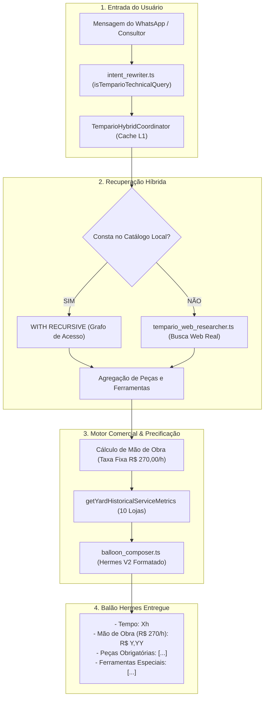

# Spec 061 — Design Técnico: Tempário Comercial Completo (Mão de Obra R$ 270/h + Associativa de Peças e Ferramentas + Pesquisa Web Real + Testes nas 10 Lojas)

**ID da Spec:** `061-hydra-tempario-bateria-testes-estresse-rede`  
**Data:** 03/11/2026  
**Status:** DESIGN TÉCNICO / HARD STOP ATIVO  

---

## 1. Fluxo Integrado: Consulta Técnica $\rightarrow$ Orçamento Comercial



---

## 2. Esquema de Banco de Dados Expandido

### 2.1. Tabela `tempario_operation_parts` (Associativa de Peças)
```sql
CREATE TABLE IF NOT EXISTS tempario_operation_parts (
  part_item_id TEXT PRIMARY KEY,
  operation_id TEXT NOT NULL,
  nome_peca TEXT NOT NULL,
  codigo_referencia TEXT,
  quantidade REAL NOT NULL DEFAULT 1,
  unidade TEXT NOT NULL DEFAULT 'UN', -- 'UN', 'L', 'JG', 'PAR', 'KIT'
  obrigatoria INTEGER NOT NULL DEFAULT 1, -- 1=Troca obrigatória, 0=Recomendada preventiva
  especificacao_tecnica TEXT, -- Ex: 'G13', 'DOT4', 'Dexos 1 Gen 3', '0W20'
  observacao TEXT,
  created_at DATETIME DEFAULT CURRENT_TIMESTAMP,
  FOREIGN KEY (operation_id) REFERENCES tempario_operations(operation_id) ON DELETE CASCADE
);

CREATE INDEX IF NOT EXISTS idx_tempario_op_parts ON tempario_operation_parts(operation_id);
```

---

## 3. Catálogo Oficial das 5 Plataformas Mecânicas (Peças, Ferramentas e Precificação)

Taxa horária base da rede: **`R$ 270,00 / hora`**.

### 3.1. VW Golf MK7.5 (2014-2021) — EA211 1.4 TSI Flex
- **Farol Esquerdo individual:** `1,40h` $\rightarrow$ **`R$ 378,00`**
  - *Peças:* Bloco óptico farol esquerdo (1 UN), Lâmpada H7/D3S (1 UN).
  - *Ferramentas:* Chave Torx T25, Chave Torx T30, Regloscópio, Torquímetro (8 Nm).
- **Radiador de Arrefecimento individual:** `2,40h` $\rightarrow$ **`R$ 648,00`**
  - *Peças:* Radiador de arrefecimento (1 UN), Aditivo G13/orgânico (3 L), Água desmineralizada (3 L), Abraçadeiras (2 UN).
  - *Ferramentas:* Chave Torx T25, Chave Torx T30, Alicate para abraçadeiras elásticas, Bandeja coletora, Equipamento de vácuo.
- **Farol + Radiador Combinados (Acesso Compartilhado):**
  - *Tempo Bruto:* `3,80h` (Sem sobreposição: `R$ 1.026,00`).
  - *Tempo Líquido:* `3,05h` $\rightarrow$ **`R$ 823,50`**.
  - *Desconto de Mão de Obra por Acesso Conjunto:* **`-R$ 202,50`** (economia de 45 min).
  - *Peças Totais:* Bloco óptico, Radiador, 3L Aditivo G13, 3L Água desmineralizada, 2 Abraçadeiras.
  - *Ferramentas Totais:* Torx T25, Torx T30, Regloscópio, Alicate de abraçadeira, Vácuo, Bandeja coletora.

### 3.2. GM Onix Plus (2020-2025) — CSS Prime 1.0 12V Turbo
- **Correia Dentada Banhada a Óleo individual:** `4,50h` $\rightarrow$ **`R$ 1.215,00`**
  - *Peças:* Kit de correia dentada banhada a óleo (1 JG), Tensor da correia (1 UN), Junta da tampa de distribuição (1 UN), Retentor dianteiro do virabrequim (1 UN), Óleo lubrificante Dexos 1 Gen 3 0W20 (4 L), Filtro de óleo (1 UN).
  - *Ferramentas:* Ferramenta de fasagem dos comandos (Raven 131003 ou similar), Trava do volante do motor, Torquímetro de precisão, Espátula de remoção de junta, Torx T30/E-Torx E12.
- **Bomba d'Água individual:** `3,20h` $\rightarrow$ **`R$ 864,00`**
  - *Peças:* Bomba d'água (1 UN), Junta de vedação (1 UN), Aditivo de arrefecimento Dex-Cool (3 L), Água desmineralizada (3 L).
  - *Ferramentas:* Alicate para abraçadeiras elásticas, Torx T30, Bandeja coletora, Torquímetro (10 Nm).
- **Correia + Bomba d'Água Combinadas:**
  - *Tempo Bruto:* `7,70h` (Sem sobreposição: `R$ 2.079,00`).
  - *Tempo Líquido:* `5,10h` $\rightarrow$ **`R$ 1.377,00`**.
  - *Desconto de Mão de Obra:* **`-R$ 702,00`** (economia de 2h 36 min).
  - *Peças Totais:* Kit Correia, Tensor, Junta distribuição, Retentor virabrequim, Bomba d'água, Junta bomba, 4L Óleo Dexos 1 Gen 3, Filtro óleo, 3L Aditivo Dex-Cool, 3L Água.
  - *Ferramentas Totais:* Conjunto fasagem CSS Prime, Trava volante, Torquímetros, Alicate de abraçadeira, Bandeja.

### 3.3. Honda Civic G10 (2017-2021) — R20Z 2.0 16V i-VTEC
- **Embreagem Completa individual:** `4,20h` $\rightarrow$ **`R$ 1.134,00`**
  - *Peças:* Platô de embreagem (1 UN), Disco de embreagem (1 UN), Atuador hidráulico concêntrico (1 UN), Fluido DOT4 (1 L).
  - *Ferramentas:* Centralizador universal de disco de embreagem, Cavalete suporte de motor/câmbio, Chave 14mm/17mm estriada, Sangrador de embreagem.
- **Retentor Traseiro do Virabrequim (Volante) individual:** `4,60h` $\rightarrow$ **`R$ 1.242,00`**
  - *Peças:* Retentor traseiro do virabrequim (1 UN), Parafusos novos do volante do motor (6 UN), Trava química de rosca (1 UN).
  - *Ferramentas:* Cavalete de motor/câmbio, Trava do volante do motor, Instalador de retentor traseiro, Torquímetro angular.
- **Embreagem + Retentor Combinados:**
  - *Tempo Bruto:* `8,80h` (Sem sobreposição: `R$ 2.376,00`).
  - *Tempo Líquido:* `4,60h` $\rightarrow$ **`R$ 1.242,00`**.
  - *Desconto de Mão de Obra:* **`-R$ 1.134,00`** (economia de 4h 12 min — a descida da caixa só é feita uma vez).
  - *Peças Totais:* Platô, Disco, Atuador concêntrico, Retentor traseiro virabrequim, 6 parafusos volante, Fluido DOT4, Trava química.

### 3.4. Toyota Corolla (2020-2025) — Dynamic Force 2.0 Flex
- **Pastilhas Dianteiras individual:** `0,80h` $\rightarrow$ **`R$ 216,00`**
  - *Peças:* Jogo de pastilhas de freio dianteiras com lâminas antirruído (1 JG), Spray limpa-freios (1 UN), Pasta lubrificante cerâmica para guias (1 UN).
  - *Ferramentas:* Encolhedor de êmbolo de pinça de freio, Chave 14mm, Torquímetro (32 Nm).
- **Discos de Freio Ventilados individual:** `1,10h` $\rightarrow$ **`R$ 297,00`**
  - *Peças:* Par de discos de freio ventilados dianteiros (1 PAR), Fluido de freio DOT4 (1 L).
  - *Ferramentas:* Chave 17mm para cavalete da pinça, Relógio comparador com base magnética (empenamento máx 0,05mm), Torquímetro (105 Nm).
- **Pastilhas + Discos Combinados:**
  - *Tempo Bruto:* `1,90h` (Sem sobreposição: `R$ 513,00`).
  - *Tempo Líquido:* `1,10h` $\rightarrow$ **`R$ 297,00`**.
  - *Desconto de Mão de Obra:* **`-R$ 216,00`** (economia de 48 min).

### 3.5. Jeep Renegade (2022-2025) — GSE T270 1.3 Turbo Flex
- **Amortecedores Dianteiros individual:** `2,20h` $\rightarrow$ **`R$ 594,00`**
  - *Peças:* Par de amortecedores dianteiros pressurizados (1 PAR).
  - *Ferramentas:* Encolhedor hidráulico de molas, Chave soquete especial de amortecedor 21mm/22mm com guia Allen, Torquímetro (75 Nm).
- **Coxins e Batentes individual:** `2,00h` $\rightarrow$ **`R$ 540,00`**
  - *Peças:* Kit de coxins superiores com rolamento de peso (1 PAR), Batentes de poliuretano e coifas guarda-pó (1 PAR).
  - *Ferramentas:* Encolhedor de molas, Torquímetro.
- **Amortecedores + Coxins Combinados:**
  - *Tempo Bruto:* `4,20h` (Sem sobreposição: `R$ 1.134,00`).
  - *Tempo Líquido:* `2,20h` $\rightarrow$ **`R$ 594,00`**.
  - *Desconto de Mão de Obra:* **`-R$ 540,00`** (economia de 2h 00 min).

---

## 4. Módulo de Pesquisa Real na Web (`tempario_web_researcher.ts`)

Quando o veículo ou serviço não constar nas tabelas homologadas do banco local:
1. **Disparo da Consulta Web:**
   O agente executa uma busca técnica com termos direcionados:
   `"${veiculo} ${motor || ''} tempo de troca ${servico} manual reparacao horas ferramentas"`
2. **Parser Técnico de Resultados Web:**
   - Varre snippets de manuais (Doutor-IE, Oficina Brasil, Notícias da Oficina, reparador, montadora).
   - Extrai o tempo numérico em horas decimais (ex: `1.8h`, `2,5 horas`, `180 minutos`).
   - Extrai menção de ferramentas de fasagem (ex: "ferramenta Raven", "trava de comando", "torquímetro").
   - Extrai componentes e peças trocadas (ex: correia, bomba, aditivo, fluido).
3. **Precificação Obrigatória a R$ 270,00/h:**
   `valorMaoDeObra = tempoExtraido * 270.00`.
4. **Registro em Staging e Quarentena com Procedência:**
   Gravado em `tempario_external_estimates_staging` com `status_evidencia = 'ESTIMATIVA_EXTERNA_PENDENTE_VALIDACAO'` e `requested_by_phone`, anotando `procedencia: 'PESQUISA_TECNICA_WEB'` e URL da fonte.

---

## 5. Formatação do Balão Hermes com Precificação Comercial

Exemplo do balão final entregue no WhatsApp para o consultor:

```text
*HYDRA | Orçamento Técnico de Mão de Obra*

> *General Motors Onix Plus (2020-2025) · Motor 1.0 12V Turbo (CSS Prime)*
- *Serviços:* Troca da Correia Dentada Banhada a Óleo + Troca da Bomba d'Água
- *Grau de dificuldade:* Especialista

*Valores de Mão de Obra (Taxa da Rede: R$ 270,00/h)*
- *Tempo bruto somado (sem pacote):* 7,70h (R$ 2.079,00)
- *Desconto por acesso compartilhado:* *-2,60h* (-R$ 702,00)
- *Tempo líquido cobrado:* *5,10h* (5h 06 min)
- *Total Mão de Obra a Cobrar:* *R$ 1.377,00*

*Associativa de Peças Necessárias*
- [x] Kit de correia dentada banhada a óleo (1 JG) — Obrigatória
- [x] Tensor da correia dentada (1 UN) — Obrigatório
- [x] Junta da tampa frontal de distribuição (1 UN) — Obrigatória
- [x] Retentor dianteiro do virabrequim (1 UN) — Obrigatório
- [x] Bomba d'água com junta (1 UN) — Obrigatória
- [x] Óleo do motor 0W20 Dexos 1 Gen 3 (4 L) — Obrigatório
- [x] Filtro de óleo lubrificante (1 UN) — Obrigatório
- [x] Aditivo de arrefecimento Dex-Cool concentrado (3 L) — Obrigatório
- [x] Água desmineralizada (3 L) — Obrigatória

*Ferramentas Especiais Exigidas na Bancada*
- Conjunto de fasagem e sincronismo da distribuição GM CSS Prime
- Trava do volante do motor
- Torquímetro de precisão (10 Nm e 25 Nm)
- Alicate para abraçadeiras elásticas
- Bandeja coletora de fluídos e raspador de cárter

*Histórico nas 10 Lojas da Rede (28 OSs encerradas)*
- *Tempo médio real de pátio:* 5,40h (Média de execução)
- *Permanência média (Lead Time):* 1,8 dias
- *Gargalos documentados:* Espera de chegada do kit de correia banhada do distribuidor (registrado em 5 OSs).

> *Proveniência e Auditoria*
- *Classificação:* Manual Oficial GM / Boletim Técnico
- *Confiança da recuperação:* 95%
```
