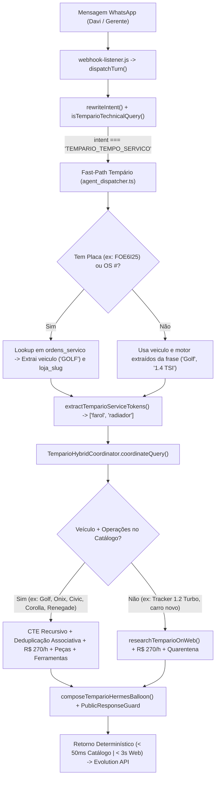

# Design Técnico — Spec 062: Fast-Path de Tempário, Extração Multi-Serviço, Placa->Veículo e Sync VPS

---

## 1. Fluxo de Dados End-to-End Corrigido



---

## 2. Interfaces e Funções TypeScript (Strict Mode — Zero `any`)

### 2.1. Extração de Componentes e Motor em `src/hydra-sync/intent_rewriter.ts`

```ts
export interface ExtractedTemparioEntities {
  readonly veiculo?: string;
  readonly motorTexto?: string;
  readonly ano?: number;
  readonly placa?: string;
  readonly osId?: string;
  readonly serviceTerms: readonly string[];
}

export function extractTemparioEntitiesFromText(rawText: string): ExtractedTemparioEntities;
```

- **Regras de Extração:**
  - `serviceTerms`: Extrai cada componente técnico mencionado individualmente (`farol`, `radiador`, `correia`, `bomba`, `embreagem`, `retentor`, `volante`, `pastilha`, `disco`, `amortecedor`, `coxim`, `batente`, `vela`, `bico`, `turbina`, `alternador`, `oleo`, `filtro`, `suspensao`, `freio`). Se nenhum token específico bater, usa a cláusula após `trocar`/`substituir`/`fazer`.
  - `motorTexto`: Extrai padrões de motorização (`1.4 TSI`, `1.0 Turbo`, `1.2 Turbo`, `1.3 Turbo`, `2.0 i-VTEC`, `2.0`, `1.6`, `1.8`, `T270`, `EA211`, `CSS Prime`).
  - `placa`: Detecta padrão Mercosul/antigo (`\b([A-Z]{3}-?\d[A-Z0-9]\d{2})\b/i`).

### 2.2. Resolução de Placa/OS para Veículo em `src/hydra-sync/tempario_hybrid_coordinator.ts`

```ts
export interface ResolvedOsVehicleContext {
  readonly osId: string;
  readonly placa: string;
  readonly veiculo: string;
  readonly lojaSlug: string;
  readonly ano?: number;
}

export function resolveVehicleFromPlateOrOs(
  db: Database.Database,
  params: { readonly placa?: string; readonly osId?: string; readonly restrictLojaSlug?: string }
): ResolvedOsVehicleContext | null;
```

- Se o usuário enviar `"FOE6I25 quanto tempo e valor de mão de obra pra trocar farol e radiador?"`, `resolveVehicleFromPlateOrOs` consulta `ordens_servico`, localiza `OS #672 (GOLF, placa FOE6I25, MPdompedro1)` e injeta `veiculoMarcaModelo = 'GOLF'` na consulta do Tempário.

### 2.3. Tokenização FTS5 Tolerante (`buildTemparioFtsQuery`) em `src/hydra-sync/tempario_vector.ts`

```ts
export function buildTemparioFtsQuery(rawQuery: string): string;
```

- Remove stopwords conversacionais (`quanto`, `tempo`, `quantas`, `horas`, `valor`, `mao`, `obra`, `pra`, `para`, `trocar`, `troca`, `substituir`, `fazer`, `custa`, `cobrar`, `orcamento`, `de`, `do`, `da`, `no`, `na`, `e`, `ou`, `um`, `uma`).
- Une os tokens técnicos com `OR` (`"farol"* OR "radiador"*`) para que o FTS5 retorne chunks de **todas** as operações solicitadas na mesma frase, viabilizando a deduplicação de acesso compartilhado no grafo.

---

## 3. Módulos a Modificar

1. **`src/hydra-sync/intent_rewriter.ts`**:
   - Adicionar `extractTemparioEntitiesFromText(textoLimpo)` e atualizar o bloco `2.8.9 Tempário Técnico Automotivo` para preencher `veiculo`, `motorTexto`, `ano`, `placa` e `serviceTerms` individualizados (ex: `['farol', 'radiador']`).
2. **`src/hydra-sync/tempario_vector.ts`**:
   - Implementar `buildTemparioFtsQuery(cleanTerm)` usando operador `OR` sem stopwords conversacionais, permitindo match simultâneo de múltiplas operações em linguagem natural.
3. **`src/hydra-sync/tempario_hybrid_coordinator.ts`**:
   - Implementar `resolveVehicleFromPlateOrOs(db, ...)` e tokenização inteligente de `servicosSolicitados` caso o chamador envie frases compostas.
   - Garantir inicialização e seed automático (`seedCanonicalTemparioCatalog(this.db)`) caso `tempario_operations` esteja vazia no banco SQLite alvo.
4. **`src/hydra-sync/operational_adapter.ts`**:
   - Adicionar no topo de `_executeOperationalQueryCore` (antes de `if (intent.veiculo)` na Linha 1060) o handler determinístico para `intent.intent === 'TEMPARIO_TEMPO_SERVICO'`.
5. **`src/hydra-sync/agent_dispatcher.ts`**:
   - Adicionar o bloco Fast-Path `3.0.4 TEMPÁRIO TÉCNICO HÍBRIDO AUTOMOTIVO (Spec 054 / 061 / 062)` antes do AI Reviewer e do `hydraDualRouter`, garantindo resposta instantânea (< 50ms) tanto para sócios (`REDE_10_LOJAS`) quanto para gerentes (`LOJA_ISOLADA` travada em `activeProfile.lojaSlug`).
6. **Deploy e Seed em Produção na VPS (`/home/operacional/hydra/`):**
   - Sincronizar os módulos atualizados para `/home/operacional/hydra/src/hydra-sync/` e `/home/operacional/hydra-deploy/current/src/hydra-sync/`.
   - Popular o catálogo canônico em `/home/operacional/hydra-data/hydra_ops.db` e reiniciar `hydra-bot`.
