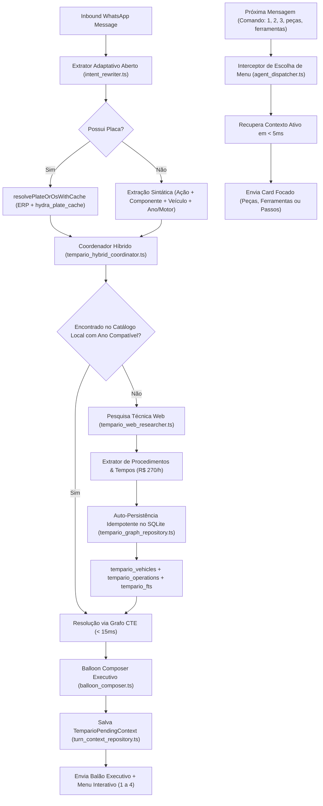

# Design Técnico — Spec 063: Arquitetura Aberta de Tempário, Auto-Persistência e Progressive Disclosure

## 1. Módulos e Fluxo de Dados



---

## 2. Contratos e Interfaces TypeScript

### 2.1. Extrator Adaptativo Aberto (`src/hydra-sync/types/tempario_contract.ts`)

```typescript
export interface AdaptiveTemparioExtraction {
  readonly isTemparioQuery: boolean;
  readonly veiculo?: string;
  readonly motor?: string;
  readonly ano?: number;
  readonly placa?: string;
  readonly osId?: string;
  readonly componentes: readonly string[];
  readonly acaoMecanica?: string;
  readonly promptOriginal: string;
}

export interface LearnedTemparioPackage {
  readonly veiculoMarca: string;
  readonly veiculoModelo: string;
  readonly anoInicio: number;
  readonly anoFim: number;
  readonly geracaoNome?: string;
  readonly motorNome?: string;
  readonly operacaoNome: string;
  readonly tempoPadraoHoras: number;
  readonly passos: readonly {
    ordem: number;
    titulo: string;
    fase: 'DESMONTAGEM' | 'EXECUCAO' | 'REMONTAGEM' | 'AJUSTE';
    tempoHoras: number;
    ferramentas: readonly string[];
    torque?: string;
  }[];
  readonly pecas: readonly {
    nome: string;
    quantidade: number;
    unidade: string;
    obrigatoria: boolean;
    especificacao?: string;
  }[];
  readonly ferramentas: readonly string[];
  readonly torques: readonly string[];
  readonly fonteUrlOuNome: string;
}

export type TemparioDetailChoice =
  | 'PECAS'
  | 'FERRAMENTAS'
  | 'PASSOS'
  | 'COMPLETO';

export interface TemparioPendingContext {
  readonly tipo: 'TEMPARIO_DISCLOSURE';
  readonly veiculo: string;
  readonly motor?: string;
  readonly ano?: number;
  readonly placa?: string;
  readonly servicos: readonly string[];
  readonly queryResponse: TemparioHybridQueryResponse;
  readonly createdAt: string;
}
```

---

## 3. Especificação Detalhada das Alterações

### 3.1. Extrator Adaptativo Aberto (`src/hydra-sync/intent_rewriter.ts`)

Substituição da lista rígida de 20 carros por um analisador gramatical e semântico aberto:

```typescript
/**
 * Extrai entidades de forma aberta, sem depender de lista fixa de veículos.
 * Identifica: Ação mecânica + Componente mecânico + Ano/Motor + Modelo livre.
 */
export function extractAdaptiveTemparioQuery(rawText: string): AdaptiveTemparioExtraction {
  // 1. Extração de Placa (Mercosul / Antiga)
  // 2. Extração de Ano (ex: 1990 - 2030)
  // 3. Extração de Motor (ex: 1.0, 1.4 TSI, 2.0 16V, etc.)
  // 4. Identificação de Componentes Mecânicos (farol, radiador, correia, embreagem, etc.)
  // 5. Identificação de Ação Mecânica (troca, trocar, substituir, manutenção, revisão, regulagem, etc.)
  // 6. Extração do Veículo Remanescente:
  //    Remove ação, componentes, ano, motor e stopwords. O núcleo restante de palavras é o Modelo/Marca.
  //    Ex: "troca farol dianteiro lado direito corsa 2010" -> Veículo: "Corsa", Ano: 2010, Componente: "farol"
  //    Ex: "trocar correia dentada tiggo 7 pro 2023" -> Veículo: "Tiggo 7 Pro", Ano: 2023, Componente: "correia"
}
```

### 3.2. Auto-Persistência no Banco (`src/hydra-sync/tempario_graph_repository.ts`)

Nova função `persistLearnedTemparioCatalog(db, packageData)`:
- Executa dentro de transação atômica SQLite.
- Cria ou reaproveita o veículo em `tempario_vehicles` com faixa de anos adequada (ex: Corsa 2002-2012 para um ano 2010).
- Insere o motor em `tempario_engines`.
- Insere a operação em `tempario_operations` vinculada à chave de veículo e motor.
- Insere as sub-operações em `tempario_suboperations`.
- Insere as peças associadas em `tempario_operation_parts`.
- Insere no índice FTS `tempario_fts`.
- **Resultado:** A partir desse instante, qualquer nova consulta para esse carro/ano/serviço é resolvida instantaneamente pelo catálogo local em < 10ms.

### 3.3. Apresentação Executiva & Menu Interativo (`src/hydra-sync/balloon_composer.ts`)

- `composeTemparioExecutiveBalloon(response)`:
  - Formata o resumo executivo de alta legibilidade com tempo líquido, total de mão de obra (R$ 270/h), economia de acesso compartilhado e menu de aprofundamento (1 a 4).
- `composeTemparioDetailBalloon(choice, response)`:
  - Gera card dedicado e cirúrgico para a opção escolhida pelo usuário (`1 - Peças`, `2 - Ferramentas e Torques`, `3 - Passo a Passo`, `4 - Completo`).

### 3.4. Interceptor de Comandos no Dispatcher (`src/hydra-sync/agent_dispatcher.ts`)

- No topo do processamento de mensagens:
  - Verifica se o remetente possui um `TemparioPendingContext` ativo (< 120 min).
  - Se a mensagem do usuário for um comando de menu (`1`, `2`, `3`, `4`, `peças`, `ferramentas`, `passos`, etc.):
    - Intercepta imediatamente em < 5ms.
    - Renderiza a opção solicitada e despacha ao WhatsApp sem invocar pipelines externos.
  - Se for uma nova pergunta de tempário:
    - Roda o Coordenador com auto-persistência.
