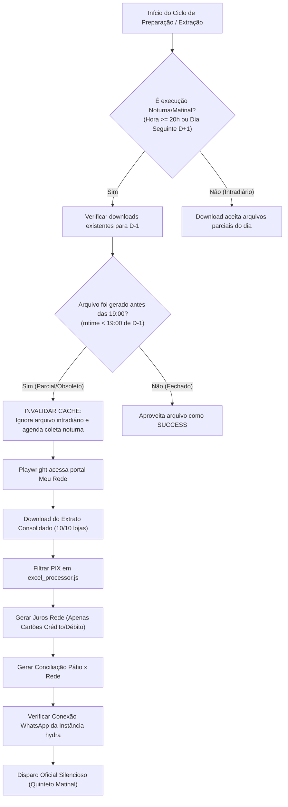

# Design Técnico: Correção do Envio Matinal da Rede, Lojas Zeradas e Expurgo de PIX

## 1. Arquitetura da Solução e Fluxo de Dados

### 1.1 Diagrama de Estados do Download da Rede (Intradiário vs Fechamento Noturno)



---

## 2. Especificação das Modificações nos Módulos

### 2.1 Módulo `excel_processor.js`: Expurgo Estrito de PIX do Relatório de Juros

- **Arquivo:** `/home/operacional/hydra-rede/src/excel_processor.js`
- **Comportamento Atual:** Linhas com `isPix === true` são transformadas em itens da tabela de cartão com taxa 0,0% e inseridas em `transacoesIndividuais`.
- **Novo Comportamento:**
  - `isPix` é detectado como hoje (`tipo.includes('pix') || modalidade.includes('pix')`).
  - O volume é acumulado em `stats.totalPix` e `stats.pixCount` para fins de auditoria interna.
  - A transação de PIX é **completamente ignorada** para o `Relatório de Juros` (não entra no array `transacoesIndividuais` e não soma em `totalBruto`, `totalLiquido`, `totalVendaJuros` ou `totalOriginal`).

#### Código Alvo (`src/excel_processor.js`):
```javascript
// Detecção de PIX na maquininha (suporte a recebimentos via QR Code no POS)
const isPix = tipo.includes('pix') || modalidade.includes('pix');
if (isPix) {
  pixCount++;
  totalPix += bruto;
  // DIRETRIZ CRÍTICA: PIX não sofre retenção de taxa MDR nem repasse de juros de cartão.
  // Deve ser expurgado da planilha de Juros e Taxas de Cartão para não poluir o fechamento financeiro.
  continue;
}
```

---

### 2.2 Módulo `state_manager.js` & `run_nightly_prep.js`: Stale Intraday Snapshot Gate

- **Arquivo:** `/home/operacional/hydra-rede/src/state_manager.js`
- **Problema:** `findExistingDownload` retorna o primeiro arquivo que dê match com o prefixo da loja e data, mesmo que tenha sido baixado às 14:40 (antes do faturamento vespertino).
- **Novo Comportamento:**
  - Adicionar parâmetro de opção `options.requireClosedDay` ou checagem de horário de modificação.
  - Se a data do arquivo for a data de ontem (D-1) e o horário atual for posterior às 20:00 (ou dia seguinte), arquivos gravados antes das 18:30 do dia faturado são considerados snapshots intradiários parciais e ignorados.

#### Código Alvo (`src/state_manager.js`):
```javascript
function findExistingDownload(loja, dateTag, options = {}) {
  if (!fs.existsSync(DOWNLOAD_DIR)) return null;
  const files = fs.readdirSync(DOWNLOAD_DIR);
  const prefix = `${loja.nomePlanilha}_${dateTag}_`;
  const match = files.find(f => f.startsWith(prefix) && f.endsWith('.xlsx'));
  if (match) {
    const fullPath = path.join(DOWNLOAD_DIR, match);
    const stat = fs.statSync(fullPath);
    
    // Se estamos em fechamento noturno ou D+1, descarta arquivos baixados antes do encerramento da loja (18:30)
    if (options.requireClosedDay) {
      const fileDate = new Date(stat.mtimeMs);
      const fileHour = fileDate.getHours();
      const fileMinutes = fileDate.getMinutes();
      const fileTimeDecimal = fileHour + fileMinutes / 60;
      if (fileTimeDecimal < 18.5) {
        // Arquivo intradiário prematuro: não serve como fechamento definitivo
        return null;
      }
    }

    const val = validateDownloadedFile(fullPath, loja.ec);
    if (val.valid) {
      return fullPath;
    }
  }
  return null;
}
```

---

### 2.3 Módulo `run_nightly_prep.js`: Invalidação de Planilha com Lojas Faltando

- **Arquivo:** `/home/operacional/hydra-rede/src/run_nightly_prep.js`
- **Problema:** Se `Juros Rede - DD-MM-AAAA.xlsx` existir no disco, a esteira noturna das 23:00 assume que tudo está pronto sem verificar se foi gerado intradiário às 14h ou 19h.
- **Novo Comportamento:**
  - Na checagem inicial da esteira noturna (executada às 23:00):
    - A planilha de `JUROS_REDE` só é considerada pronta se tiver sido gerada **após as 20:00**.
    - Se a planilha foi gerada antes das 20:00, ela é marcada como `PENDENTE`, forçando a execução da extração noturna completa das 10 lojas.

---

### 2.4 Módulo `run_unified_morning_dispatch.js`: Escopo Léxico e Pre-flight WhatsApp

- **Arquivo:** `/home/operacional/hydra-rede/src/run_unified_morning_dispatch.js`
- **Problema:** `dispatchRes` é declarada dentro de bloco condicional e gera `ReferenceError` na linha 734 em caso de erro.
- **Novo Comportamento:**
  1. Declarar `let dispatchRes = null;` no escopo superior da função `run()`.
  2. Implementar verificação pré-voo (Pre-flight check) do estado da instância `hydra` via API HTTP antes de tentar enviar os 5 arquivos:
     - Se `state !== "open"`, tenta auto-healing via `/instance/restart/hydra` com espera de até 10 segundos antes do disparo.

#### Código Alvo (`src/run_unified_morning_dispatch.js`):
```javascript
let dispatchFinanceiroOk = false;
let dispatchRes = null;

try {
  if (!isDryRun) {
    // Pre-flight check da instância WhatsApp
    try {
      const statusRes = await axios.get(`${EVO_URL}/instance/connectionState/${EVO_INSTANCE}`, {
        headers: { apikey: EVO_API_KEY },
        timeout: 5000
      });
      const st = statusRes.data && statusRes.data.instance ? statusRes.data.instance.state : 'unknown';
      if (st !== 'open') {
        log(`⚠️ Instância ${EVO_INSTANCE} em estado '${st}'. Tentando reinicialização preventiva...`);
        await axios.post(`${EVO_URL}/instance/restart/${EVO_INSTANCE}`, {}, {
          headers: { apikey: EVO_API_KEY },
          timeout: 10000
        });
        await new Promise(r => setTimeout(r, 6000));
      }
    } catch (errCheck) {
      log(`⚠️ Aviso no pre-flight da instância: ${errCheck.message}`);
    }

    dispatchRes = await dispararRelatoriosMatinaisSilenciosos({ ... });
    dispatchFinanceiroOk = dispatchRes && dispatchRes.ok;
```

---

## 3. Protocolo de Restabelecimento da Instância WhatsApp (`hydra`)

1. **Consulta de Estado Atual:**
   `GET https://evo.tork.services/instance/connectionState/hydra`
2. **Reinício de Sessão (Warm Restart):**
   `POST https://evo.tork.services/instance/restart/hydra`
3. **Reconexão de Socket (se permanecer em connecting):**
   `POST https://evo.tork.services/instance/connect/hydra`
4. **Verificação de Confirmação:**
   Aguardar retorno `{"instance":{"instanceName":"hydra","state":"open"}}`.
5. **Trava de Segurança:**
   Se a reconexão falhar, **nunca** desviar o disparo para instâncias de gerentes. O erro será roteado diretamente para o console e log do sistema.
