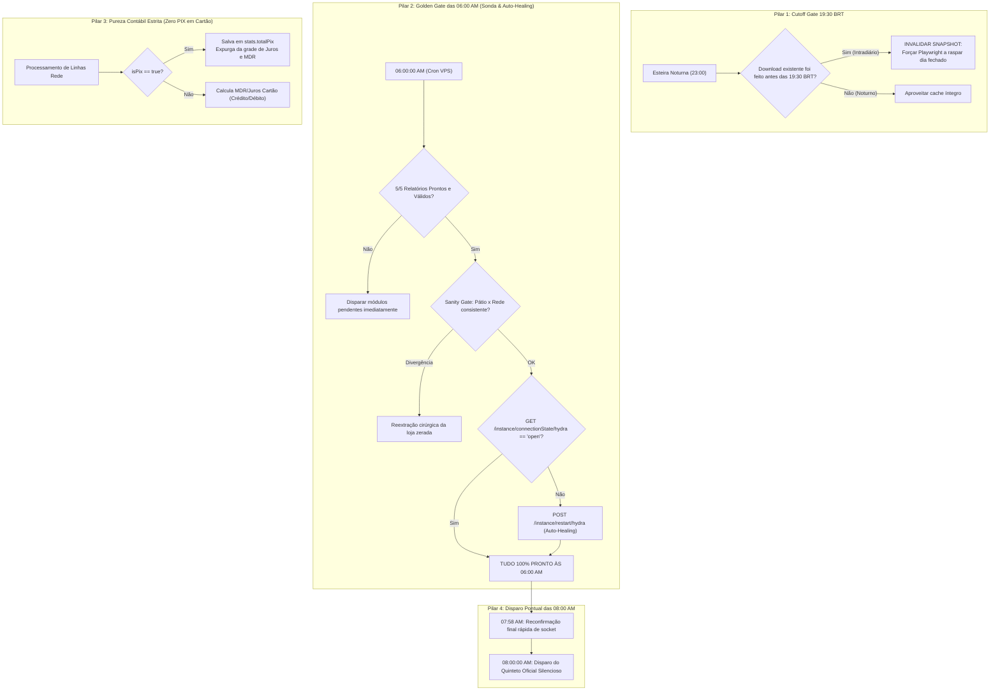

# Spec 033 — Proposta de Arquitetura: Blindagem Sistêmica da Esteira Noturna, Sonda das 06:00 AM, Auto-Healing de WhatsApp e Sanity Gate Pátio x Rede

> **ID da Spec:** `033-robustez-definitiva-esteira-rede`  
> **Status:** PROPOSTA TÉCNICA ATUALIZADA (COM SONDA DAS 06:00 AM)  
> **Data:** 2026-10-27  
> **Diretriz Mandatória do Usuário:** *"tem que sondar as 6 da manha irmao tem que ta td certo as 6 da manha ja"*

---

## 1. Por Que Esses Problemas Continuam Acontecendo? (Diagnóstico Estrutural)

As falhas observadas na operação matinal de 27/10/2026 (loja Santo André zerada, não entrega dos relatórios às 08:00 e presença indevida de PIX na planilha de juros) decorreram de 4 fragilidades arquiteturais acopladas:

1. **Idempotência Cega no Cache (`state_manager.js` e `run_nightly_prep.js`):** Qualquer arquivo `.xlsx` > 1KB baixado à tarde (ex: às 14:40) era tratado como "sucesso definitivo para o dia inteiro". A esteira noturna das 23:00 via o arquivo e pulava a reextração noturna, descartando todas as vendas da tarde.
2. **Sessão WhatsApp Desconectada Sem Sonda Prévia:** A instância `hydra` sofreu desconexão de socket na madrugada e ninguém testou se ela estava `open`. Às 08:00:00 o disparo estourou `500 Connection Closed` e um bug de escopo léxico (`ReferenceError: dispatchRes is not defined`) abortou o processo sem auto-recuperação.
3. **Vazamento Contábil de PIX em Cartão:** Transações de PIX da maquininha foram inseridas com taxa 0,0% no `Relatório de Juros`, distorcendo o cálculo contábil de MDR e a taxa média ponderada das lojas.
4. **Ausência de Sanity Gate Cruzado:** O Pátio registrou 3 OSs faturadas em cartão para Santo André, mas a Rede veio com R$ 0,00 e o sistema permitiu essa incongruência bizarra passar sem alarme.

---

## 2. A Solução Arquitetural Definitiva (Os 5 Pilares de Blindagem)

---

## 3. O Marco das 06:00 AM (Golden Gate de Prontidão Operacional)

A partir desta spec, **o horário de validação e garantia de integridade é formalmente antecipado para as 06:00:00 AM** (duas horas completas de folga antes do envio das 08:00 AM ao cliente):

1. **Auditoria de Arquivos (06:00 AM):**
   * O script `src/run_morning_watchdog_0600.js` executa pontualmente às 06:00:00 AM.
   * Valida se o Quinteto Oficial (`Juros Rede`, `Carros em Patio`, `Mapa de Metas`, `Contas a Pagar`, `Conciliacao Patio x Rede`) está gerado e com tamanho > 1KB.
   * Se faltar qualquer arquivo, dispara imediatamente a esteira do módulo pendente.
2. **Auditoria de Plausibilidade Comercial Pátio x Rede (06:00 AM):**
   * Se qualquer loja faturou cartão no Pátio mas tiver R$ 0,00 na Rede, o watchdog invalida o cache da loja e executa o scraper cirúrgico às 06:02 AM.
3. **Auditoria de Conectividade WhatsApp (06:00 AM):**
   * Consulta a Evolution API. Se o socket da instância `hydra` estiver desconectado (`connecting` ou `close`), dispara `POST /instance/restart/hydra`.
   * Valida a reconexão. Se a instância permanecer desconectada, emite alerta de contingência para o Dev às **06:05 AM**, garantindo tempo hábil para intervenção antes das 08:00 AM.
4. **Despacho das 08:00:00 AM:**
   * Quando o relógio bater 07:45 e 08:00 AM, o orquestrador apenas faz a entrega silenciosa, pois tudo já foi auditado e consolidado desde as 06:00 AM.

---

## 4. Análise de Riscos e Mitigações

| Risco | Impacto | Mitigação |
|---|---|---|
| Instância WhatsApp cair entre 06:10 e 07:59 | Falha no disparo das 08:00 | O orquestrador das 07:45 mantém uma segunda checagem rápida de socket às 07:58 AM como salvaguarda dupla. |
| Crawl das 06:00 falhar por manutenção no portal Rede | Atraso no relatório | A esteira noturna das 23:00 já terá feito a carga primária; a sonda das 06:00 atua como rede de contenção para falhas e retries. |
| Disparo antecipado de mensagens para o cliente | Quebra de procedimento | A sonda das 06:00 AM **não envia nenhuma mensagem ao cliente**; ela apenas prepara, audita e cura. O envio ao cliente permanece cravado às 08:00:00 AM. |
