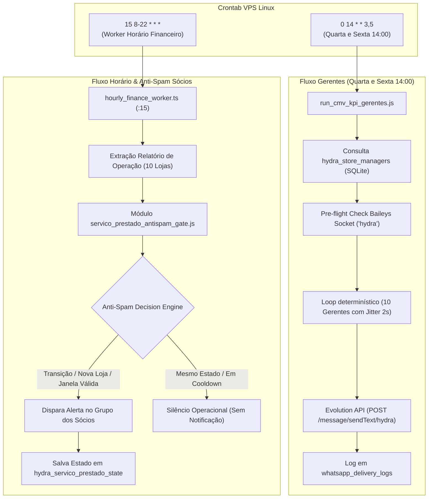

# Design Técnico — Spec 037: Roteamento Gerentes 14:00 & Anti-Spam de Serviço Prestado

## 1. Arquitetura e Fluxo de Dados



---

## 2. Máquina de Estados Anti-Spam (`servico_prestado_antispam_gate.js`)

### Estados de Transição Possíveis:
1. `PRIMEIRA_APURACAO_DIA`: primeiro disparo do dia (janela matinal de corte, por exemplo entre 10:30 e 12:00, quando os dados do mês já possuem consistência de abertura de caixa).
2. `NOVA_LOJA_CRITICA`: uma loja que não estava na lista crítica caiu abaixo de 45.0% no meio do dia. **Disparo Imediato de Alerta com Badge de Atenção**.
3. `CONSOLIDADO_TARDE`: segundo e último disparo diário programado (entre 16:30 e 18:00) caso ainda persistam unidades críticas, desde que respeite o cooldown mínimo de 3 horas em relação ao disparo anterior.
4. `ESTADO_ESTAVEL_IGNORADO`: a extração horária rodou, mas as lojas críticas são as mesmas ou tiveram apenas variações decimais irrelevantes (< 1.5 p.p.) e o cooldown está ativo. **Nenhum envio (Silêncio)**.
5. `TODAS_CONFORMES`: nenhuma loja está abaixo de 45.0%. **Nenhum envio**.

---

## 3. Interfaces TypeScript / Estrutura de Tipos

```typescript
export interface LojaServicoStatus {
  slug: string;
  nome: string;
  faturamentoTotal: number;
  servicoPrestadoFat: number;
  servicoPrestadoPct: number;
  isCritico: boolean; // servicoPrestadoPct < 45.0
}

export interface HistoricoAlertaDia {
  id?: number;
  dataReferencia: string; // YYYY-MM-DD
  lojasCriticasHash: string; // sha256 ou slugs ordenados
  lojasCriticas: Array<{
    slug: string;
    nome: string;
    pct: number;
    fatServico: number;
    fatTotal: number;
  }>;
  totalCriticas: number;
  motivoDisparo: 'PRIMEIRA_APURACAO' | 'NOVA_LOJA_CRITICA' | 'CONSOLIDADO_TARDE';
  novasLojas: string[]; // slugs de lojas que entraram
  recuperadasLojas: string[]; // slugs de lojas que saíram
  disparadoEm: string; // ISO8601
}

export interface DecisaoAntiSpam {
  deveDisparar: boolean;
  motivo: 'PRIMEIRA_APURACAO' | 'NOVA_LOJA_CRITICA' | 'CONSOLIDADO_TARDE' | 'BLOQUEADO_MESMO_ESTADO' | 'BLOQUEADO_COOLDOWN' | 'TODAS_CONFORMES';
  novasLojasCriticas: LojaServicoStatus[];
  lojasRecuperadas: string[];
  lojasAbaixo45: LojaServicoStatus[];
  tempoDesdeUltimoMinutos: number | null;
}
```

---

## 4. Schema SQLite: `hydra_servico_prestado_state`

Criado no banco `/home/operacional/hydra-data/hydra_ops.db` (e mock local em testes):

```sql
CREATE TABLE IF NOT EXISTS hydra_servico_prestado_state (
  id INTEGER PRIMARY KEY AUTOINCREMENT,
  data_referencia TEXT NOT NULL,
  lojas_criticas_hash TEXT NOT NULL,
  lojas_criticas_json TEXT NOT NULL,
  total_lojas_criticas INTEGER NOT NULL,
  motivo_disparo TEXT NOT NULL,
  novas_lojas_json TEXT,
  recuperadas_json TEXT,
  disparado_em TEXT NOT NULL
);

CREATE INDEX IF NOT EXISTS idx_servico_state_data ON hydra_servico_prestado_state(data_referencia);
```

---

## 5. Algoritmo de Decisão Anti-Spam

```javascript
function avaliarDecisaoAntiSpam({ dadosAtuais, historicoHoje, horaAtual = new Date() }) {
  const lojasAbaixo45 = dadosAtuais.filter(l => l.servicoPrestadoPct !== null && l.servicoPrestadoPct < 45.0);
  
  // 1. Se nenhuma loja estiver abaixo de 45%, silêncio total
  if (lojasAbaixo45.length === 0) {
    return { deveDisparar: false, motivo: 'TODAS_CONFORMES', lojasAbaixo45: [] };
  }

  const horaNum = horaAtual.getHours();
  // 2. Gate de maturação: não dispara antes das 10h da manhã (evita ruído de caixas recém-abertos)
  if (horaNum < 10) {
    return { deveDisparar: false, motivo: 'AGUARDANDO_MATURACAO_MATINAL', lojasAbaixo45 };
  }

  const hashAtual = gerarHashLojasCriticas(lojasAbaixo45);
  
  // 3. Se ainda não houve nenhum disparo hoje e já passou das 10:30 -> PRIMEIRA APURAÇÃO DO DIA
  if (!historicoHoje || historicoHoje.length === 0) {
    return {
      deveDisparar: true,
      motivo: 'PRIMEIRA_APURACAO',
      novasLojasCriticas: lojasAbaixo45,
      lojasRecuperadas: [],
      lojasAbaixo45
    };
  }

  const ultimoDisparo = historicoHoje[historicoHoje.length - 1];
  const diffMinutos = (horaAtual.getTime() - new Date(ultimoDisparo.disparado_em).getTime()) / 60000;
  
  // 4. Identificar deltas (lojas que entraram na lista crítica e não estavam no último disparo)
  const slugsAnteriores = new Set(ultimoDisparo.lojas_criticas.map(l => l.slug));
  const novasLojas = lojasAbaixo45.filter(l => !slugsAnteriores.has(l.slug));
  const slugsAtuais = new Set(lojasAbaixo45.map(l => l.slug));
  const recuperadas = ultimoDisparo.lojas_criticas.filter(l => !slugsAtuais.has(l.slug)).map(l => l.nome);

  // Se uma NOVA loja caiu abaixo de 45%, dispara IMEDIATAMENTE (alerta prioritário)
  if (novasLojas.length > 0) {
    return {
      deveDisparar: true,
      motivo: 'NOVA_LOJA_CRITICA',
      novasLojasCriticas: novasLojas,
      lojasRecuperadas: recuperadas,
      lojasAbaixo45
    };
  }

  // 5. Cooldown mínimo de 180 minutos (3 horas) para relatórios consolidados
  if (diffMinutos < 180) {
    return { deveDisparar: false, motivo: 'BLOQUEADO_COOLDOWN', lojasAbaixo45, tempoDesdeUltimoMinutos: Math.round(diffMinutos) };
  }

  // 6. Janela da Tarde (16:00 às 18:30): se já passaram 3h+ e é fim de expediente, dispara CONSOLIDADO_TARDE (máx 2 disparos/dia)
  if (horaNum >= 16 && horaNum <= 18 && historicoHoje.length < 2) {
    return {
      deveDisparar: true,
      motivo: 'CONSOLIDADO_TARDE',
      novasLojasCriticas: [],
      lojasRecuperadas: recuperadas,
      lojasAbaixo45
    };
  }

  // 7. Caso padrão: mesmo estado, sem evento novo -> SILÊNCIO
  return { deveDisparar: false, motivo: 'BLOQUEADO_MESMO_ESTADO', lojasAbaixo45 };
}
```

---

## 6. Módulos a Modificar e Criar

1. **`projects/hydra-rede/src/servico_prestado_antispam_gate.js` (NOVO):**
   - Implementa a máquina de estados, hashing de lista, consultas e inserts em `hydra_servico_prestado_state`.
   - Exporta: `avaliarDecisaoAntiSpam()`, `registrarDisparoAlerta()`, `obterHistoricoHoje()`.

2. **`projects/hydra-rede/src/run_cmv_kpi_gerentes.js` (MODIFICAR):**
   - Separar o disparo de gerentes (Quarta e Sexta 14:00) do despacho para os sócios.
   - Suportar flag CLI:
     - `--mode=gerentes` (disparo exclusivo individual para gerentes)
     - `--mode=socios-hourly` (avaliação anti-spam horária pós-crawler para o grupo dos sócios)
     - `--mode=all` (executa ambos se elegível)

3. **`crontab` na VPS Linux (MODIFICAR):**
   - Atualizar a linha de gerentes para as **14:00**:
     `0 14 * * 3,5 /usr/bin/node /home/operacional/hydra-rede/src/run_cmv_kpi_gerentes.js --mode=gerentes --immediate >> /home/operacional/hydra-data/logs/cmv-kpi-gerentes.log 2>&1`
   - Adicionar o hook horário pós-crawler financeiro (às :30 de 10-20h):
     `30 10-20 * * 1-5 /usr/bin/node /home/operacional/hydra-rede/src/run_cmv_kpi_gerentes.js --mode=socios-hourly --immediate >> /home/operacional/hydra-data/logs/servico-prestado-hourly.log 2>&1`

4. **`projects/hydra-rede/src/test_servico_prestado_antispam.js` (NOVO):**
   - Suíte de 10+ testes cobrindo:
     - Idempotência de estado (mesmo hash -> silêncio).
     - Nova loja crítica -> disparo imediato `NOVA_LOJA_CRITICA`.
     - Cooldown de 3h ativo -> bloqueia reenvio.
     - Janela matinal antes das 10h -> aguarda maturação.
     - Teto de disparos diários (máximo 2 consolidados/dia).
     - Formatação delta Hermes 2.0.
