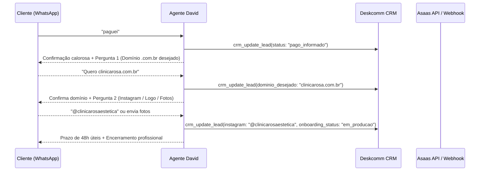

# Design Técnico: Reformulação da Esteira Comercial do Agente David (Backstudio)
## Arquitetura de Estados, Bifurcação de Preview, Trava Asaas e Onboarding Pós-Venda

**Spec ID:** `038-backstudio-fluxo-preview-onboarding-antihallucination`  
**Data:** 27/10/2026  
**Status:** Planejamento (SDD Proposal)  

---

## 1. Arquitetura Geral & Componentes

O agente David opera sobre a stack do **DeskcommCRM** na VPS de produção (`/opt/deskcomm/`):
- **Motor de Execução:** Worker Deskcomm (`ghcr.io/melgarafael/deskcomm-worker:stable`).
- **Banco e Estados:** Supabase Cloud (`ai_agents`, `ai_agent_versions`, `crm_leads`, `contacts`).
- **Provider LLM:** Google Cloud Vertex AI via LiteLLM (`deskcomm-vertex-bridge`, modelo `3.5-flash-lite`).
- **Engine WhatsApp:** WAHA (`devlikeapro/waha`).
- **Gateway Financeiro:** Asaas API v3 via tool MCP `Gerar_Cobranca_Asaas`.

---

## 2. Bifurcação Lógica: Com Preview vs Sem Preview

O agente deve avaliar o contexto do lead injetado no turno (`lead.custom_fields` ou tags):

```typescript
export interface LeadPreviewContext {
  has_preview: boolean;
  demo_url?: string;
  nicho?: string;
  nome_negocio?: string;
}

export function resolverEstrategiaAbertura(ctx: LeadPreviewContext): 'com_preview' | 'sem_preview' {
  if (ctx.has_preview && ctx.demo_url && ctx.demo_url.startsWith('http')) {
    return 'com_preview';
  }
  return 'sem_preview';
}
```

### 2.1 Cenário A: Lead COM Preview (`has_preview: true`, `demo_url` válida)
- **Origem típica:** Prospecção ativa do Google Maps onde a equipe já produziu uma página de demonstração prévia.
- **Fluxo:**
  1. Abertura cordial validando com quem está falando.
  2. SPIN Selling curto (Situação e Implicação de depender de indicação).
  3. Apresentação da demonstração real: `"Eu montei uma demonstração prática de como a {{nome_negocio}} pode aparecer no Google: {{demo_url}}"`.
  4. Validação de interesse e avanço para plano.

### 2.2 Cenário B: Lead SEM Preview (`has_preview: false` / Inbound Orgânico)
- **Origem típica:** Anúncio, indicação, link da bio, WhatsApp orgânico. O lead chega perguntando: *"quais os seus serviços?"*, *"como funciona o aluguel de sites?"*.
- **REGRAS ESTRITAS:**
  - ⛔ **PROIBIDO** dizer *"preparei uma demonstração rápida"*, *"deixei um link pronto"* ou inventar links como `demo.backstudio.com.br/<nicho>`.
  - ✅ **OBRIGATÓRIO** explicar o serviço com clareza:
    > *"Nós criamos o site profissional completo para o seu negócio e cuidamos de tudo no modelo de assinatura chave na mão: domínio próprio (.com.br), hospedagem de alta velocidade e alterações ilimitadas no conteúdo sempre que você precisar, sem você se preocupar com a parte técnica."*
  - ✅ **Coleta de Informações de Produção (Briefing Enxuto):**
    > *"Para eu entender o que faz mais sentido para o seu caso: qual é o nome da sua empresa e a sua cidade?"*
    > *(Próximo turno):* *"E hoje, qual é o principal serviço ou procedimento carro-chefe de vocês que não pode faltar no site?"*
  - Em seguida, avança direto para a ancoragem de valores (Mensal R$ 149 vs Anual 10x R$ 99,80). O site será produzido **após** o fechamento ou enviado para aprovação no onboarding!

---

## 3. Matriz de Sanitização Anti-Alucinação (Anti-Hallucination Guard)

### 3.1 Expurgo de Nomes Hardcoded
- No `system_prompt`, substituir qualquer ocorrência de nomes literais (`"Marcos"`, `"João"`) por tokens dinâmicos:
  - Se `contact_name` for conhecido e válido: use `{{contact_name}}`.
  - Se `contact_name` for genérico, numérico ou inexistente (ex: "5511...", "Teste", "Clinica"): trate sem vocativo ou pelo nome da empresa (ex: *"Fico feliz que tenha gostado!", "Excelente escolha para a clínica!"*).

### 3.2 Trava de Coerência de Cobrança (Asaas Delivery Guard)
- Se a tool `Gerar_Cobranca_Asaas` for disparada e responder com `{ success: true, invoice_url: "..." }`:
  - O prompt deve conter a diretriz estrutural:
    ```markdown
    ### REGRA DE OURO DA COBRANÇA
    Assim que a tool `Gerar_Cobranca_Asaas` retornar o link de pagamento, sua resposta DEVE compulsoriamente conter o link no formato:
    "Aqui está o link oficial da sua assinatura [mensal/anual]:
    {{invoice_url}}
    Assim que efetuar o pagamento, me avisa por aqui para começarmos a configuração do seu domínio e os materiais do site!"
    
    É TERMINANTEMENTE PROIBIDO responder dizendo "assim que compensar já iniciamos" SEM TER ENVIADO O LINK NO MESMO TURNO!
    ```

---

## 4. Protocolo de Onboarding Pós-Venda (`funil_cliente`)

Quando o lead disser *"paguei"* ou quando o Webhook do Asaas confirmar a compensação financeira:



### Mensagens Padronizadas de Onboarding:
- **Turno 1 (Confirmação & Domínio):**
  > *"Pagamento confirmado com sucesso! Parabéns pela decisão de profissionalizar a presença da clínica na internet.*
  > 
  > *Já estamos dando início à produção do seu site. Para começarmos agora: qual é o endereço de domínio (.com.br) que você gostaria de registrar para a sua empresa? (Ex: suaclinica.com.br)"*

- **Turno 2 (Coleta de Materiais / Instagram):**
  > *"Excelente escolha de domínio! Já reservei aqui.*
  > 
  > *Para deixarmos o site com a identidade visual de vocês: você tem logotipo e fotos dos procedimentos para me mandar por aqui, ou prefere que a gente puxe as fotos direto do seu Instagram? Se for pelo Instagram, qual é o @ de vocês?"*

- **Turno 3 (Finalização e Prazo):**
  > *"Perfeito! Já passei tudo para a nossa equipe de design e desenvolvimento.*
  > 
  > *Em até 48 horas úteis nós vamos te enviar o link provisório do site pronto aqui no WhatsApp para você dar uma olhada e pedir qualquer ajuste que quiser antes de apontar o domínio definitivo. Qualquer dúvida é só chamar por aqui!"*

---

## 5. Substituição de Pipes (`|`) e Fatiamento de Bolhas

### 5.1 Ajuste no Prompt do David
- Substituir a regra:
  `1. Divisão em Balões (|): Escreva respostas curtas divididas em 2 a 3 balões usando o caractere |...`
- Pela regra:
  `1. Divisão em Balões Naturais: Escreva respostas em 2 a 3 parágrafos curtos, separando cada balão com UMA LINHA EM BRANCO DUPLA (\n\n). NUNCA use o caractere pipe (|) como separador.`

### 5.2 Sanitizador Defensivo no Código Deskcomm
Em `/opt/deskcomm/lib/agent-engine/agent/split-message.ts`:
Garantir que, se o modelo ainda emitir algum caractere `|` isolado por vício de contexto anterior, o fatiador converta o `|` em quebra de linha antes de qualquer envio.

---

## 6. Guardrail de Horário Comercial (Business Hours)

Para evitar disparos indesejados às 07:00 da manhã:
- No agendador de follow-up (`/opt/deskcomm/lib/followup/` ou `prospecting/worker.ts`):
  - Trava de horário comercial: envios ativos de prospecção e lembretes apenas entre **09:00 e 18:30 (Segunda a Sexta)** e entre **10:00 e 16:00 (Sábados)**.
  - Se um follow-up cair fora desse intervalo, ele é automaticamente postergado para as **09:15 do próximo dia útil**.
