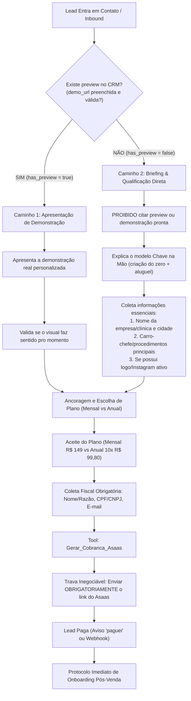

# Proposta: Reformulação da Esteira Comercial do Agente David (Backstudio)
## Bifurcação de Preview, Eliminação de Alucinações, Trava Asaas e Onboarding Pós-Venda

**Spec ID:** `038-backstudio-fluxo-preview-onboarding-antihallucination`  
**Data:** 27/10/2026  
**Status:** Planejamento (SDD Proposal)  
**Autor:** Antigravity AI  

---

## 1. Diagnóstico dos Fatos Reais (Auditoria de Conversa & VPS)

A análise factual da conversa real do lead com o agente David (`ai_agent_id: 23346315-4feb-4ee4-8964-b523c852913e`, versão `af2a1c57-ca4b-40f7-8958-b037d6eb5dd3`) nos dias 23/10 a 27/10/2026 e a inspeção do código no DeskcommCRM (`/opt/deskcomm/`) revelaram seis falhas críticas operacionais:

1. **Alucinação de Demonstração / Preview Inexistente:**
   - **O que ocorreu:** O lead informou o nicho ("eu tenho uma clínica estética") e, no dia seguinte, o bot afirmou: *"preparei uma demonstração rápida de como o site da sua clínica de estética ficaria na prática... https://demo.backstudio.com.br/clinica-estetica"*. O link enviado era genérico e a clínica não possuía site prévio gerado.
   - **Causa Raiz:** O `system_prompt` da versão 8 assume cegamente que *todo* lead possui uma demonstração pronta (`ctx_site_demo_pronto` / `demo_url`), tratando leads inbound orgânicos como se fossem leads de prospecção ativa mapeados previamente no Google Maps.
   - **Diretriz do Usuário:** Se o lead NÃO possui site/preview pronto, o agente **não pode** falar que preparou um preview nem mandar links genéricos. Deve qualificar o negócio e coletar as informações necessárias para viabilizar a criação do site.

2. **Alucinação de Nome Fantasma ("Marcos"):**
   - **O que ocorreu:** O agente chamou o cliente de *"Marcos"* (*"Fico muito feliz que tenha gostado, Marcos!"*), embora o lead jamais tivesse mencionado esse nome (o nome nos dados fiscais era "Teste da silva" / David).
   - **Causa Raiz:** O `system_prompt` contém nos blocos de few-shot (Exemplos 2 e 3) o nome fixo `"Marcos"`. O modelo (`3.5-flash-lite` via Vertex AI) sofreu overfitting nesses exemplos e reproduziu o vocativo sem que houvesse correspondência no histórico do lead.

3. **Vazamento do Caractere Pipe (`|`) nas Mensagens:**
   - **O que ocorreu:** Balões no WhatsApp exibiram o caractere `|` inline (ex: *"Deixa eu resumir de forma bem direta: | Nós criamos e cuidamos..."*).
   - **Causa Raiz:** O prompt instrui o modelo a separar balões com `|`. Embora o módulo `/opt/deskcomm/lib/agent-engine/agent/split-message.ts` contenha `splitIntoBubbles`, mensagens enviadas fora do fatiador ou com formatações atípicas deixam o pipe vazar como caractere cru no WhatsApp.

4. **Omissão Crítica do Link de Cobrança (Asaas Blunder):**
   - **O que ocorreu:** O lead enviou nome, CPF e e-mail. O bot chamou a tool `Gerar_Cobranca_Asaas`, mas respondeu: *"Assim que compensar, já iniciamos os ajustes com as suas fotos e definimos o domínio. Qualquer dúvida é só chamar!"*, **esquecendo de entregar o link de pagamento**. O lead teve que cobrar explicitamente: *"cadê o link da assinatura?"*.
   - **Causa Raiz:** Falta de trava de invariante na geração de cobrança: o retorno de `Gerar_Cobranca_Asaas` contém `invoice_url`, mas o prompt não proibia o encerramento da resposta sem a inclusão explícita da URL.

5. **Vácuo de Onboarding no Pós-Pagamento ("paguei"):**
   - **O que ocorreu:** O lead avisou que pagou (*"paguei"*), o bot confirmou o pagamento, disse que entraria em contato e a conversa morreu em *"ok"*, sem próximos passos concretos.
   - **Impacto:** O cliente que acabou de pagar fica sem saber como enviar logotipo, fotos dos procedimentos, endereço, Instagram e a escolha do domínio `.com.br`.

6. **Follow-up em Horário Inadequado (07:00 AM):**
   - **O que ocorreu:** O bot disparou mensagem ativa às 07:00 da manhã de um sábado/dia útil.
   - **Impacto:** Abordagem B2B antes das 09:00 é invasiva e prejudica a conversão.

---

## 2. Solução Proposta

### 2.1 Bifurcação Estrita de Jornada: Lead COM Preview vs Lead SEM Preview
A árvore conversacional do David será dividida em dois caminhos determinísticos baseados em dados reais do CRM:



### 2.2 Blindagem Anti-Alucinação de Nomes
- Eliminar nomes próprios hardcoded (`"Marcos"`) dos exemplos de few-shot no prompt.
- Inserir regra de ouro:
  > *"NUNCA invente ou presuma o nome do lead. Use o nome do cliente APENAS se ele tiver informado na conversa ou se estiver presente de forma explícita no contexto `{{contact_name}}`. Se o nome não foi informado, trate com cordialidade direta sem inventar nomes."*
- Tratamento de nomes em cadastros: se o cliente digitar dados fiscais com nomes de teste (ex: "Teste da silva"), priorizar o tratamento pelo nome do negócio ou vocativo neutro cordial.

### 2.3 Substituição dos Pipes (`|`) por Quebras de Linha Duplas
- Atualizar a instrução de formatação: substituir o uso de `|` por **duas quebras de linha (`\n\n`)**, que é o padrão nativo já suportado pelo `splitIntoBubbles` do DeskcommCRM (`/opt/deskcomm/lib/agent-engine/agent/split-message.ts`).
- Adicionar sanitização defensiva no interceptor do bot: qualquer caractere `|` residual no texto gerado é automaticamente convertido para `\n\n` antes do despacho ao WAHA/WhatsApp.

### 2.4 Trava Inegociável de Entrega do Link Asaas
- Incluir no prompt e no guardrail `before_send`:
  > *"Ao executar `Gerar_Cobranca_Asaas`, é COMPULSÓRIO e INEGOCIÁVEL incluir a URL retornada (`invoice_url`) na resposta para o cliente no mesmo turno. É proibido dizer que o link foi gerado ou pedir para o cliente aguardar sem entregar o link na mensagem."*

### 2.5 Protocolo de Onboarding Pós-Venda (Pós-Pagamento)
Assim que o cliente efetuar o pagamento (ou informar *"paguei"* com confirmação financeira):
1. **Comemoração e Boas-Vindas:** Validar a compensação no sistema.
2. **Coleta das 3 Informações de Produção:**
   - **Domínio:** Sugerir formato padrão e perguntar qual endereço `.com.br` ele prefere registrar (ex: `clinicaestetica.com.br`).
   - **Materiais:** Solicitar o @ do Instagram ou envio do logotipo e fotos dos procedimentos/espaço por este WhatsApp.
   - **WhatsApp de Atendimento:** Confirmar qual número de WhatsApp deve ser colocado nos botões de agendamento do site.
3. **Alinhamento de Prazo:** Informar que a equipe técnica colocará o site no ar para aprovação em até 48 horas úteis.

### 2.6 Guardrail de Janela Comercial (Business Hours)
- Trava no agendamento de follow-ups: proibir mensagens ativas de prospecção/acompanhamento antes das **09:00 BRT** e após as **18:30 BRT**.

---

## 3. Contratos de Dados & Integração Deskcomm

### 3.1 Custom Fields do Lead (`crm_leads.custom_fields`)
```typescript
interface BackstudioLeadContext {
  has_preview: boolean;          // true se houver demo real; false se for inbound do zero
  preview_url?: string;          // URL real da demonstração (ex: https://...)
  nicho?: string;                // ex: "clinica_estetica", "ar_condicionado"
  nome_negocio?: string;         // Nome da empresa do lead
  cidade?: string;               // Cidade de atuação
  carro_chefe?: string;          // Procedimento ou serviço principal
  instagram?: string;            // @ ou link do Instagram
  dominio_desejado?: string;     // ex: "clinicarosa.com.br"
  plano_escolhido?: 'mensal' | 'anual';
  cpf_cnpj?: string;
  email_faturamento?: string;
  asaas_invoice_url?: string;
  asaas_payment_id?: string;
  onboarding_status?: 'pendente' | 'em_coleta' | 'enviado_producao';
}
```

---

## 4. Risco Principal e Mitigações

- **Risco:** O lead não enviar as fotos ou não responder o domínio no pós-venda, paralisando a entrega.
- **Mitigação:** Se o lead demorar para responder o domínio ou fotos, o bot sugere usar as fotos e dados públicos do Instagram/Google Maps da empresa para montar a primeira versão e entregar em 48h sem travar o cliente.
