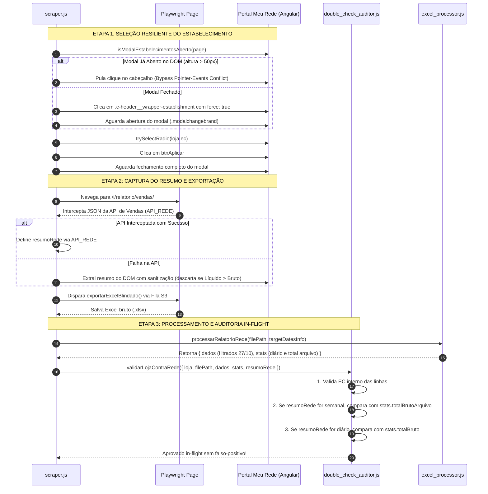

# Design Técnico — Spec 046: Fix de Interceptação de Modal de Lojas e Eliminação de Falso-Positivo In-Flight no Hydra Rede

## 1. Visão Geral da Arquitetura

O objetivo desta especificação é eliminar cirurgicamente dois pontos de atrito identificados na esteira matinal do Hydra Rede:
1. Interceptação de eventos de clique pelo modal de troca de estabelecimentos (`modal-default[modalid="pv-lightbox-change-side-header-bar"]`).
2. Falso-positivo no motor de Dupla Verificação In-Flight (`validarLojaContraRede`) provocado por leitura incoerente do DOM da tela de vendas ou descompasso entre tela semanal e corte diário.

---

## 2. Diagrama de Sequência e Fluxo de Controle



---

## 3. Módulos Afetados e Alterações Detalhadas

### 3.1. `projects/hydra-rede/src/scraper.js`

#### A. Função Auxiliar: `isModalEstabelecimentosAberto(page)`
```javascript
async function isModalEstabelecimentosAberto(page) {
  return await page.evaluate(() => {
    const modal = document.querySelector('modal-default[modalid*="change"], .modal-pv-lightbox, .modalchangebrand, #pv-lightbox-change-side-header-bar, .modal.fade.in, .modal.show');
    if (!modal) return false;
    const inner = modal.querySelector('.modal, .modal-dialog, [role="none"]') || modal;
    const rect = inner.getBoundingClientRect();
    const style = window.getComputedStyle(inner);
    return rect.height > 50 && rect.width > 50 && style.display !== 'none' && style.visibility !== 'hidden';
  }).catch(() => false);
}
```

#### B. Refatoração de `selecionarEstabelecimento(page, loja)`
1. Se a loja já estiver ativa no cabeçalho (`jaSelecionado`), encerra com sucesso.
2. Checa `modalAberto = await isModalEstabelecimentosAberto(page)`.
3. Se `!modalAberto`, clica no cabeçalho com `{ force: true }` dentro de `expectToPass` e aguarda `isModalEstabelecimentosAberto(page)`.
4. Se o modal estiver aberto, avança diretamente para a seleção do radio button (`#child-${loja.ec}`).
5. Se não localizar o radio após 12 ciclos de scroll virtual, clica no botão de fechar modal (`.close, button[aria-label="Close"]`), aguarda fechamento e tenta reabrir do zero.
6. Ao clicar em `btnAplicar`, dispara com `{ force: true }` e aguarda o modal desaparecer:
```javascript
await page.waitForFunction(() => {
  const m = document.querySelector('.modalchangebrand, .modal.fade.in, modal-default[modalid*="change"]');
  if (!m) return true;
  const style = window.getComputedStyle(m);
  return style.display === 'none' || style.visibility === 'hidden' || !m.classList.contains('in');
}, { timeout: 15000 }).catch(() => {});
```

#### C. Refatoração de `navegarECapturarResumoRede(page, loja, targetDatesInfo)`
1. Adiciona validação de consistência contábil:
   - Se `liquido > bruto`, descarta o valor como `DOM_INCOERENTE` (saldo ou antecipação contaminada).
2. Adiciona escopo estrito para seletores de vendas:
   - Restringe o seletor para containers de relatório: `[class*="summary"], [class*="sales"], [class*="vendas"], table` em vez de varrer a árvore inteira de `div, span`.

---

### 3.2. `projects/hydra-rede/src/double_check_auditor.js`

#### Refatoração de `validarLojaContraRede({ loja, filePath, dados, stats, resumoRede })`
1. Se `resumoRede.fonte === 'DOM_INCOERENTE'`, não utiliza valores de tela para rejeitar o arquivo (registra log de auditoria, mas valida o arquivo através da integridade de EC e dados).
2. Comparação temporalmente consciente:
   - O auditor avalia se `resumoRede.brutoEsperado` bate com `stats.totalBruto` (corte diário de 27/10) OU com `stats.totalBrutoArquivo` (total semanal do arquivo exportado da Rede).
   - Se bater com qualquer um dos dois (com tolerância de R$ 0,05), o arquivo é **APROVADO**.
3. Proteção anti-deleção:
   - Nunca executar `fs.unlinkSync` se o arquivo tiver linhas válidas com o EC correto da loja.

---

### 3.3. `projects/hydra-rede/src/index.js`

#### Garantia Estrita Anti-Fallback
- Em `main()`, se a auditoria global reprovar ou o Gatekeeper bloquear a entrega:
  - O sistema grava log de erro detalhado.
  - O sistema **NÃO copia** nenhum arquivo legado da pasta `output/` para o Desktop nem renomeia planilhas antigas.
  - Reporta falha explícita com os motivos exatos.

---

## 4. Plano de Validação e Testes

1. **Teste Automatizado In-Flight com Falso-Positivo Simulado:**
   - Adicionar caso de teste em `tests/test_double_check_auditor.js` validando cenário onde a tela da Rede mostra o total semanal e o Excel contém dados diários filtrados.
2. **Teste da Suíte Unificada:**
   - Executar `tests/run_all_tests.js` garantindo 100% de aprovação.
3. **Verificação de Compilação / Sintaxe:**
   - Executar `node -c src/scraper.js`, `node -c src/double_check_auditor.js`, `node -c src/index.js`.
