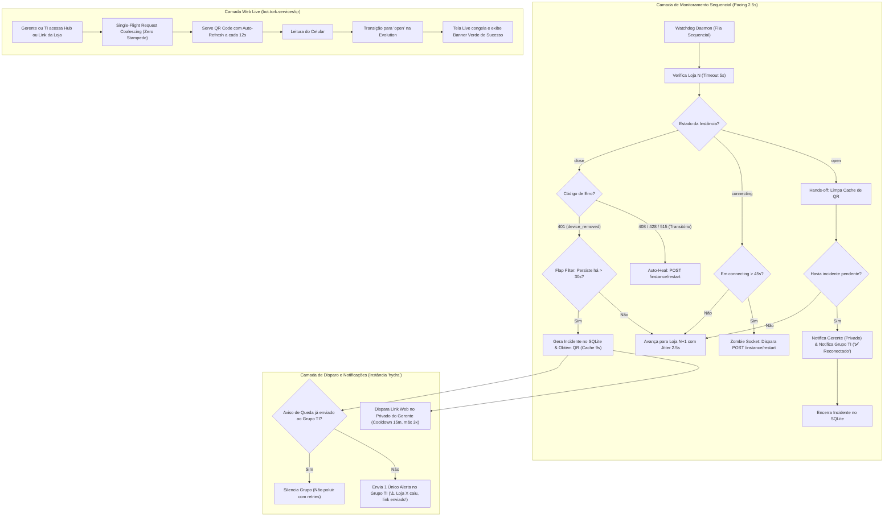

# Design Técnico: Sistema Universal de Reconexão e Watchdog de WhatsApp (10 Lojas)

**ID da Spec:** `051-hydra-rede-universal-qr-watchdog-resilience`  
**Data:** 29/10/2026  
**Status:** ESPECIFICAÇÃO DE DESIGN  
**Target:** Node.js 22 LTS / TypeScript strict / Evolution API v2 / PM2 VPS (`100.126.50.101`)  

---

## 1. Diagrama de Fluxo e Arquitetura de Eventos



---

## 2. Contratos e Interfaces TypeScript

### 2.1. Catálogo e Registro de Lojas (`StoreCatalogRecord`)
```typescript
export interface StoreCatalogRecord {
  slug: string;
  name: string;
  instanceEvolution: string;
  phoneCanonical: string;
  managerName: string;
}

export interface StoreHealthStatus {
  slug: string;
  name: string;
  instanceName: string;
  status: 'open' | 'close' | 'connecting' | 'error';
  phone: string;
  managerName: string;
  disconnectionReason?: number | null;
  lastCheckedAt: string;
}
```

### 2.2. Estado e Controle de Concorrência (`ConcurrencyPolicy`)
```typescript
export interface QrCacheEntry {
  base64: string | null;
  count: number;
  status: 'open' | 'close' | 'connecting';
  updatedAt: number;
  expiresAt: number;
}

export const CONCURRENCY_POLICY = {
  HTTP_TIMEOUT_MS: 5000,
  QR_CACHE_TTL_MS: 9000,
  PACING_BETWEEN_STORES_MS: 2500,
  JITTER_MS: 500,
  ZOMBIE_CONNECTING_TIMEOUT_MS: 45000,
  FLAP_FILTER_SECONDS: 30,
  PRIVATE_ALERT_COOLDOWN_MS: 15 * 60 * 1000, // 15 minutos
  MAX_PRIVATE_ALERTS_PER_INCIDENT: 3,
  OPERATIONAL_WINDOW: {
    start: '07:30',
    end: '19:30'
  }
};
```

---

## 3. Esquema de Banco de Dados SQLite (`hydra_ops.db`)

Para garantir persistência imune a reinicializações de containers e processos PM2:

```sql
-- Controle de Incidentes de Reconexão (Lojas)
CREATE TABLE IF NOT EXISTS hydra_reconnect_incidents (
  loja_slug TEXT PRIMARY KEY,
  instance_name TEXT NOT NULL,
  status TEXT NOT NULL,
  disconnection_code INTEGER,
  incident_started_at DATETIME,
  last_private_alert_sent_at DATETIME,
  private_alerts_count INTEGER NOT NULL DEFAULT 0,
  is_silenced INTEGER NOT NULL DEFAULT 0,
  resolved_at DATETIME,
  updated_at DATETIME DEFAULT CURRENT_TIMESTAMP
);

-- Idempotência de Notificações no Grupo Oficial TI
CREATE TABLE IF NOT EXISTS hydra_group_incident_notifications (
  incident_id TEXT PRIMARY KEY,
  loja_slug TEXT NOT NULL,
  instance_name TEXT NOT NULL,
  drop_alert_sent_at DATETIME,
  resolved_alert_sent_at DATETIME,
  created_at DATETIME DEFAULT CURRENT_TIMESTAMP
);
```

---

## 4. Templates Padronizados de Mensagens

### 4.1. Privado do Gerente (Ao Detectar Queda)
*Remetente:* `hydra`  
*Destinatário:* Número oficial da loja (aparelho a ser conectado)  
```text
⚠️ *[HYDRA ALERTA] RECONEXÃO DE WHATSAPP*

*Unidade:* {{LOJA_NOME}}
*Status:* Desconectado

O WhatsApp desta loja foi desconectado. Para que os relatórios e ordens de serviço continuem sincronizando, reconecte pelo link abaixo:

💻 *Acesse no computador da loja:*
👉 https://bot.tork.services/qr/{{LOJA_SLUG}}

_O link atualiza o QR Code sozinho a cada 12 segundos. Basta apontar a câmera em Aparelhos Conectados._
```

### 4.2. Grupo Oficial TI: Aviso de Queda (Disparo Único por Incidente)
*Remetente:* `hydra`  
*Destinatário:* `120363425738307789@g.us`  
```text
⚠️ *[HYDRA ALERTA] INSTÂNCIA DESCONECTADA*

• *Loja:* {{LOJA_NOME}}
• *Instância:* `{{INSTANCE_NAME}}`
• *Número:* `{{PHONE}}`
• *Horário da Queda:* {{HORA_QUEDA}}

📲 *Ação Automática:*
O link de reconexão já foi enviado no privado do gerente/responsável.
Aguardando leitura do QR Code.

🔗 *Hub de Acompanhamento:*
https://bot.tork.services/qr
```

### 4.3. Grupo Oficial TI: Confirmação de Reconexão
*Remetente:* `hydra`  
*Destinatário:* `120363425738307789@g.us`  
```text
✅ *[HYDRA RECONEXÃO] INSTÂNCIA RESTABELECIDA*

• *Loja:* {{LOJA_NOME}}
• *Instância:* `{{INSTANCE_NAME}}`
• *Horário de Retorno:* {{HORA_RETORNO}}
• *Tempo Fora do Ar:* {{TEMPO_DURACAO}}

🎉 O WhatsApp da unidade foi restabelecido e está 100% operacional.
```

### 4.4. Grupo Oficial TI: Resumo Matinal das Instâncias (07:30 AM)
*Remetente:* `hydra`  
*Destinatário:* `120363425738307789@g.us`  

**Se 10/10 Online:**
```text
📊 *[HYDRA] SAÚDE DAS INSTÂNCIAS (07:30)*

🟢 *Todas as 10 lojas conectadas com sucesso!*

1. Planalto: Online ✅
2. Piraporinha: Online ✅
3. Mauá: Online ✅
4. Kennedy: Online ✅
5. Rudge Ramos: Online ✅
6. Jorge Beretta: Online ✅
7. Dom Pedro I: Online ✅
8. Jabaquara: Online ✅
9. Santo André: Online ✅
10. Rei do Módulo: Online ✅

_Rede pronta para as conciliações e alertas do dia._
```

**Se houver pendência:**
```text
📊 *[HYDRA] SAÚDE DAS INSTÂNCIAS (07:30)*

⚠️ *Atenção: {{CONECTADAS}}/10 lojas conectadas.*

{{LISTA_STATUS_LOJAS}}

🔗 *Hub de Reconexão da Rede:*
https://bot.tork.services/qr
```

---

## 5. Estrutura de Módulos e Responsabilidades

```
projects/hydra-rede/src/reconnect_system/
├── config.js                 # Constantes, catálogo das 10 lojas e políticas de pacing
├── evolution_client.js       # Cliente HTTP com AbortSignal(5000), single-flight e cache 9s
├── incident_repository.js    # Consultas SQLite (hydra_reconnect_incidents e group notifications)
├── whatsapp_notifier.js      # Envio privado e em grupo com trava estrita de remetente 'hydra'
├── web_server.js             # Servidor HTTP porta 3344 (Hub /qr, telas individuais e APIs)
├── morning_summary_cron.js   # Job diário das 07:30 AM para o grupo
└── watchdog_daemon.js        # Loop sequencial pacing 2.5s monitorando as 10 lojas
```
