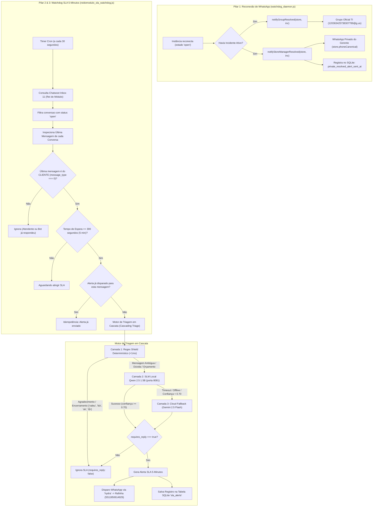

# Design Técnico: Confirmação Privada de Reconexão, Watchdog SLA 5-Min Rei do Módulo e Triagem por LLM Local

**ID da Spec:** `052-reidomodulo-sla-triage-local-llm`  
**Data:** 29/10/2026  
**Status:** ESPECIFICAÇÃO DE DESIGN  
**Target:** Node.js 22 LTS / TypeScript strict / Evolution API v2 / Chatwoot v3 / `llama-server` (C++ AVX2) / PM2 VPS (`100.126.50.101`)  

---

## 1. Diagrama de Arquitetura e Fluxo de Dados



---

## 2. Pilar 1: Notificação Privada de Reconexão ao Gerente

### 2.1. Assinatura e Contrato em `whatsapp_notifier.js`
```javascript
/**
 * Alerta de Sucesso / Reconexão no Privado do Gerente da Loja
 * Remetente estritamente validado: 'hydra'
 */
async function notifyStoreManagerResolved(store, incident) {
  assertSenderIsHydra(); // Trava de segurança incondicional

  const incidentId = `${store.slug}_${incident.incident_started_at || new Date().toISOString().slice(0, 10)}`;
  if (!shouldSendPrivateResolvedAlert(incidentId)) {
    return { skipped: true, reason: 'ALREADY_SENT_TO_STORE_MANAGER' };
  }

  const horaRetorno = new Date().toLocaleTimeString('pt-BR', { hour: '2-digit', minute: '2-digit' });
  let duracaoStr = 'alguns minutos';
  if (incident.incident_started_at) {
    const diffMs = Date.now() - new Date(incident.incident_started_at).getTime();
    const mins = Math.max(1, Math.round(diffMs / 60000));
    duracaoStr = `${mins} min`;
  }

  const text = [
    '✅ *[HYDRA INFORMA] WHATSAPP RECONECTADO COM SUCESSO!*',
    '',
    `Olá, *${store.managerName}*!`,
    '',
    `O WhatsApp da sua loja (*${store.name}*) foi reconectado e já está 100% operacional no sistema.`,
    '',
    `• *Instância:* \`${store.instanceEvolution}\``,
    `• *Número:* \`${store.phoneFormatted}\``,
    `• *Horário de Retorno:* ${horaRetorno}`,
    `• *Tempo Fora do Ar:* ${duracaoStr}`,
    '',
    'As ordens de serviço, relatórios e conversas com clientes continuam sincronizando normalmente. Obrigado pela rápida conexão!'
  ].join('\n');

  const res = await sendTextMessage(store.phoneCanonical, text);
  if (res.ok) {
    recordPrivateResolvedAlertSent(incidentId, store.slug);
  }
  return res;
}
```

### 2.2. Integração no `watchdog_daemon.js`
```javascript
  // No processStore(store):
  if (state === 'open') {
    flapState.delete(store.slug);
    const activeInc = getActiveIncident(store.slug);
    if (activeInc) {
      console.log(`[${ts}] 🎉 [RECONECTADO] Loja ${store.name} restabeleceu conexão!`);
      // Disparo em grupo (TI)
      await notifyGroupResolved(store, activeInc);
      // Disparo no privado da loja/gerente
      await notifyStoreManagerResolved(store, activeInc);
      
      resolveIncident(store.slug);
      invalidateQrCache(store.instanceEvolution);
    }
    return;
  }
```

---

## 3. Pilar 2: Motor de SLA 5-Minutos Rei do Módulo

### 3.1. Arquitetura de Gateway e Redis (`/home/operacional/watchdog/`)
O módulo de SLA do Rei do Módulo (`lib/reidomodulo_sla.js`) integra-se com a esteira já operante do Chatwoot na VPS:

1. **Ajuste em `gateway.js`:**
   - Remoção de `11` da constante `IGNORED_INBOXES = [14, 15]`.
   - Manutenção mandatória de `11` em `PROCEDURAL_AUDIT_EXCLUDED_INBOXES = [1, 11, 14, 15, 16]`. A Inbox 11 **nunca** sofrerá auditoria procedural de oficina física (sem exigência de checklist de elevador ou gravação de vídeo).
   - Acoplamento dos ganchos de mensageria:
     - `trackIncomingReiDoModuloMessage(event)` ao receber mensagem de cliente (`message_type === 0`).
     - `trackOutgoingReiDoModuloMessage(event)` ao receber mensagem do Rafinha (`message_type === 1`).

2. **Topologia de Chaves no Redis:**
   - `reidomodulo_sla:conv:<convId>` (Hash): armazena `waitingSince`, `lastMsgId`, `senderPhone`, `senderName`, `contentExcerpt`, `hasAudio`, `hasImage`. TTL de 7200s (2h).
   - `reidomodulo_sla:pending` (Sorted Set): conversas com pendência aguardando resposta humana. `Score = waitingSince + 300` (timestamp de vencimento do SLA de 5 minutos).
   - `reidomodulo_sla:alerted:<convId>` (String/Flag): trava de cooldown de 45 minutos (`EX 2700`) para impedir rajada de alertas caso o atendente esteja em teste delicado de bancada.

3. **Varredura no Loop do `worker.js` (a cada 15-20 segundos):**
   - Executa `zrangebyscore reidomodulo_sla:pending -inf <now>`.
   - Para cada conversa vencida:
     - Se `reidomodulo_sla:alerted:<convId>` existir, descarta.
     - Confirma se o status da conversa permanece `open` e não é grupo de WhatsApp (`group_type === 0`).
     - Despacha o alerta formatado via Evolution API (`hydra`).
     - Ativa o cooldown no Redis e registra o histórico no SQLite.

### 3.2. Regra de Elegibilidade e Tratamento de Mídias
```typescript
interface SlaCheckResult {
  isEligible: boolean;
  conversationId: number;
  customerPhone: string;
  customerName: string;
  lastMessageId: number;
  lastMessageContent: string;
  messageTimestamp: number; // Unix Epoch ms
  elapsedSeconds: number;
  hasAudio: boolean;
  hasImage: boolean;
  skipReason?: string;
}

function evaluateConversationSla(conversation: ChatwootConversation, messages: ChatwootMessage[]): SlaCheckResult {
  // 1. Ignorar grupos de WhatsApp (@g.us ou group_type === 1)
  if (conversation.meta?.sender?.group_type === 1 || conversation.meta?.sender?.name?.includes('(GROUP)')) {
    return { isEligible: false, skipReason: 'WHATSAPP_GROUP' };
  }

  if (conversation.status !== 'open') {
    return { isEligible: false, skipReason: 'CONVERSATION_NOT_OPEN' };
  }

  const realMessages = messages.filter(m => m.message_type === 0 || m.message_type === 1);
  if (realMessages.length === 0) {
    return { isEligible: false, skipReason: 'NO_MESSAGES' };
  }

  const lastMsg = realMessages[realMessages.length - 1];

  // Se a última mensagem for do atendente (1), o cliente não está aguardando
  if (lastMsg.message_type !== 0) {
    return { isEligible: false, skipReason: 'LAST_MESSAGE_WAS_ATTENDANT' };
  }

  // Detecção de Áudio ou Imagem
  const attachments = lastMsg.attachments || [];
  const hasAudio = attachments.some(a => a.file_type === 'audio' || a.data_url?.includes('.oga') || a.data_url?.includes('.mp3'));
  const hasImage = attachments.some(a => a.file_type === 'image' || a.data_url?.includes('.jpg') || a.data_url?.includes('.png'));

  const msgTimeMs = (typeof lastMsg.created_at === 'number' ? lastMsg.created_at : Math.floor(new Date(lastMsg.created_at).getTime() / 1000)) * 1000;
  const nowMs = Date.now();
  const elapsedSec = Math.floor((nowMs - msgTimeMs) / 1000);

  if (elapsedSec < 300) { // Menos de 5 minutos
    return { isEligible: false, skipReason: 'UNDER_5_MINUTES_THRESHOLD', elapsedSeconds: elapsedSec };
  }

  let excerpt = lastMsg.content || '';
  if (!excerpt && hasAudio) excerpt = '🎙️ [Mensagem de Áudio enviada pelo cliente]';
  if (!excerpt && hasImage) excerpt = '📷 [Foto de etiqueta/módulo enviada pelo cliente]';

  return {
    isEligible: true,
    conversationId: conversation.id,
    customerPhone: conversation.meta?.sender?.phone_number || '',
    customerName: conversation.meta?.sender?.name || 'Cliente',
    lastMessageId: lastMsg.id,
    lastMessageContent: excerpt,
    messageTimestamp: msgTimeMs,
    elapsedSeconds: elapsedSec,
    hasAudio,
    hasImage
  };
}
```

### 3.3. Tabela SQLite de Rastreamento de Alertas de SLA (`sla_alerts.db`)
```sql
CREATE TABLE IF NOT EXISTS hydra_reidomodulo_sla_alerts (
  id INTEGER PRIMARY KEY AUTOINCREMENT,
  conversation_id INTEGER NOT NULL,
  last_message_id INTEGER NOT NULL,
  customer_phone TEXT NOT NULL,
  customer_name TEXT,
  last_message_text TEXT,
  elapsed_seconds INTEGER NOT NULL,
  triage_method TEXT NOT NULL, -- 'regex', 'local_slm', 'cloud_fallback'
  triage_category TEXT NOT NULL,
  triage_reason TEXT,
  alert_sent_at DATETIME NOT NULL DEFAULT CURRENT_TIMESTAMP,
  resolved_at DATETIME,
  UNIQUE(conversation_id, last_message_id)
);
```

---

## 4. Pilar 3: Motor de Triagem em Cascata & LLM Local

### 4.1. Camada 1: Heurística Determinística (Regex Shield)
Antes de invocar qualquer modelo de linguagem, a mensagem passa pela validação determinística de curtíssima latência (<1ms):
```javascript
const CLOSING_REGEX = /^(ok|blz|beleza|valeu|vlw|show|obrigado|obg|brigado|brigada|show de bola|combinado|fechou|fechado|tks|thanks|tmj|tamo junto|perfeito|tranquilo|bom dia|boa tarde|boa noite|ola|olá|👍|🙏|🤝|👌|🚗|🏍️|👋)+[\s!.]*$/i;

function evaluateRegexShield(text) {
  const trimmed = text.trim();
  
  // 1. Mensagens curtíssimas de encerramento ou agradecimento
  if (CLOSING_REGEX.test(trimmed)) {
    return {
      handled: true,
      requires_reply: false,
      category: 'ENCERRAMENTO_OU_AGRADECIMENTO',
      confidence: 0.99,
      reason: 'Mensagem trivial de fechamento ou saudação sem pergunta.'
    };
  }

  // 2. Apenas emojis sem texto
  if (/^[\p{Emoji}\s]+$/u.test(trimmed) && trimmed.length <= 8) {
    return {
      handled: true,
      requires_reply: false,
      category: 'EMOJI_REACAO',
      confidence: 0.99,
      reason: 'Reação com emoji sem necessidade de resposta técnica.'
    };
  }

  // 3. Perguntas diretas explícitas (acelerador)
  const isDirectQuestion = trimmed.includes('?') && (
    /quanto|qual|como|onde|quando|consegue|tem|previsão|orçamento|valor|conserto|reparo|testou/i.test(trimmed)
  );
  if (isDirectQuestion && trimmed.length > 15) {
    return {
      handled: true,
      requires_reply: true,
      category: 'PERGUNTA_TECNICA_OU_ORCAMENTO',
      confidence: 0.95,
      reason: 'Pergunta direta e explícita identificada com palavras-chave de serviço.'
    };
  }

  // Não tratada pelo regex -> enviar para Camada 2 (SLM Local)
  return { handled: false };
}
```

### 4.2. Camada 2: SLM Local Qwen 2.5 1.5B via `llama-server`

#### 4.2.1. Configuração do Serviço no Linux VPS
- **Binário:** `/usr/local/bin/llama-server` (compilado nativamente com `make -j8 LLAMA_AVX2=1`).
- **Modelo:** `/opt/models/qwen2.5-1.5b-instruct-q4_k_m.gguf` (~980 MB).
- **Parâmetros de Execução:**
  ```bash
  /usr/local/bin/llama-server \
    -m /opt/models/qwen2.5-1.5b-instruct-q4_k_m.gguf \
    --host 127.0.0.1 \
    --port 8081 \
    -c 2048 \
    -t 4 \
    --mlock \
    --cont-batching \
    --log-disable
  ```
- **Alocação de Recursos:**
  - Threads: 4 vCPUs dedicadas durante inferência (restam 4 vCPUs para o ecossistema Node.js / Playwright / Redis).
  - Memória: 1.2 GB travados em RAM física via `mlock` (sem paging no swap).
  - Latência típica: 600 a 850 milissegundos.

#### 4.2.2. Prompt do Sistema Calibrado para Atendimento Rei do Módulo
```text
Você é o classificador de atendimento técnico da oficina especializada 'Rei do Módulo' (conserto de módulos de injeção eletrônica ECU, câmbio automatizado I-Motion/Dualogic/Powershift, imobilizador, decodificação e testes em bancada).

Seu único objetivo é determinar se a última mensagem do cliente exige uma resposta humana urgente do atendente 'Rafinha'.

Regras de Classificação:
1. 'requires_reply': true quando:
   - O cliente pergunta status de serviço, orçamento, prazo de bancada ou viabilidade técnica.
   - O cliente relata defeito no veículo ou pede endereço/horário para levar o módulo.
   - O cliente faz uma cobrança ('e aí, ficou pronto?', 'conseguiu olhar?').
2. 'requires_reply': false quando:
   - O cliente apenas agradece ('valeu', 'obrigado', 'show', 'blz', '👍').
   - O cliente confirma um combinado prévio sem nova dúvida ('fechou', 'vou levar amanhã').
   - O cliente enviou apenas um comprovante de pagamento após o Rafinha ter pedido.

Responda ESTRITAMENTE em formato JSON com o schema:
{
  "requires_reply": boolean,
  "category": "ORCAMENTO" | "STATUS_BANCADA" | "DUVIDA_TECNICA" | "AGRADECIMENTO_FINAL" | "OUTRO",
  "confidence": number (entre 0.0 e 1.0),
  "reason": "breve justificativa em 1 frase"
}
```

### 4.3. Camada 3: Cloud Fallback (Gemini 2.5 Flash)
- Invocado via SDK oficial com timeout estrito de 2.000ms caso `http://127.0.0.1:8081` retorne `ECONNREFUSED`, `ETIMEDOUT` ou `confidence < 0.70`.
- Garante resiliência incondicional sem interromper o fluxo de alertas se a máquina estiver passando por manutenção de pacotes.

---

## 5. Formato Final do Alerta de WhatsApp

```text
🚨 *[REI DO MÓDULO] ALERTA DE SLA (5 MIN)*

⚠️ *Cliente aguardando resposta do Rafinha há mais de 5 minutos!*

• *Cliente:* João da Oficina Central
• *Telefone:* `+55 11 98765-4321`
• *Horário da Mensagem:* 15:42:10
• *Tempo de Espera:* ⏱️ 5 min

💬 *Última Mensagem do Cliente:*
"Boa tarde Rafinha, o cliente tá me cobrando o módulo do Punto Dualogic. Conseguiu passar no simulador?"

🎯 *Triagem:* Status de Bancada (Confiança: 98% via SLM Local)

📲 *Clique para Responder no WhatsApp:*
👉 https://wa.me/5511987654321

💻 *Abrir no Chatwoot:*
👉 https://chat.tork.services/app/accounts/1/conversations/3842
```

---

## 6. Governança e Regras Invioláveis

1. ⛔ **Trava Rígida de Remetente:** Todo e qualquer envio de WhatsApp DEVE utilizar como remetente a instância oficial `hydra` (`5511917837618`). É terminantemente proibido enviar alertas usando a instância de qualquer loja.
2. ⏱️ **Janela de Operação do SLA:**
   - Segunda a Sexta: 08:00 às 18:30 BRT.
   - Sábados: 08:00 às 13:00 BRT.
   - Fora desse horário: alertas de SLA permanecem pausados e são enfileirados para reavaliação na abertura do próximo expediente.
3. 🔒 **Anti-Spam / Idempotência:** Apenas 1 alerta de SLA por turno não respondido do cliente (`UNIQUE(conversation_id, last_message_id)`).
