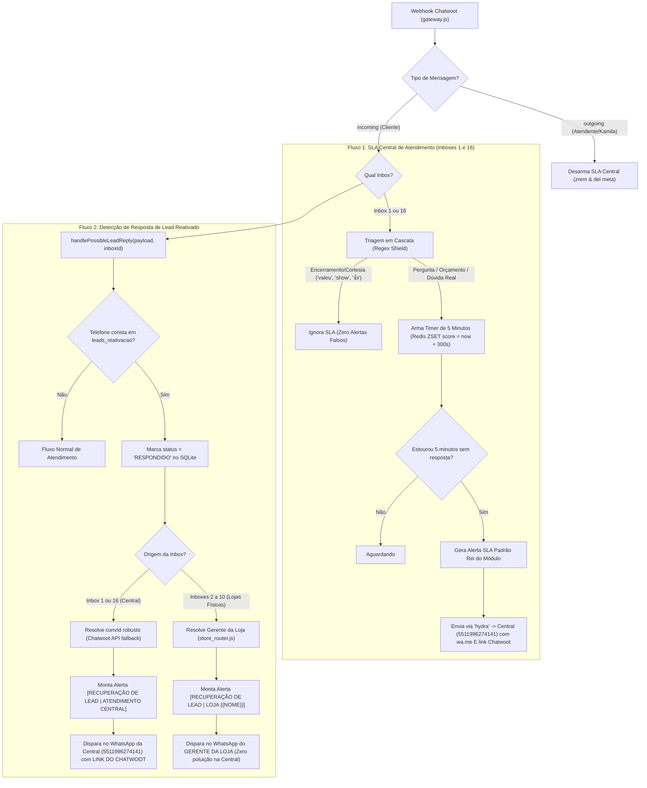

# Design Técnico: Unificação do SLA da Central (Padrão Rei do Módulo), Isolamento de Lojas e Links Chatwoot para Leads

**ID da Spec:** `053-central-sla-lead-recovery-routing`  
**Data:** 29/10/2026  
**Status:** ESPECIFICAÇÃO DE DESIGN  
**Target:** Node.js 22 LTS / Fastify / Redis / SQLite / Chatwoot API v3 / Evolution API v2 (`100.126.50.101`)  

---

## 1. Diagrama de Fluxo e Roteamento de Mensagens



---

## 2. Especificação do Pilar 1: Modernização do SLA da Central (`central_sla.js`)

### 2.1. Constantes e Parâmetros Operacionais
```javascript
const CENTRAL_INBOX_IDS = [1, 16]; // 1: 'atendimento', 16: 'central atendimento'
const CENTRAL_SLA_SECONDS = 300; // Reduzido de 600s para 300s (5 minutos, igual ao Rei do Módulo)
const CENTRAL_ATENDIMENTO_TARGETS = (process.env.CENTRAL_ATENDIMENTO_PHONE || '5511996274141,5511917698769').split(',');
const COOLDOWN_TTL_SECONDS = 2700; // 45 minutos (anti-flood)
const SENDER_INSTANCE = 'hydra'; // Remetente exclusivo obrigatório
```

### 2.2. Integração com a Triagem em Cascata (Regex Shield)
No processamento de mensagens recebidas (`trackIncomingCentralMessage`):
```javascript
const { evaluateRegexShield, isOnlyClosings } = require('./triage_regex_shield');

// Se o cliente enviar apenas encerramento, agradecimento ou emoji:
if (!hasAudio && !hasImage && isOnlyClosings(content)) {
  await redis.zrem('central_sla:pending', String(convId));
  await redis.del(`central_sla:conv:${convId}`);
  console.log(`[CENTRAL_SLA] Encerramento/cortesia de ${clientName} ("${content}"). SLA cancelado.`);
  return { handled: true, action: 'closing_ignored' };
}
```

### 2.3. Formato Unificado do Alerta de WhatsApp
```javascript
function buildCentralSlaNotification({ clientName, clientPhone, waitMinutes, lastMessageText, convId, inboxLabel, messageTime }) {
  const cleanPhone = clientPhone ? String(clientPhone).replace(/\D/g, '') : '';
  const waLink = cleanPhone ? `https://wa.me/${cleanPhone}` : 'N/D';
  const chatwootLink = `https://chat.tork.services/app/accounts/1/conversations/${convId}`;
  const safeMinutes = Math.max(5, waitMinutes || 5);
  const horaMsg = messageTime || new Date().toLocaleTimeString('pt-BR', { hour: '2-digit', minute: '2-digit', second: '2-digit' });

  return [
    `🚨 *[ATENDIMENTO CENTRAL] ALERTA DE SLA (5 MIN)*`,
    '',
    `⚠️ *Cliente aguardando resposta da Kamila / Central há ${safeMinutes} minutos!*`,
    '',
    `• *Canal:* ${inboxLabel || 'Atendimento Central'}`,
    `• *Cliente:* ${clientName || 'Cliente'}`,
    `• *Telefone:* \`${clientPhone || 'Sem número'}\``,
    `• *Horário da Mensagem:* ${horaMsg}`,
    `• *Tempo de Espera:* ⏱️ ${safeMinutes} min`,
    '',
    '💬 *Última Mensagem do Cliente:*',
    `"${(lastMessageText || '').trim() || '[Sem texto / Mídia]'}"`,
    '',
    '🎯 *Classificação:* Dúvida / Orçamento (Triagem Automática)',
    '',
    '📲 *Clique para Responder no WhatsApp:*',
    `👉 ${waLink}`,
    '',
    '💻 *Abrir no Chatwoot:*',
    `👉 ${chatwootLink}`
  ].join('\n');
}
```

---

## 3. Especificação do Pilar 2: Isolamento de Escopo e Roteamento de Leads (`lead_reply_notifier.js`)

### 3.1. Roteamento por Origem de Caixa de Entrada
Atualmente, qualquer resposta de lead dispara para `CENTRAL_ATENDIMENTO_PHONE`. Com a refatoração:

```javascript
const { getStoreInfo } = require('./store_router');

async function routeLeadReplyNotification(lead, replyContent, convId, inboxId) {
  const isCentralInbox = (inboxId === 1 || inboxId === 16);

  if (isCentralInbox) {
    // 1. Lead respondendo na Central de Atendimento -> Envia para a Central
    const alertText = buildCentralLeadAlert({
      firstName: lead.first_name,
      vehicleModel: lead.vehicle_model,
      plate: lead.plate,
      monthName: lead.month_name,
      phoneE164: lead.phone_e164,
      replyText: replyContent,
      convId
    });
    return await sendWhatsAppAlert(CENTRAL_ATENDIMENTO_PHONE, alertText, { convId });
  }

  // 2. Lead respondendo em Loja Física (ex: Mauá, Kennedy, Rudge)
  const store = getStoreInfo(inboxId);
  if (store && store.phone) {
    const storeAlertText = buildStoreLeadAlert({
      storeName: store.name,
      managerName: store.manager,
      firstName: lead.first_name,
      vehicleModel: lead.vehicle_model,
      plate: lead.plate,
      phoneE164: lead.phone_e164,
      replyText: replyContent,
      convId
    });
    console.log(`[LEAD_NOTIFIER] 📍 Lead de ${lead.first_name} pertence à ${store.name}. Roteando para gerente ${store.manager} (${store.phone})...`);
    return await sendWhatsAppAlert(store.phone, storeAlertText, { convId });
  }

  // Fallback seguro: se a loja não tiver telefone cadastrado, avisa Central com aviso explícito de loja externa
  const fallbackText = buildCrossStoreLeadAlert({
    storeName: store?.name || `Loja #${inboxId}`,
    firstName: lead.first_name,
    vehicleModel: lead.vehicle_model,
    plate: lead.plate,
    phoneE164: lead.phone_e164,
    replyText: replyContent,
    convId
  });
  return await sendWhatsAppAlert(CENTRAL_ATENDIMENTO_PHONE, fallbackText, { convId });
}
```

---

## 4. Especificação do Pilar 3: Resolução Blindada do Link Chatwoot

### 4.1. Algoritmo de Extração de ID de Conversa
```javascript
/**
 * Extrai o ID da conversa de forma resiliente em múltiplos formatos de payload
 */
function resolveChatwootConversationId(payload) {
  if (!payload || typeof payload !== 'object') return null;

  // 1. Estrutura padrão de eventos Chatwoot (payload.conversation.id)
  if (payload.conversation && payload.conversation.id) {
    return Number(payload.conversation.id);
  }

  // 2. Estrutura plana (payload.conversation_id)
  if (payload.conversation_id) {
    return Number(payload.conversation_id);
  }

  // 3. Estrutura aninhada em meta (payload.meta.conversation.id)
  if (payload.meta && payload.meta.conversation && payload.meta.conversation.id) {
    return Number(payload.meta.conversation.id);
  }

  // 4. Estrutura de contact_inbox
  if (payload.contact_inbox && payload.contact_inbox.source_id) {
    const sourceId = Number(payload.contact_inbox.source_id);
    if (!isNaN(sourceId)) return sourceId;
  }

  return null;
}
```

### 4.2. Fallback via API Chatwoot (Zero Links `undefined`)
Caso o `convId` não esteja presente no payload, o sistema consulta a API antes de montar o texto:
```javascript
async function fetchActiveConversationId(phoneDigits) {
  try {
    const res = await axios.get(`${CHATWOOT_BASE_URL}/api/v1/accounts/1/conversations?q=${phoneDigits}`, {
      headers: { 'api_access_token': CHATWOOT_TOKEN },
      timeout: 3000
    });
    const convs = res.data?.data?.payload || [];
    if (convs.length > 0) {
      return convs[0].id;
    }
  } catch (err) {
    console.warn(`[LEAD_NOTIFIER] Falha ao consultar ID da conversa via API:`, err.message);
  }
  return null;
}
```

### 4.3. Template de Recuperação da Central
```javascript
function buildCentralLeadAlert({ firstName, vehicleModel, plate, monthName, phoneE164, replyText, convId }) {
  const cleanPhone = String(phoneE164).replace(/\D/g, '');
  const convUrl = convId ? `https://chat.tork.services/app/accounts/1/conversations/${convId}` : 'https://chat.tork.services';

  return [
    `🎯 *[RECUPERAÇÃO DE LEAD | INSTÂNCIA ATENDIMENTO]*`,
    '',
    `🎉 *Lead reativado respondeu no WhatsApp da Central!*`,
    '',
    `• *Cliente:* ${firstName}`,
    `• *Veículo:* ${vehicleModel || 'Carro'} | *Placa:* ${plate || 'N/D'}`,
    `• *Telefone:* \`+${cleanPhone}\``,
    `• *Última Passagem:* ${monthName || 'recentemente'}`,
    '',
    '💬 *Mensagem do Lead:*',
    `"${(replyText || '').trim() || '[Mídia enviada]'}"`,
    '',
    '💻 *Abrir no Chatwoot (Atendimento Imediato):*',
    `👉 ${convUrl}`,
    '',
    '📲 *Abrir no WhatsApp:*',
    `👉 https://wa.me/${cleanPhone}`
  ].join('\n');
}
```

---

## 5. Governança e Segurança

1. ⛔ **Remetente Exclusivo:** Todo e qualquer envio deve usar estritamente a instância oficial `hydra` (`5511917837618`).
2. ⏱️ **Janela de Operação da Central:**
   - Segunda a Sexta: 08:00 às 18:00 BRT.
   - Sábado: 08:00 às 13:00 BRT.
   - Fora desse expediente: o cronômetro do SLA é congelado até a reabertura.
3. 🔒 **Idempotência:** Cooldown de 45 minutos no Redis (`central_sla:alerted:<convId>`) e no SQLite (`leads_reativacao.central_notified = 1`).
