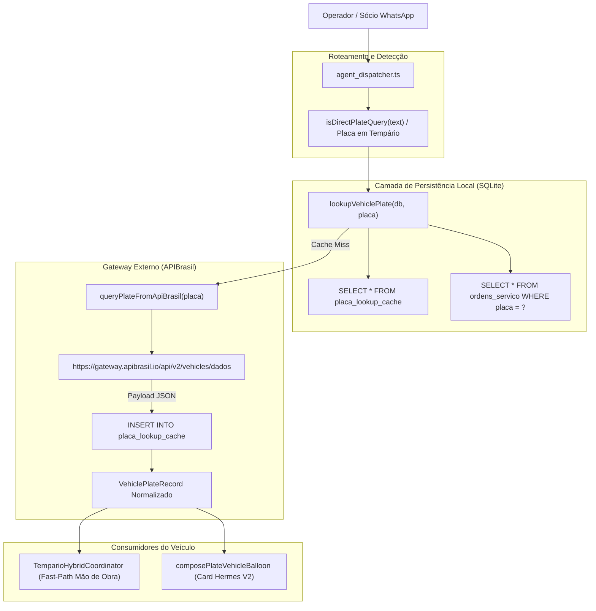

# Design Técnico — Spec 064: Consulta Veicular Direta por Placa (APIBrasil & Cache SQLite Nativo)

## 1. Visão Geral da Arquitetura



---

## 2. Contratos TypeScript Estritos (Zero `any`)

### Arquivo: `src/hydra-sync/types/plate_lookup_contract.ts`

```typescript
export interface ApiBrasilPlateResponse {
  readonly error?: boolean;
  readonly message?: string;
  readonly codigo?: number;
  readonly dados?: {
    readonly placa?: string;
    readonly marca?: string;
    readonly modelo?: string;
    readonly submodelo?: string;
    readonly versao?: string;
    readonly anoFabricacao?: number | string;
    readonly anoModelo?: number | string;
    readonly cor?: string;
    readonly combustivel?: string;
    readonly motor?: string;
    readonly cilindrada?: number | string;
    readonly potencia?: number | string;
    readonly chassi?: string;
    readonly municipio?: string;
    readonly uf?: string;
    readonly segmento?: string;
    readonly situacao?: string;
    readonly extra?: Record<string, unknown>;
  };
}

export interface VehiclePlateRecord {
  readonly placaLimpa: string;       // ex: 'FOE6I25'
  readonly placaFormatada: string;   // ex: 'FOE-6I25'
  readonly marca: string;            // ex: 'VOLKSWAGEN'
  readonly modelo: string;           // ex: 'GOLF'
  readonly modeloCompleto: string;   // ex: 'Volkswagen Golf 1.4 TSI'
  readonly versao?: string;          // ex: 'Comfortline 1.4 TSI'
  readonly anoFabricacao?: number;   // ex: 2014
  readonly anoModelo?: number;       // ex: 2015
  readonly cor?: string;             // ex: 'Branca'
  readonly combustivel?: string;     // ex: 'Gasolina'
  readonly motor?: string;           // ex: 'EA211 1.4'
  readonly cilindrada?: number;      // ex: 1395
  readonly potencia?: number;        // ex: 140
  readonly chassiMascarado?: string; // ex: '9BW***123'
  readonly municipio?: string;       // ex: 'São Paulo'
  readonly uf?: string;              // ex: 'SP'
  readonly segmento?: string;        // ex: 'AUTO'
  readonly situacao?: string;        // ex: 'CIRCULACAO'
  readonly origemDados: 'APIBRASIL' | 'ORDENS_SERVICO_REDE' | 'MANUAL';
  readonly rawPayloadJson: string;
  readonly createdAt: string;
}

export interface PlateLookupOptions {
  readonly timeoutMs?: number;
  readonly bearerToken?: string;
  readonly deviceToken?: string;
  readonly forceRefresh?: boolean;
}
```

---

## 3. Módulos e Componentes

### 3.1. `src/hydra-sync/apibrasil_plate_client.ts`
Implementa:
- `ensurePlateLookupTable(db: Database.Database): void`: Cria a tabela e índices em SQLite WAL.
- `normalizePlate(rawText: string): { placaLimpa: string; placaFormatada: string } | null`: Valida se é placa cinza (`AAA0000`) ou Mercosul (`AAA0A00`).
- `queryPlateFromApiBrasil(placa: string, options?: PlateLookupOptions): Promise<VehiclePlateRecord | null>`:
  Dispara `fetch` contra `https://gateway.apibrasil.io/api/v2/vehicles/dados` com headers:
  - `Content-Type: application/json`
  - `Authorization: Bearer <process.env.APIBRASIL_BEARER_TOKEN>`
  - `DeviceToken: <process.env.APIBRASIL_DEVICE_TOKEN>`
- `lookupVehiclePlate(db: Database.Database, placa: string, options?: PlateLookupOptions): Promise<VehiclePlateRecord | null>`:
  Mecanismo Cache-First:
  1. Verifica se existe em `placa_lookup_cache`. Se existir, retorna.
  2. Verifica se existe em `ordens_servico`. Se existir, converte e armazena no cache.
  3. Se ausente, chama `queryPlateFromApiBrasil` e persiste no SQLite em transação atômica.

### 3.2. Integração no `tempario_hybrid_coordinator.ts`
Atualização da função `resolveVehicleFromPlateOrOs`:
- Quando `placa` for fornecida e não houver OS no banco da loja, chama `lookupVehiclePlate`.
- Transforma `record.modeloCompleto` em `veiculo` e extrai `ano` e `motor`, permitindo que qualquer carro consultado por placa entre no Fast-Path do tempário.

### 3.3. Integração no `intent_rewriter.ts` e `agent_dispatcher.ts`
- Função `isDirectPlateQuery(text: string)`:
  Detecta padrões como:
  - `^([A-Z]{3}-?[0-9][A-Z0-9][0-9]{2})$` (mensagem contendo apenas a placa)
  - `\b(consulta|consultar|puxar|qual o carro|qual carro|que carro|dados da placa|ficha da placa)\b.*\b([A-Z]{3}-?[0-9][A-Z0-9][0-9]{2})\b`
- No `agent_dispatcher.ts`:
  Interceptor prioritário no início do ciclo (junto a comandos). Quando o usuário envia uma consulta de placa, o bot devolve o balão de cadastro veicular formatado.

### 3.4. Formatação Visual em `balloon_composer.ts`
Implementa `composePlateVehicleBalloon(record: VehiclePlateRecord): string[]`:
Card Hermes V2 limpo:
```text
*HYDRA | Consulta Veicular por Placa*

> *Volkswagen Golf Comfortline 1.4 TSI (2014/2015)*
- *Placa:* FOE-6I25
- *Cor:* Branca · *Combustível:* Gasolina
- *Município:* São Paulo / SP
- *Motor:* 1.4 TSI (140 cv) · *Cilindradas:* 1395 cc
- *Situação cadastral:* Em circulação (Regular)

_Dados obtidos via Base Nacional de Registro Veicular._
```

---

## 4. Variáveis de Ambiente Necessárias

Em `.env` (ou injetadas no PM2 da VPS):
- `APIBRASIL_BEARER_TOKEN`: JWT da conta do usuário na APIBrasil.
- `APIBRASIL_DEVICE_TOKEN`: Token do dispositivo gerado para a API de Placas na APIBrasil.
- `APIBRASIL_GATEWAY_URL`: URL base (padrão: `https://gateway.apibrasil.io`).
