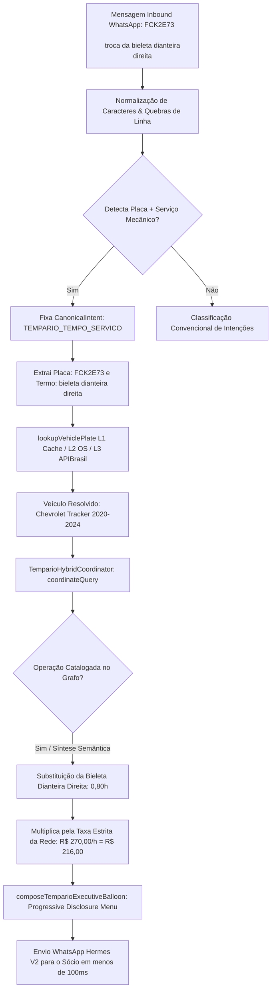

# Design Técnico — Spec 065: Tempário Técnico por Placa, Expansão do Vocabulário de Suspensão e Roteamento Multiline

## 1. Arquitetura e Fluxo de Execução



---

## 2. Expansão do Vocabulário Técnico Automotivo

### 2.1. Novo Regex Unificado de Componentes Mecânicos (`mechanicalComponentPattern`)
Em `src/hydra-sync/intent_rewriter.ts`:
```typescript
const mechanicalComponentPattern = /\b(farol|radiador|arrefecimento|correia|dentada|banhada|bomba|d'?agua|embreagem|retentor|volante|pastilha|disco|amortecedor|coxim|batente|bucha|vela|bobina|cabo\s*de\s*vela|bico|injecao|turbina|alternador|oleo|filtro|suspensao|freio|fluido\s*de\s*freio|cambio|parachoque|para-choque|bieleta|bieletas|barra\s*estabilizadora|estabilizadora|pivo|pivos|terminal|terminais|braco\s*axial|axial|bandeja|bandejas|balanca|balancas|braco\s*oscilante|homocinetica|junta\s*homocinetica|semieixo|semi-eixo|cubo|rolamento|escapamento|valvula|termostatica|termostato|reservatorio|eletroventilador|ventoinha|alinhamento|geometria|balanceamento|cambagem|sangria)\b/i;
```

### 2.2. Expansão de `recognizedComponents` em `extractAdaptiveTemparioQuery`
Mapeamento ontológico de componentes e sinônimos operacionais:
- `bieleta` / `bieletas` -> `bieleta`
- `barra estabilizadora` / `estabilizadora` -> `barra_estabilizadora`
- `pivo` / `pivo de suspensao` -> `pivo`
- `terminal` / `terminal de direcao` / `braco axial` -> `terminal_direcao`
- `bandeja` / `balanca` / `braco oscilante` -> `bandeja_suspensao`
- `homocinetica` / `junta homocinetica` / `coifa homocinetica` -> `junta_homocinetica`
- `semieixo` -> `semieixo`
- `coxim` / `suporte motor` / `suporte cambio` -> `coxim`
- `batente` -> `batente`
- `bobina` / `bobina de ignicao` -> `bobina_ignicao`
- `vela` / `vela de ignicao` -> `vela_ignicao`
- `valvula termostatica` / `termostato` -> `valvula_termostatica`
- `ventoinha` / `eletroventilador` -> `eletroventilador`
- `alinhamento` / `geometria` -> `alinhamento`
- `balanceamento` -> `balanceamento`

---

## 3. Roteamento de Placa + Serviço Mecânico

### Regra de Ouro em `isTemparioTechnicalQuery`
```typescript
// Caso D (Spec 065): [PLACA VÁLIDA] + [AÇÃO MECÂNICA OU COMPONENTE MECÂNICO]
// Ex: "FCK2E73 \n\ntroca da bieleta dianteira direita"
// Ex: "placa ABC1234 trocar correia dentada"
// Ex: "FCK2E73 pastilha de freio"
const plateMatch = norm.match(/\b([a-z]{3}[0-9][a-z0-9][0-9]{2}|[a-z]{3}[0-9]{4})\b/i);
if (plateMatch && (mechanicalActionPattern.test(norm) || mechanicalComponentPattern.test(norm))) {
  // Proibição: Se for pergunta explícita sobre OS anterior ("o que foi feito", "itens da os", "historico da placa")
  const isPastOsHistory = /\b(o que foi feito|o que ja foi feito|historico|itens da os|servicos feitos|ja trocou|quando trocou)\b/i.test(norm);
  if (!isPastOsHistory) {
    return true;
  }
}
```

---

## 4. Integração no Catálogo Canônico do Grafo (`tempario_graph_repository.ts`)

Inclusão de operações canônicas de suspensão e direção:
1. **Substituição da Bieleta Dianteira (Unitária / Par):**
   - Código: `SUSP_BIELETA_DIANT_01`
   - Tempo base: `0,50h` a `0,80h` (30 a 48 min)
   - Mão de obra tabelada (R$ 270,00/h): `R$ 135,00` a `R$ 216,00`
   - Etapas:
     1. Elevar veículo em elevador automotivo e remover roda dianteira (`0,20h`).
     2. Desconectar articulação da bieleta com contra-apoio sextavado e chave combinada (`0,30h`).
     3. Instalar nova bieleta, torqueando porcas autofrenantes (45-55 Nm) e reinstalar roda com torque de 120 Nm (`0,30h`).
   - Ferramentas: Elevador automotivo, Chave combinada 17/18mm, Chave Allen/Torx de contra-apoio, Torquímetro.
   - Peças: Bieleta da barra estabilizadora dianteira com porcas autotravantes.

2. **Substituição de Pivô de Suspensão:**
   - Código: `SUSP_PIVO_DIANT_01`
   - Tempo base: `0,70h` a `1,00h` (R$ 189,00 a R$ 270,00).

3. **Substituição de Terminal de Direção / Braço Axial:**
   - Código: `DIR_TERMINAL_DIANT_01`
   - Tempo base: `0,60h` a `0,90h` (R$ 162,00 a R$ 243,00) + recomendação obrigatória de alinhamento.

---

## 5. Módulos a Modificar

1. [`src/hydra-sync/intent_rewriter.ts`](file:///C:/Users/User/Desktop/agy/src/hydra-sync/intent_rewriter.ts):
   - Atualizar `mechanicalComponentPattern` com os termos de suspensão e mecânica pesada.
   - Atualizar `recognizedComponents` em `extractAdaptiveTemparioQuery`.
   - Implementar regra de ouro Caso D para `[PLACA] + [SERVIÇO]`.
   - Ajustar `_rewriteIntentCore` para não classificar placa + serviço como `service_search`.

2. [`src/hydra-sync/tempario_graph_repository.ts`](file:///C:/Users/User/Desktop/agy/src/hydra-sync/tempario_graph_repository.ts):
   - Adicionar operações canônicas para bieleta, pivô, terminal de direção, junta homocinética e amortecedor.

3. [`src/hydra-sync/tempario_hybrid_coordinator.ts`](file:///C:/Users/User/Desktop/agy/src/hydra-sync/tempario_hybrid_coordinator.ts):
   - Garantir que `resolveVehicleFromPlateOrOs` mapeie nomes curtos de veículo (ex: `TRACKER` -> `Chevrolet Tracker`).
