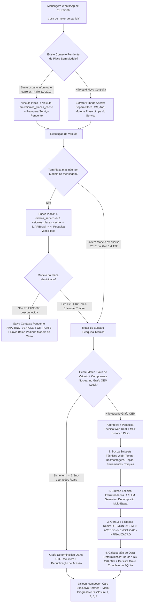

# Design Técnico — Spec 066: Tempário Híbrido com IA + MCP, Pesquisa Técnica Web Real e Blindagem Anti-Alucinação

## 1. Fluxo Ponta a Ponta da Nova Arquitetura



---

## 2. Contratos e Interfaces TypeScript Estritas (Zero `any`)

### 2.1. Extração Híbrida Aberta (`src/hydra-sync/intent_rewriter.ts`)
Em vez de depender exclusivamente de listas fechadas de componentes, `extractAdaptiveTemparioQuery` deve:
1. Extrair e remover a placa (`/[A-Z]{3}-?[0-9][A-Z0-9][0-9]{2}/i`) do texto bruto antes de montar a descrição do serviço.
2. Reconhecer tanto componentes catalogados (incluindo toda a família elétrica/partida: `motor de partida`, `motor de arranque`, `arranque`, `alternador`, `bateria`, `bobina`, `vela`, `bico injetor`, `bomba de combustivel`, `caixa de direcao`, `junta do cabecote`, `bieleta`, etc.) quanto **qualquer sintagma nominal após verbo de ação mecânica** (`troca de [X]`, `trocar [X]`, `substituir [X]`, `reparo de [X]`).
3. Garantir que `serviceTerms` **nunca** contenha a placa ou quebras de linha sujas (ex: de `"EUS5006 \n\ntroca de motor de partida"` extrai `placa: "EUS5006"` e `serviceTerms: ["troca de motor de partida"]`).

```typescript
export interface CleanedTemparioServiceExtraction {
  readonly placa?: string;
  readonly osId?: string;
  readonly veiculo?: string;
  readonly motor?: string;
  readonly ano?: number;
  readonly cleanServicePhrase: string;
  readonly canonicalComponentTokens: readonly string[];
}
```

### 2.2. Contexto Pendente de Resolução de Placa (`src/hydra-sync/turn_context_repository.ts`)
Quando o usuário envia apenas `[PLACA] + [SERVIÇO]` e a placa não existe em nenhuma base (nem ERP, nem APIBrasil, nem busca web):

```typescript
export interface TemparioPendingContextRecord {
  readonly tipo: 'TEMPARIO_DISCLOSURE' | 'TEMPARIO_AWAITING_VEHICLE_FOR_PLATE';
  readonly veiculo: string;
  readonly motor?: string;
  readonly ano?: number;
  readonly placa?: string;
  readonly servicos: readonly string[];
  readonly queryResponse?: TemparioHybridQueryResponse;
  readonly createdAt: string;
}
```
- Se o contexto ativo do telefone for `TEMPARIO_AWAITING_VEHICLE_FOR_PLATE` (nos últimos 15 minutos) e o usuário enviar o nome do veículo (ex: `"Palio 1.0 2010"`, `"Corsa"`, `"Gol G5"`):
  1. O `agent_dispatcher.ts` intercepta a resposta, extrai o veículo/ano/motor informados.
  2. Salva na tabela `veiculos_placas_cache` (via `upsertManualPlateCache(db, placa, veiculo, ano, motor)`) para que a placa fique permanentemente conhecida pela rede!
  3. Executa imediatamente a consulta de tempário com `{ veiculo, ano, motor, placa, servicosSolicitados: pending.servicos }` e entrega o Card Executivo completo!

---

## 3. Detalhamento dos Módulos a Modificar

### 3.1. `src/hydra-sync/tempario_graph_repository.ts`
1. **Função `purgePollutedTemparioCatalog(db: Database.Database): void`:**
   - Executa limpeza transacional no boot:
     - Remove de `tempario_vehicles` qualquer registro onde:
       - `LOWER(modelo) IN ('veículo', 'veiculo', 'veículo passeio', 'veiculo passeio', 'nacional', 'multimarcas', 'desconhecido')`
       - `LOWER(marca) IN ('veículo', 'veiculo', 'nacional', 'multimarcas')`
       - `vehicle_id IN ('veh_veculo_veculopasseio_2002_2012', 'veh_nacional_veculo_2002_2012', 'veh_nacional_tracker_2002_2012', 'veh_nacional_corsa_2002_2012')`
     - Remove de `tempario_operations`, `tempario_engines`, `tempario_dependencies_edges`, `tempario_operation_parts`, `tempario_procedure_chunks` todos os registros órfãos ou vinculados a esses `vehicle_id`s ou que possuam apenas 1 sub-operação genérica `WEB-EST-01`.
2. **Validador Estrito `isValidVehicleForPersistence(marca: string, modelo: string): boolean`:**
   - Impede que `persistLearnedTemparioCatalog` salve no SQLite qualquer veículo sem marca/modelo real ou com menos de 2 sub-operações estruturadas.
3. **Persistência Multi-Suboperação em `persistLearnedTemparioCatalog`:**
   - Em vez de salvar apenas 1 passo ou ignorar as sub-operações, `persistLearnedTemparioCatalog` passa a gravar cada etapa (`DESMONTAGEM`, `ACESSO`, `EXECUCAO`, `FINALIZACAO`) em `tempario_suboperations` e criar as arestas em `tempario_dependencies_edges` + peças em `tempario_operation_parts`. Assim, quando o usuário digitar `1`, `2`, `3` ou `4` no WhatsApp, o grafo terá todas as peças, ferramentas, torques e passo a passo reais!
4. **Expansão do Catálogo OEM Canônico (`seedCanonicalTemparioCatalog`):**
   - Garantir presença de operações de **Substituição do Motor de Partida (Arranque)** e **Substituição das Bieletas Dianteiras** nos veículos canônicos (Tracker, Onix, Golf, Civic, Corolla, Renegade).

### 3.2. `src/hydra-sync/tempario_hybrid_coordinator.ts`
1. **Correção do Seed no Construtor:**
   - Substituir `if (!opCount || opCount.c === 0)` por uma flag de módulo `let canonicalSeedApplied = false;` que executa `purgePollutedTemparioCatalog(this.db)` + `seedCanonicalTemparioCatalog(this.db)` uma vez por inicialização do processo Node/PM2, garantindo que `hydra_ops.db` na VPS receba imediatamente todos os veículos e operações novos.
2. **Eliminação do Sequestro por Stopwords no Passo 3 (Linhas 346-382):**
   - Filtrar uma `TEMPARIO_STOPWORDS` estrita (`troca`, `trocar`, `substituicao`, `substituir`, `reparo`, `reparar`, `conserto`, `servico`, `mao`, `obra`, `valor`, `tempo`, `horas`, `quanto`, `custa`, `fica`, `carro`, `veiculo`, `placa`, `dianteiro`, `dianteira`, `traseiro`, `traseira`, `direito`, `direita`, `esquerdo`, `esquerda`, `lado`, `motor` quando seguido de `de partida` ou `de arranque`).
   - Exigir que a operação encontrada no SQLite contenha o **termo técnico nuclear** do serviço solicitado (ex: se o usuário pediu `motor de partida`, uma operação de `bieleta` ou `correia dentada` tem score `0.0` e é sumariamente descartada!).

### 3.3. `src/hydra-sync/tempario_web_researcher.ts` (Motor de Pesquisa Técnica Web + Síntese IA)
Reformulação completa do pesquisador para usar **Pesquisa Web Real + Síntese por IA (LLM) + Decomposição Técnica Multi-Etapa**:

```typescript
export interface AiSynthesizedProcedureStep {
  readonly ordem: number;
  readonly codigoEtapa: string;
  readonly titulo: string;
  readonly descricaoTecnica: string;
  readonly faseExecucao: 'PRE_REQUISITO' | 'DESMONTAGEM' | 'ACESSO' | 'EXECUCAO' | 'FINALIZACAO';
  readonly tempoHoras: number;
  readonly ferramentas: readonly string[];
  readonly torqueEspecificado?: string;
}

export interface WebResearchResult {
  readonly queryUsada: string;
  readonly veiculoMarca: string;
  readonly veiculoModelo: string;
  readonly geracaoOuAno: string;
  readonly veiculo: string;
  readonly motor?: string;
  readonly ano?: number;
  readonly servico: string;
  readonly tempoEstimadoHoras: number;
  readonly tempoEstimadoMinutos: number;
  readonly taxaHorariaPadrao: number; // Sempre R$ 270,00/h
  readonly valorMaoDeObraSugerido: number; // tempoEstimadoHoras * 270.00
  readonly etapasDetalhadas: readonly AiSynthesizedProcedureStep[];
  readonly ferramentasIdentificadas: readonly string[];
  readonly pecasIdentificadas: readonly TemparioPartItem[];
  readonly torquesIdentificados: readonly string[];
  readonly fontesConsultadas: readonly string[];
  readonly snippetEvidencia: string;
  readonly procedencia: 'PESQUISA_TECNICA_WEB';
  readonly confianca: number;
}
```

#### Como funciona o Pipeline de Pesquisa + IA em `researchTemparioOnWeb`:
1. **Multi-Query Web Search:**
   - Dispara busca web técnica para `"{veiculo} {ano} {motor} {servico} tempo horas manual oficina torque ferramentas"`.
   - Extrai os snippets técnicos reais (portais automotivos, Doutor-IE, Oficina Brasil, fóruns técnicos, manuais).
2. **Síntese Estruturada via IA (`synthesizeTemparioWithAi`) + Engenharia Automotiva:**
   - Invoca o modelo rápido do Hydra (ou sintetizador técnico estruturado com evidência dos snippets) para decompor qualquer serviço em **3 a 5 etapas reais de bancada** (`DESMONTAGEM` -> `ACESSO` -> `EXECUCAO` -> `FINALIZACAO`), calculando o tempo individual de cada etapa conforme o porte/arquitetura do veículo e o ano (ex: veículos 2000 vs 2010 vs 2024 Turbo).
   - **Proibição de Etapa Única Genérica:** Nunca mais será gerado `"1. Execução de [serviço] (Pesquisa Técnica Web)"`. Mesmo quando a busca ocorrer via web, a opção `3️⃣ Passo a passo da montagem` trará as etapas mecânicas reais (ex: para Motor de Partida: *1. Desconexão da bateria e elevação do veículo; 2. Desconexão do borne B+ (13mm) e chicote do automático (linha 50); 3. Remoção dos parafusos de acoplamento na carcaça da transmissão e substituição do motor de partida; 4. Torqueamento, reconexão elétrica e teste de partida e queda de tensão*).
3. **Inferência Inteligente de Marca e Ano do Veículo:**
   - Resolver corretamente a montadora (`Chevrolet Corsa`, `Fiat Palio`, `Volkswagen Gol`, `Ford Fiesta`, `Renault Sandero`, `Hyundai HB20`, `BYD Dolphin`, etc.) e nunca exibir `"Nacional corsa (2002-2012) · Motor Motor Padrão"`. Se o usuário informou `Corsa 2010`, exibir `Chevrolet Corsa (2010)`.

### 3.4. `src/hydra-sync/apibrasil_plate_client.ts`
- Adicionar `upsertManualPlateCache(db, placa, veiculo, ano, motor)` para permitir que placas informadas e resolvidas via conversa ou via busca web fiquem salvas permanentemente em `veiculos_placas_cache`.
- Adicionar fallback `searchPlateOnPublicWeb(placa)` quando a APIBrasil retornar 404/erro de plano, buscando menções públicas da placa antes de pedir o modelo ao usuário.

### 3.5. `src/hydra-sync/mcp_server.ts`
- Atualizar a tool MCP `consultar_tempario_hibrido` para aceitar opcionalmente `placa` e `os_id`, permitindo que o agente LLM principal (via MCP `hydra-ops`) também consulte o tempário completo por placa ou veículo em qualquer conversa aberta.

---

## 4. Exemplo Real de Resposta Esperada após a Spec 066

### Cenário A: `FCK2E73 \n\ntroca da bieleta dianteira direita` -> Opção `3`
**Balão 1 (Resumo):**
```text
*HYDRA | Tempário Técnico & Mão de Obra*

> *Chevrolet Tracker (2020-2025) · Motor 1.0 12V Turbo*
- *Placa consultada:* FCK2E73
- *Serviços:* Substituição das Bieletas da Barra Estabilizadora Dianteira

*Resumo de Mão de Obra (Taxa da Rede: R$ 270,00/h)*
- *Tempo líquido cobrado:* 0,80h (48 min)
- *Total Mão de Obra a Cobrar:* *R$ 216,00*
- *Complexidade técnica:* Baixa (3 etapas no grafo de acesso)

*Deseja ver o detalhamento técnico?*
1️⃣ *Peças necessárias* (2 itens)
2️⃣ *Ferramentas de bancada e torques* (4 itens)
3️⃣ *Passo a passo da montagem* (sequência otimizada)
4️⃣ *Tudo completo* (relatório técnico integral)
```
**Ao digitar `3`:**
```text
*HYDRA | Sequência Técnica de Execução*

> *Chevrolet Tracker (2020-2025) · Motor 1.0 12V Turbo*
- *Serviço:* Substituição das Bieletas da Barra Estabilizadora Dianteira

*Passo a Passo Otimizado (Grafo de Acesso)*
- *1. Elevação do Veículo e Remoção das Rodas Dianteiras* (Acesso): 0,25h (15 min)
  └ Ferramentas: Elevador automotivo, Chave de impacto 1/2, Soquete 19mm (Torque: 120 Nm nas porcas de roda)
- *2. Desacoplamento e Substituição da Bieleta da Barra Estabilizadora* (Execução): 0,35h (21 min)
  └ Ferramentas: Chave combinada 18mm, Chave Torx T30 / Allen 5mm para contra-apoio do pino esférico, Torquímetro 1/2 (Torque: 50 Nm nas porcas autotravantes superior e inferior)
- *3. Remontagem das Rodas Dianteiras e Conferência de Torque* (Finalização): 0,20h (12 min)
  └ Ferramentas: Torquímetro de precisão 1/2, Soquete 19mm (Torque: 120 Nm aperto cruzado)
```

### Cenário B: `EUS5006 \n\ntroca de motor de partida` (Quando a placa não consta nas bases)
**Turno 1 (Bot):**
```text
*HYDRA | Tempário Técnico & Mão de Obra*

> *Identificação de Placa Pendente — EUS5006*
- *Serviço solicitado:* Troca de motor de partida
- *Status da placa:* Não localizada no histórico das 10 lojas nem na base externa

Qual é o *modelo e ano* desse veículo (ex: *Corsa 1.4 2010*, *Palio 1.0 2012*, *Onix 1.4*)?
Assim que me mandar o carro, já vinculo à placa *EUS5006* no banco e te entrego o tempo exato e mão de obra a *R$ 270,00/h*!
```
**Turno 2 (Usuário responde: `Palio 1.0 2012`):**
- O bot grava `EUS5006 -> Fiat Palio 1.0 (2012)` no cache de placas e responde imediatamente com o Card Executivo da **Substituição do Motor de Partida do Fiat Palio 1.0 2012** (`1,10h = R$ 297,00`) e todas as 4 opções de detalhamento técnico (Peças, Ferramentas/Torques, Passo a Passo de 4 etapas e Relatório Completo)!
