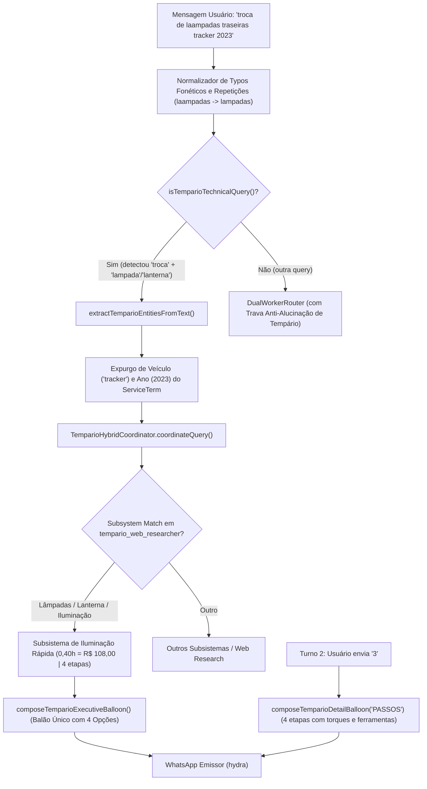

# Arquitetura e Design — Spec 068: Tempário Técnico de Iluminação, Resiliência a Typos e Neutralização de Alucinação LLM

## 1. Fluxo de Execução Ponta a Ponta



---

## 2. Modificações Estruturadas por Arquivo

### 2.1 `src/hydra-sync/intent_rewriter.ts`

#### A. Normalizador de Repetição Fonética em Consultas de Oficina
```typescript
export function normalizeMechanicalQueryText(raw: string): string {
  if (!raw) return '';
  let text = raw.toLowerCase().normalize('NFD').replace(/[\u0300-\u036f]/g, '');
  // Corrige vogais ou consoantes duplicadas por erro de digitação comum em teclado virtual
  text = text
    .replace(/\bla+mpada(s)?\b/g, 'lampada$1')
    .replace(/\bla+nterna(s)?\b/g, 'lanterna$1')
    .replace(/\bree\b/g, 're')
    .replace(/\bcoo+rreia(s)?\b/g, 'correia$1')
    .replace(/\bpnee?uu?s\b/g, 'pneus')
    .replace(/\bba+teria(s)?\b/g, 'bateria$1');
  return text;
}
```

#### B. Expansão de `mechanicalComponentPattern`
Adicionar explicitamente os componentes de sinalização:
```typescript
const mechanicalComponentPattern = /\b(motor\s*de\s*partida|...|lampada|lampadas|lanterna|lanternas|luz|luzes|iluminacao|farolete|pisca|piscas|seta|setas|soquete|soquetes|luz\s*de\s*freio|luz\s*de\s*re|luz\s*de\s*placa|drl|luz\s*diurna)\b/i;
```

#### C. Expansão de `recognizedComponents` em `extractAdaptiveTemparioQuery`
```typescript
{ token: 'lampada', label: 'lampada' },
{ token: 'lampadas', label: 'lampada' },
{ token: 'lanterna', label: 'lanterna' },
{ token: 'lanternas', label: 'lanterna' },
{ token: 'luz de freio', label: 'luz_freio' },
{ token: 'luz de re', label: 'luz_re' },
{ token: 'luz de placa', label: 'luz_placa' },
{ token: 'pisca', label: 'seta_direcional' },
{ token: 'seta', label: 'seta_direcional' },
{ token: 'soquete', label: 'soquete' },
{ token: 'drl', label: 'drl' },
```

#### D. Sanitização de `serviceTerms` em `extractTemparioEntitiesFromText`
Quando o serviço for extraído da frase residual, remover ocorrências do nome do veículo (`adaptive.veiculo`) e do ano (`adaptive.ano`), garantindo termos limpos para o coordenador.

---

### 2.2 `src/hydra-sync/tempario_web_researcher.ts`

#### Subsistema de Iluminação Rápida e Lâmpadas
```typescript
// 5.1 LÂMPADAS, ILUMINAÇÃO RÁPIDA E SINALIZAÇÃO EXTERNA (LANTERNA / FAROL / SETA / FREIO / RÉ / PLACA)
if (
  sLower.includes('lampada') ||
  sLower.includes('luz de freio') ||
  sLower.includes('luz de re') ||
  sLower.includes('luz de placa') ||
  sLower.includes('pisca') ||
  sLower.includes('seta') ||
  (sLower.includes('lanterna') && !sLower.includes('parachoque'))
) {
  const isTraseira = sLower.includes('traseir') || sLower.includes('re') || sLower.includes('placa') || sLower.includes('lanterna');
  const tituloFormatado = isTraseira
    ? 'Substituição de Lâmpadas das Lanternas Traseiras (Sinalização)'
    : 'Substituição de Lâmpadas de Iluminação e Sinalização';
  
  const totalH = 0.40; // 24 minutos (teto de serviço rápido da rede)
  return {
    tituloFormatado,
    tempoBaseHoras: totalH,
    etapas: [
      {
        ordem: 1,
        codigoEtapa: 'IL-1101',
        titulo: 'Acesso e soltura dos fixadores da carcaça óptica traseira',
        descricaoTecnica: 'Abrir tampa traseira, remover forração de acabamento lateral ou parafusos Torx/10mm do batente da lanterna.',
        faseExecucao: 'DESMONTAGEM',
        tempoHoras: 0.10,
        ferramentas: ['Chave Torx T20 / canhão 10mm', 'Espátulas de nylon para acabamentos'],
        torqueEspecificado: '3 Nm nos parafusos de fixação'
      },
      {
        ordem: 2,
        codigoEtapa: 'IL-1102',
        titulo: 'Desencaixe dos pinos-guia de pressão e desconexão do chicote elétrico',
        descricaoTecnica: 'Puxar o conjunto da lanterna em linha reta para liberar os pinos de retenção e destravar o plugue multipino.',
        faseExecucao: 'ACESSO',
        tempoHoras: 0.10,
        ferramentas: ['Espátula plástica para alavanca controlada'],
        torqueEspecificado: 'Destravamento manual sem torção'
      },
      {
        ordem: 3,
        codigoEtapa: 'IL-1103',
        titulo: 'Substituição das lâmpadas e inspeção dos soquetes de contato',
        descricaoTecnica: 'Remover soquetes por rotação de 1/4 de volta, inspecionar terminais contra zinabre e instalar lâmpadas novas correspondentes.',
        faseExecucao: 'EXECUCAO',
        tempoHoras: 0.12,
        ferramentas: ['Luvas de proteção para manuseio de bulbos', 'Lixa fina / limpa-contato para soquetes'],
        torqueEspecificado: 'Encaixe com trava de baioneta / pressão'
      },
      {
        ordem: 4,
        codigoEtapa: 'IL-1104',
        titulo: 'Remontagem da lanterna, aperto controlado e teste de sinalização',
        descricaoTecnica: 'Reconectar chicote, assentar nos pinos-guia, apertar fixadores e testar funções de lanterna, freio, pisca e marcha a ré.',
        faseExecucao: 'FINALIZACAO',
        tempoHoras: 0.08,
        ferramentas: ['Ponta de prova 12V / Multímetro', 'Chave Torx T20'],
        torqueEspecificado: '3 Nm no aperto final da carcaça'
      }
    ],
    ferramentasPadrao: [
      'Jogo de chaves Torx T20 e canhão 10mm',
      'Espátulas de nylon para acabamentos plásticos',
      'Multímetro digital ou ponta de prova 12V',
      'Luvas de proteção para manuseio de lâmpadas halógenas/LED'
    ],
    pecasPadrao: [
      { nomePeca: 'Lâmpadas automotivas 12V (P21W / W21W / W5W conforme aplicação da montadora)', quantidade: 2, unidade: 'UN', obrigatoria: true },
      { nomePeca: 'Presilhas plásticas de pressão da lanterna', quantidade: 2, unidade: 'UN', obrigatoria: false }
    ],
    torquesPadrao: [
      'Parafusos de fixação da lanterna à carroceria: 2,5 a 3,5 Nm',
      'Pinos-guia de retenção: Assentamento manual sob pressão'
    ]
  };
}
```

---

### 2.3 `src/hydra-sync/tempario_hybrid_coordinator.ts`
Garantir guarda defensiva em `buildCacheKey`:
```typescript
const persona = (input.securityContext?.persona || 'socio').toLowerCase();
const store = (input.securityContext?.authorizedLojaSlug || input.securityContext?.authorizedStore || input.targetLojaSlug || 'rede').toLowerCase();
```

---

### 2.4 `src/hydra-sync/agent_dispatcher.ts`
Adicionar regra formal na seção Hermes Directives:
```typescript
// 10. PROIBIÇÃO ABSOLUTA DE GERAR TEMPÁRIOS OU ORÇAMENTOS DE MÃO DE OBRA NO PROMPT GERAL:
// - Toda estimativa de tempo e custo de mão de obra mecânica é de competência EXCLUSIVA do motor determinístico de tempário.
// - NUNCA invente cabeçalhos como "Tempário Técnico e Estimativa Operacional".
// - NUNCA crie intervalos de tempo/preço (ex: "0,4h a 0,6h" ou "R$ 108 a R$ 405").
// - NUNCA emita campos com "Não informado / Pendente" em listas técnicas.
```

---

## 3. Matriz de Testes Automatizados
- Teste Unitário 1: Query de Davi `troca de laampadas traseiras tracker 2023` com typo.
- Teste Unitário 2: Extração de entidades `veiculo: tracker`, `ano: 2023`, `serviceTerms: ['troca de lampadas traseiras']`.
- Teste Unitário 3: Resposta do coordenador gerando `0,40h`, valor `R$ 108,00`, 4 etapas, balão executivo único e opções 1 a 4.
- Teste Unitário 4: Seleção da opção `3` (Passo a passo) entregando as 4 etapas de bancada com torques de 3 Nm.
- Teste de Regressão: Farol estrutural dianteiro (ex: `troca de farol dianteiro golf 2020`) continua usando 1,00h com desmontagem de para-choque.
