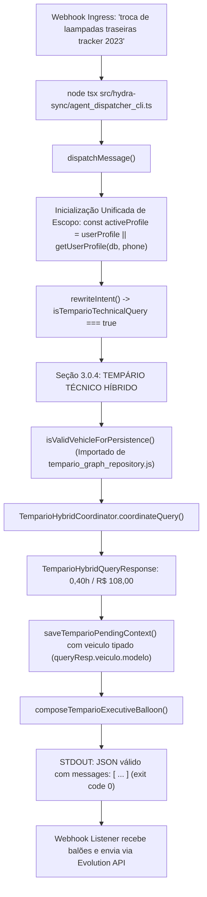

# Arquitetura e Design — Spec 069: Correção de ReferenceError e Escopo de Variáveis no Dispatcher em Produção

## 1. Fluxo de Execução com Correção de Símbolos e Escopos



---

## 2. Modificações Estruturadas em `src/hydra-sync/agent_dispatcher.ts`

### 2.1 Import de `isValidVehicleForPersistence`
```typescript
import {
  TemparioGraphRepository,
  isValidVehicleForPersistence
} from './tempario_graph_repository.js';
```

### 2.2 Eliminação da TDZ de `activeProfile`
No início de `dispatchOperationalQuery`, promover a resolução do perfil ativo:
```typescript
export async function dispatchOperationalQuery(
  db: Database.Database,
  phone: string,
  textoLimpo: string,
  rawMessageId?: string,
  userProfile?: UserProfile,
  ...
): Promise<DispatcherResult> {
  const startTime = Date.now();
  const activeProfile = userProfile || getUserProfile(db, phone);
  ...
```
Isso garante que tanto o bloco `0.2.1` (follow-up de placa pendente) quanto a seção `3.0.4` (tempário híbrido) e seções posteriores tenham acesso seguro e estrito a `activeProfile` sem ReferenceError.

### 2.3 Resolução Segura de `veiculoIdentificado`
No salvamento do contexto pendente de tempário:
```typescript
const resolvedVehicleName = queryResp.veiculo
  ? `${queryResp.veiculo.marca} ${queryResp.veiculo.modelo}`.trim()
  : (targetVeiculo || 'Veículo');

saveTemparioPendingContext(db, phone, {
  tipo: 'TEMPARIO_DISCLOSURE',
  veiculo: resolvedVehicleName,
  motor: extractedFollowUp.motorTexto || resolvedIdentity.motorPadrao,
  ...
});
```

---

## 3. Suite de Testes de Integração E2E
`src/hydra-sync/tests/test_harness_spec069_dispatcher_e2e.ts`
- Cenário 1: Disparo de `dispatchMessage` com `{ phone: '5511996242812', message: 'troca de laampadas traseiras tracker 2023' }`.
  - Verifica que a promessa resolve sem erros.
  - Verifica que `status === 'success'`.
  - Verifica que o primeiro balão contém `HYDRA | Tempário Técnico & Mão de Obra`, `0,40h (24 min)` e `R$ 108,00`.
- Cenário 2: Disparo com placa desconhecida `"EUS5006 \n\ntroca de motor de partida"`.
  - Verifica que retorna a Estimativa de Referência (Linha Passeio Padrão a 1,10h / R$ 297,00) sem exceções.
- Cenário 3: Follow-up conversacional `"Palio 1.0 2012"`.
  - Verifica que `activeProfile` é acessado sem erro de inicialização e o veículo é vinculado com sucesso.
- Cenário 4: Seleção `"3"`.
  - Verifica retorno imediato da sequência técnica otimizada.
