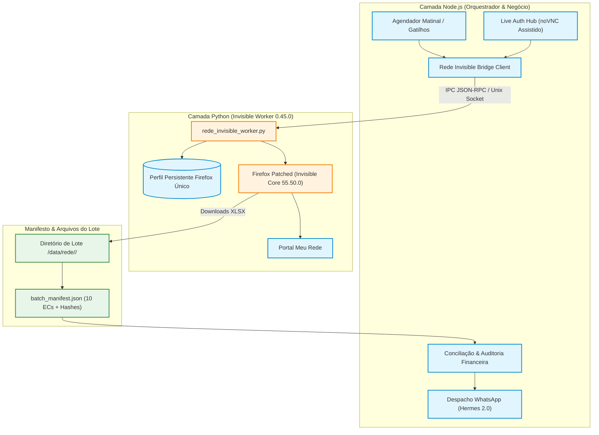

# Design Técnico — Spec 071: Migração da Rede para Invisible Playwright

## 1. Arquitetura de Execução Unificada



---

## 2. Contratos de Dados & Protocolo IPC (Node ↔ Python)

### 2.1 Requisições JSON-RPC (Node para Worker Python)

```typescript
export type WorkerCommand = 
  | 'CHECK_SESSION'
  | 'EXPORT_STORE_BATCH'
  | 'ENTER_ASSISTED_MODE'
  | 'RESUME_AFTER_AUTH'
  | 'TERMINATE';

export interface BatchRequestPayload {
  readonly datePeriod: string; // YYYY-MM-DD
  readonly stores: readonly {
    readonly storeId: string;
    readonly ecCode: string;
    readonly name: string;
  }[];
  readonly options: {
    readonly headless: boolean;
    readonly timeoutMs: number;
    readonly display: string; // ex: ":99"
  };
}
```

### 2.2 Resposta e Manifesto de Lote (`batch_manifest.json`)

```typescript
export interface DownloadedStoreReport {
  readonly ecCode: string;
  readonly storeId: string;
  readonly filename: string;
  readonly sha256: string;
  readonly recordCount: number;
  readonly downloadedAt: string;
}

export interface BatchManifest {
  readonly datePeriod: string;
  readonly status: 'PENDING' | 'ASSISTED_REQUIRED' | 'COMPLETED' | 'FAILED';
  readonly storesTotal: number;
  readonly storesCompleted: number;
  readonly reports: readonly DownloadedStoreReport[];
  readonly sealedBatchHash?: string;
  readonly auditedAt?: string;
}
```

---

## 3. Mapeamento de Arquivos a Criar e Modificar

1. **Camada Python Invisible Playwright:**
   - `projects/hydra-rede/src/invisible/rede_invisible_worker.py`: daemon único em Python 3.11 gerenciando o browser Invisible Playwright 0.45.0 e perfil persistente.
   - `projects/hydra-rede/src/invisible/session_guard.py`: detector físico de sessão via seletores do DOM, tratador de tutoriais/pop-ups e detecção de CAPTCHA.
   - `projects/hydra-rede/src/invisible/manifest_tracker.py`: gerenciador atômico do `batch_manifest.json` com cálculo de SHA-256 por arquivo.
2. **Camada Node.js (Cliente & Integração):**
   - `projects/hydra-rede/src/invisible_bridge_client.js`: adaptador IPC Node para comunicação assíncrona com o worker Python.
   - `projects/hydra-rede/src/scraper.js`: refatorado para delegar o ciclo de extração e downloads ao `invisible_bridge_client`, removendo dependência direta de `playwright-extra` Chromium.
   - `projects/hydra-rede/src/reconnect_system/rede_live_auth_hub.js`: migrado para acionar o modo assistido do worker Invisible no display `:99`.
3. **Manifesto e Setup de Infraestrutura:**
   - `projects/hydra-rede/deploy/setup_invisible_env.sh`: script de instalação do ambiente virtual Python 3.11 com `invisible-playwright==0.45.0` e execução de `invisible-playwright fetch`.

---

## 4. Tabela de Ensaios e Validação (Matriz de Qualidade)

| Ensaio | Cenário de Teste | Critério de Aceite Determinístico |
| :-- | :-- | :-- |
| **E1** | Concorrência de gatilhos | Dois processos disparados simultaneamente geram lock único; 1 único browser abre no perfil. |
| **E2** | Timeout e recuperação | Processos filhos terminam graciosamente; perfil liberado sem zumbis no PM2. |
| **E3** | Desafio de autenticação | Worker entra em modo assistido; cede visualização no display `:99`; retoma após login. |
| **E4** | Pop-ups e tutoriais | Tutoriais dispensados automaticamente via seletores confirmados sem travar fluxo. |
| **E5** | Lote integral de 10 ECs | 10 arquivos XLSX gerados com hash válido e `batch_manifest.json` selado. |
