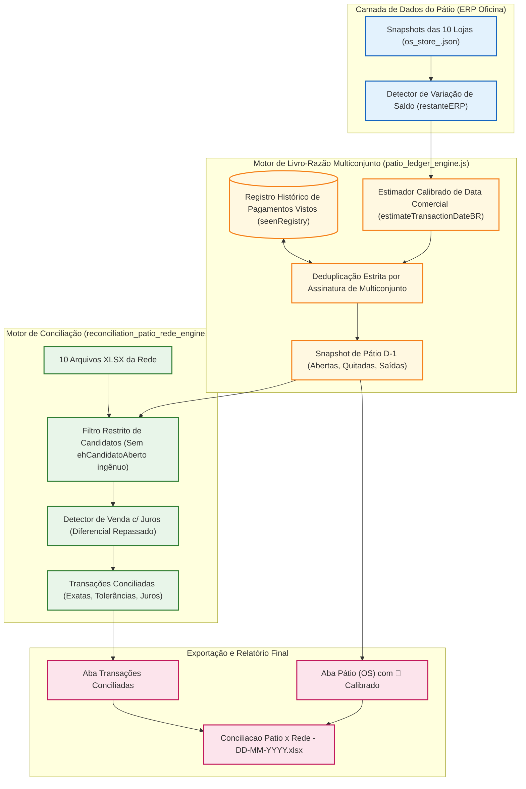

# Design Técnico — Spec 072: Resolução de Discrepâncias de Pátio x Rede

## 1. Arquitetura do Pipeline de Conciliação e Ledger de Pátio



---

## 2. Contratos e Lógica Algorítmica

### 2.1 Deduplicação Ponderada no Multiconjunto (`patio_ledger_engine.js`)

Atualmente, `extractPaymentsForReferenceDay` consulta `seenCount`, porém adiciona `...g.items` sem verificar se a assinatura já foi esgotada em execuções anteriores:

```javascript
// Assinatura única da transação comercial na OS
const sig = `${storeKey}|${rec.osNumber}|${formaNorm}|${Math.round(g.total * 100)}`;
```

**Novo Contrato de Deduplicação:**
1. Para cada transação agrupada `g` dentro da OS, calcula-se o número de ocorrências idênticas presentes na OS (`totalOcorrenciasNaOS`).
2. Consulta-se quantas vezes essa assinatura já foi consumida em dias anteriores em `seenRegistry.transacoes[sig]` (`seenCount`).
3. Se `seenCount >= totalOcorrenciasNaOS`, a transação já pertence integralmente ao passado e é ignorada para D-1.
4. Se `seenCount < totalOcorrenciasNaOS` e a data estimada da transação pertence a `refDatesList`, o item é adicionado a `matchedPayments` e a contagem é incrementada.

### 2.2 Calibração do Estimador de Data Comercial (`estimateTransactionDateBR`)

A Âncora 3 de tolerância (28 a 34 dias) gerava falso-positivo para qualquer OS aberta com pagamento de cartão de crédito:

**Regras Reformuladas:**
- **OS com Fechamento em D-1:** Se `dtFechamentoBR` coincide com `refDatesList` e a 1ª parcela vence entre 26 e 36 dias após, a data da venda é rigorosamente `dtFechamentoBR`.
- **OS Aberta:** Se a OS não foi fechada, a estimativa pelo primeiro vencimento só pode apontar para D-1 se:
  1. A data de abertura (`dtAberturaBR`) coincidir com D-1; OU
  2. O crawler tiver detectado abatimento de saldo da OS (`restanteERP < valorTotal`) especificamente na transição de D-2 para D-1; OU
  3. O `seenRegistry` não tiver registrado a parcela em execuções anteriores E a data de abertura for recente (≤ 3 dias de D-1).
- Se a OS estiver aberta há 5+ dias e não houve alteração cadastral em D-1, a parcela é classificada como pertencente à data de abertura da OS, e não a D-1.

### 2.3 Supressão do Falso-Candidato na Conciliação (`reconciliation_patio_rede_engine.js`)

Eliminar a cláusula:
```javascript
// BUG ANTERIOR:
} else if (isOsAberta) {
  ehCandidatoAberto = true;
  dataRef = dataInicioBR || (targetDatesList[0] || '');
}
```

**Substituição por Validação Estrita:**
Para uma OS aberta fornecer candidatos a pagamento para a conciliação:
1. O vencimento de débito/PIX deve coincidir exatamente com a data de conciliação (`targetDatesList.includes(g.vencimento)`);
2. Para crédito parcelado, deve haver correspondência com a data estimada de transação calibrada ou confirmação pelo log de modificação do crawler.
3. Se nenhum pagamento da OS aberta pertenceu a D-1, a OS não envia transações fantasmas para o motor de conciliação.

### 2.4 Tratamento da Venda com Juros

Quando uma transação de máquina da Rede possui valor superior ao da OS (ex: OS R$ 4.401,50 vs Cartão R$ 4.886,22 na Mauá):
- O motor de conciliação já possui a categoria `Venda c/ Juros Rede (OS s/ juros)`.
- No relatório de Pátio (OS), o valor da OS deve permanecer o valor nominal contratado (`R$ 4.401,50`) e o pagamento deve exibir `Credito: R$ 4.401,50`.
- Na aba de conciliação, o diferencial (`R$ 484,72`) deve ser explicitado como repasse de juros ao consumidor, alinhando-se à aba `SALDO` do financeiro.

---

## 3. Matriz de Correção dos Casos de Teste

| Loja | OS | Problema Original | Causa Raiz | Correção no Spec 072 |
| :-- | :-- | :-- | :-- | :-- |
| **Piraporinha** | 40465 | Exibida com valor 2842 e pagto `—` | Janela temporal rejeitou crédito em D-1 | Estimativa aceita crédito de D-1; saldo de pátio zera e pagto exibe `Credito: R$ 2.842,00` |
| **Planalto** | 18537 | Exibiu falso `🔵 Credito: R$ 3.030,00` | Âncora 3 forçou OS aberta velha como pagto de hoje | Âncora 3 rejeita OS aberta antiga sem baixa em D-1; pagto fica `—` |
| **Kennedy** | 4461 | Exibiu falso `🔵 Credito: R$ 5.131,10` | Multiconjunto re-injetou pagamento de D-2 | Multiconjunto deduz transação já vista em 04/11; pagto em 05/11 fica `—` |
| **Kennedy** | 4460 | Exibiu falso `🔵 Credito: R$ 2.159,70` | Multiconjunto re-injetou pagamento de D-2 | Multiconjunto deduz transação já vista em 04/11; saldo permanece 1439.90 e pagto fica `—` |
| **Jabaquara** | 489 | Exibiu falso `🔵 Credito: R$ 2.561,34` | Re-injeção retroativa em OS aberta antiga | Transação já vista é descartada; saldo de pátio permanece 1707.56 sem 🔵 |
| **Santo André** | 2520/2522 | Apareciam como saídas de ontem | Falha no descarte de saídas consumadas em D-2 | Saídas já contabilizadas em D-2 não ressurgem em D-1 |
| **Mauá** | 22660 | Venda com juros R$ 4.886,22 vs R$ 4.401,50 | Classificação de juros gerando resíduo | Conciliado com juros destacados, OS zerada no pátio |
