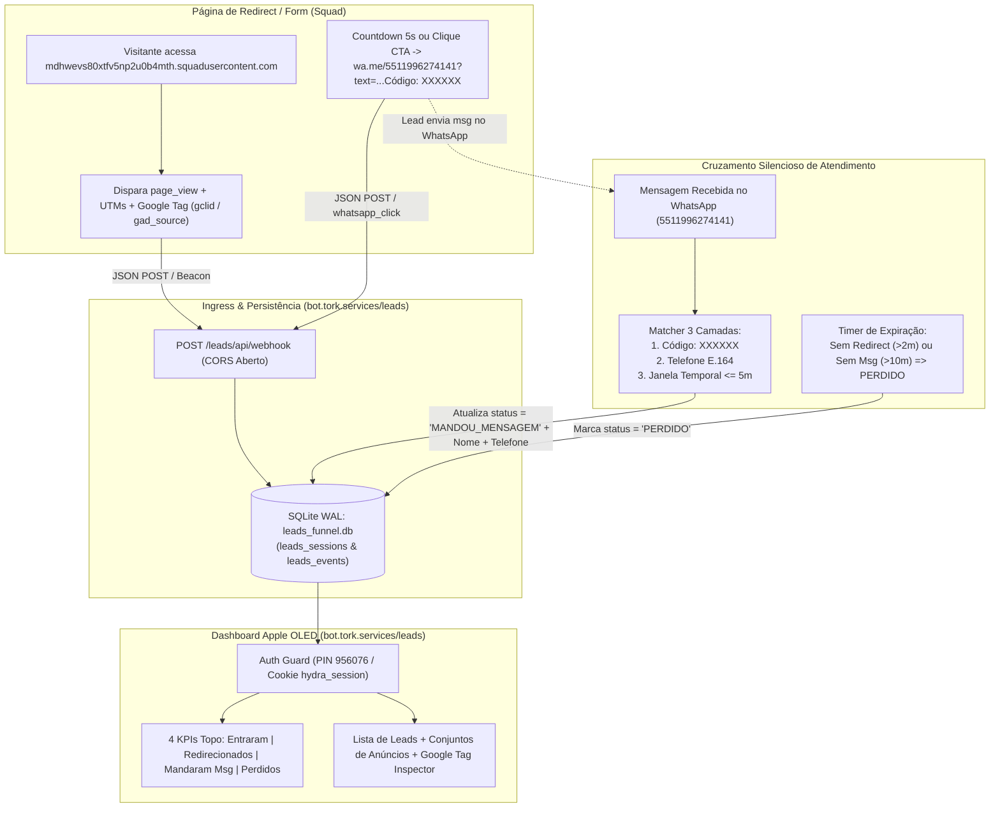

# Design Técnico — Spec 073: Webhook Listener & Hub `/leads`

## 1. Arquitetura e Fluxo de Dados



---

## 2. Esquema do Banco de Dados SQLite WAL (`leads_funnel.db`)

Localização na VPS: `/home/operacional/hydra-data/leads_funnel.db` (fallback local em `projects/hydra-rede/data/leads_funnel.db`).

```sql
CREATE TABLE IF NOT EXISTS leads_sessions (
  id INTEGER PRIMARY KEY AUTOINCREMENT,
  visit_id TEXT UNIQUE NOT NULL,
  match_code TEXT,
  lead_name TEXT,
  lead_phone TEXT,
  lead_vehicle TEXT,
  lead_store TEXT,
  page_url TEXT,
  referrer TEXT,
  user_agent TEXT,
  client_ip TEXT,
  device_type TEXT,
  -- Parâmetros de Anúncios e Google Tag
  utm_source TEXT,
  utm_medium TEXT,
  utm_campaign TEXT,
  utm_content TEXT,   -- Conjunto de Anúncios / Criativo
  utm_term TEXT,      -- Termo / Conjunto
  ad_group TEXT,      -- Conjunto de Anúncios explícito (se enviado)
  gclid TEXT,
  gbraid TEXT,
  wbraid TEXT,
  gad_source TEXT,
  gad_campaignid TEXT,
  fbclid TEXT,
  gtag_data_json TEXT,
  -- Máquina de Estados do Funil
  entered_at TEXT NOT NULL,
  redirected_at TEXT,
  messaged_at TEXT,
  lost_at TEXT,
  funnel_status TEXT NOT NULL DEFAULT 'ENTROU', -- 'ENTROU' | 'REDIRECIONADO' | 'MANDOU_MENSAGEM' | 'PERDIDO'
  lost_reason TEXT,                             -- 'SEM_REDIRECT' | 'NAO_CHAMOU_WHATSAPP'
  -- Dados Enriquecidos quando o Lead manda mensagem
  whatsapp_message_text TEXT,
  external_conv_id INTEGER,
  match_method TEXT,                            -- 'MATCH_CODE' | 'PHONE_E164' | 'TEMPORAL_WINDOW'
  raw_payload_json TEXT,
  updated_at TEXT NOT NULL
);

CREATE INDEX IF NOT EXISTS idx_leads_match_code ON leads_sessions(match_code);
CREATE INDEX IF NOT EXISTS idx_leads_phone ON leads_sessions(lead_phone);
CREATE INDEX IF NOT EXISTS idx_leads_status ON leads_sessions(funnel_status);
CREATE INDEX IF NOT EXISTS idx_leads_entered_at ON leads_sessions(entered_at);

CREATE TABLE IF NOT EXISTS leads_events (
  id INTEGER PRIMARY KEY AUTOINCREMENT,
  visit_id TEXT NOT NULL,
  event_name TEXT NOT NULL,
  occurred_at TEXT NOT NULL,
  payload_json TEXT
);
```

---

## 3. Contratos HTTP e Interfaces

### 3.1. Endpoints Públicos de Ingestão (Sem PIN, com CORS)
- `OPTIONS /leads/api/webhook` e `OPTIONS /leads/webhook` → `204 No Content` com headers:
  - `Access-Control-Allow-Origin: <Origin ou *>`
  - `Access-Control-Allow-Methods: POST, GET, OPTIONS`
  - `Access-Control-Allow-Headers: Content-Type, Authorization, X-Requested-With`
  - `Access-Control-Allow-Credentials: true`
- `POST /leads/api/webhook` e `POST /leads/webhook`:
  - Aceita:
    1. **Formato Envelope (`sab.analytics`):**
       ```json
       {
         "protocol": "sab.analytics",
         "events": [
           {
             "visitId": "019...",
             "name": "whatsapp_click",
             "occurredAt": "2026-11-05T19:50:00.000Z",
             "page": { "url": "https://mdhwevs80xtfv5np2u0b4mth.squadusercontent.com/?utm_source=google&utm_campaign=Campanha_ABC&utm_content=Conjunto_Cambio&gclid=CjwKCA...", "referrer": "https://www.google.com/" },
             "params": { "cta_id": "whatsapp_redirect", "match_code": "K7M9P2" }
           }
         ]
       }
       ```
    2. **Formato JSON Direto / Custom:**
       ```json
       {
         "event": "redirect",
         "visit_id": "vis_123",
         "match_code": "K7M9P2",
         "nome": "Carlos Eduardo",
         "telefone": "11988887777",
         "veiculo": "Civic 2020",
         "url": "https://mdhwevs80xtfv5np2u0b4mth.squadusercontent.com/?utm_campaign=Diagnostico&utm_content=Conjunto_01&gclid=EAIaIQ...",
         "utm_campaign": "Diagnostico",
         "utm_content": "Conjunto_01",
         "gclid": "EAIaIQ...",
         "gad_source": "1"
       }
       ```
  - Resposta: `200 OK` `{ "ok": true, "visit_id": "...", "funnel_status": "REDIRECIONADO" }`
- `POST /leads/api/internal/message-hook`:
  - Recebe notificação em tempo real do `watchdog/gateway.js` toda vez que chega uma mensagem `incoming` no canal de atendimento (`5511996274141`), executando o batimento imediato das 3 camadas.

### 3.2. Endpoints de Autenticação (Padrão `/live`)
- `GET /leads/api/auth/status`: Retorna `{ authenticated: boolean }`.
- `POST /leads/api/auth/unlock`: Valida `{ pin: "956076" }` via `verifyPin` (`timingSafeEqual`) e define cookie `Set-Cookie: hydra_session=<token>; HttpOnly; Path=/; Max-Age=43200; SameSite=Lax`.
- `POST /leads/api/auth/lock`: Limpa cookie `hydra_session`.

### 3.3. Endpoints Protegidos do Dashboard (`/leads/api/*`)
- `GET /leads/api/dashboard?period=today|7d|30d|all&status=all|messaged|lost|redirected&q=...`:
  - Antes de responder, executa o **Sweep de Expiração de Perdidos** e o **Reconciliador Ativo de Conversas** (garantindo sincronia 100%).
  - Retorna:
    ```json
    {
      "kpis": {
        "totalEntered": 120,
        "totalRedirected": 95,
        "totalMessaged": 68,
        "totalLost": 52,
        "redirectRate": 79.2,
        "messageRateFromEntered": 56.7,
        "messageRateFromRedirected": 71.6,
        "lostRate": 43.3
      },
      "adGroups": [
        {
          "campaign": "Pesquisa_Oficina_ABC",
          "adGroup": "Conjunto_Cambio_Automatico",
          "source": "google",
          "entered": 45,
          "redirected": 38,
          "messaged": 29,
          "lost": 16,
          "conversionRate": 64.4
        }
      ],
      "googleTagSummary": {
        "totalWithGclid": 82,
        "totalWithGadSource": 88,
        "totalWithUtms": 104,
        "sourcesBreakdown": { "google": 88, "meta": 19, "direct": 13 }
      },
      "leads": [ ... ]
    }
    ```

---

## 4. Mapeamento de Arquivos Afetados e Criados

| Arquivo | Ação | Descrição |
| :--- | :--- | :--- |
| `projects/hydra-rede/src/leads_system/leads_db.js` | Criar | Repositório SQLite WAL (`leads_funnel.db`), migrations automáticas, ingestão de eventos, extração de UTMs/Google Tag e cálculo de KPIs/Conjuntos de Anúncios. |
| `projects/hydra-rede/src/leads_system/leads_matcher.js` | Criar | Motor de batimento silencioso em 3 camadas (`match_code`, `phone_e164`, `temporal_window`) + reconciliador ativo com a API de conversas da Central (`5511996274141`). |
| `projects/hydra-rede/src/leads_system/auth_guard.js` | Criar | Guarda de autenticação por PIN (`956076`), rate-limiter anti-brute-force e token HMAC compatível com o cookie `hydra_session` do `/live`. |
| `projects/hydra-rede/src/leads_system/web_server.js` | Criar | Servidor HTTP na porta `4550` servindo `/leads`, `/leads/api/webhook`, `/leads/api/dashboard` e interface Apple iOS Dark OLED Mobile-First. |
| `projects/hydra-rede/src/leads_system/public/index.html` | Criar | Interface Mobile-First padrão Apple `/live` (`#000000` OLED, `frosted` glass, keypad iOS de senha, 4 KPIs de funil, lista de leads com badges de contato/perdido, aba de Conjuntos de Anúncios & Google Tag e aba de Webhook/Snippet). |
| `projects/hydra-rede/src/leads_system/test_leads_system.js` | Criar | Suíte de testes determinísticos validando ingestão JSON (formato direto e `sab.analytics`), CORS, batimento de mensagens, marcação de perdidos e autenticação PIN. |
| `/home/operacional/watchdog/gateway.js` (VPS) | Atualizar | Adicionar disparo assíncrono não-bloqueante para `POST http://127.0.0.1:4550/leads/api/internal/message-hook` ao receber mensagem `incoming`. |
| `/opt/tork-stack/traefik/dynamic_leads.yml` (VPS) | Criar | Rota Traefik `Host('bot.tork.services') && PathPrefix('/leads')` apontando para `http://172.18.0.1:4550`. |
