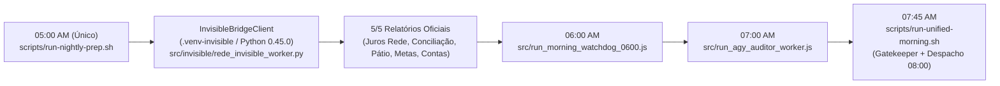

# Design de Arquitetura Refinado — Spec 078: Invisible Playwright Exclusivo (`origin/master`), Agendamento Único Matinal (05:00 AM), Frescor do Pátio e Validação Google Sheets

## 1. Arquitetura da Esteira Matinal da Rede (Zero Execução Noturna + Invisible Playwright Exclusivo)

### 1.1 Fluxo Temporal Único no Crontab (Segunda a Sexta)
A extração da Rede **nunca** roda à noite (`23:00`, `01:00`, `03:00`). Existe apenas **uma única execução às 05:00 AM** pós-clearing bancário, operando exclusivamente via **Invisible Playwright 0.45.0** (`InvisibleBridgeClient` -> `rede_invisible_worker.py`).

### 1.2 Reconciliação Git na VPS (`origin/master` `57cabe4` como Fonte Canônica da Rede)
1. **Arquivos onde `origin/master` (`57cabe4`) DEVE sobrescrever `97c65b6` na VPS:**
   - `src/scraper.js` (contém a trava `USE_INVISIBLE_PLAYWRIGHT` que proíbe Chromium e delega 100% ao `InvisibleBridgeClient`)
   - `src/invisible_bridge_client.js`
   - `src/invisible/rede_invisible_worker.py`
   - `src/invisible/session_guard.py`
   - `src/invisible/manifest_tracker.py`
   - `src/invisible/xlsx_helper.py`
   - `src/batch_audit_guard.js`
   - `src/reconnect_system/rede_live_auth_hub.js`
   - `src/reconciliation_patio_rede_engine.js`
   - `src/patio_ledger_engine.js`
   - `src/leads_system/*`
   - `deploy/setup_invisible_env.sh` e `deploy/invisible_manifest.json`
2. **Scripts e módulos de `origin/master` (`57cabe4`) ausentes no disco da VPS a restaurar:**
   - `scripts/run-nightly-prep.sh`, `scripts/run-unified-morning.sh`, `scripts/run-patio.sh`, `scripts/cleanup-crawler-zombies.sh`, `scripts/rotate-crawler-logs.sh`
   - `src/run_morning_watchdog_0600.js`, `src/exportar_contas_pagar_cli.js`, `src/ai_crawler_healing_hook.js`, `src/hydra_network_watchdog.js`, `src/sanity_gate_patio_rede.js`, `src/contas_pagar_retention.js`, `src/patio_hydra_bot_adapter.js`, `src/excel_patio_builder.js`, `src/crawler_patio_oi.js`, `src/patio_xls_parser.js`, `src/excel_conciliacao_builder.js`, `src/excel_conciliacao_updater.js`, `src/servico_prestado_antispam_gate.js`, `src/whatsapp_unified_dispatcher.js`, `src/whatsapp_notifier.js`, `src/state_manager.js`, `src/excel_processor.js`, `src/date_resolver.js`, `src/run_patio_daily.js`, `src/run_conciliacao_daily.js`, `src/index.js`, `src/config.js`.
3. **Ambiente Python `.venv-invisible`:**
   - Executar `bash deploy/setup_invisible_env.sh` na VPS (reutilizando `/home/operacional/.local/bin/invisible-playwright` e `/home/operacional/.cache/invisible-playwright` já instalados na máquina) para garantir `.venv-invisible/bin/python3` operacional.

---

## 2. Correção do Frescor Diurno (SLA 15 min) e Contagem de Pátio (`src/patio_ledger_engine.js`)

Em `recalcularSnapshotDiurno()` (`src/patio_ledger_engine.js`, linhas 844–908):
1. Para cada `slug` em `CANONICAL_STORE_SLUGS`, ler `/home/operacional/hydra-data/crawls/os_store_${slug}.json`:
   - Resolver `sourceCapturedAt` como o maior timestamp entre `crawls_execucoes.fim_em`, `MAX(ordens_servico.updated_at)` e `os_store_${slug}.json -> ultima_atualizacao`.
   - Reconciliar a contagem de OSs abertas (`is_aberta === 1`) usando `os_store_${slug}.json` quando sua captura for mais recente que `crawls_execucoes`.

---

## 3. Diagnóstico de Validação HTML (Célula D8) e Exit Code no Google Sheets

1. **`src/lib/google_sheets_client.js`:**
   - Detectar respostas HTML (`<!DOCTYPE` / `<html`) antes do `JSON.parse` e extrair a mensagem de erro do Google Sheets (`"Erro: Os dados inseridos na célula D8 violam o respectivo conjunto de regras de validação de dados..."`).
   - Preservar linhas vazias em `parseCsv()` para manter alinhamento 1:1 do `rowIndex` com a planilha real.
2. **`src/sync_sheets_os_worker.js`:**
   - Quando `updates.length > 0 && !isDryRun && !webhookResult?.ok`, retornar `ok: false` para que o processo saia com código `1` e envie o diagnóstico da célula infratora ao Dev via instância `hydra`.

---

## 4. Mapeamento de Arquivos e Estado Afetados

| Alvo | Ambiente | Ação |
|---|---|---|
| `src/scraper.js`, `src/invisible_bridge_client.js`, `src/invisible/*`, `src/batch_audit_guard.js`, `src/reconnect_system/rede_live_auth_hub.js`, `deploy/*` | VPS (`hydra-rede`) | Checkout forçado de `origin/master` (`57cabe4` / Spec 071 Invisible Playwright) sobrescrevendo o Chromium de `97c65b6` |
| `scripts/*.sh` e módulos de `src/` ausentes | VPS (`hydra-rede`) | Checkout de `origin/master` (`57cabe4`) + `chmod +x scripts/*.sh` |
| Crontab (`crontab -l`) | VPS (`operacional`) | Remover `0 23 * * *` e `0 1,3,5,7 * * *`; definir execução única `0 5 * * 1-5 /home/operacional/hydra-rede/scripts/run-nightly-prep.sh` |
| `src/patio_ledger_engine.js` | Local + VPS (`hydra-rede`) | Atualizar `recalcularSnapshotDiurno()` para ler `os_store_<slug>.json` (`ultima_atualizacao` e OSs abertas) |
| `src/lib/google_sheets_client.js` & `src/sync_sheets_os_worker.js` | Local + VPS (`hydra-rede`) | Extrair erro de validação HTML (`D8`), alinhar `parseCsv()` e retornar `exit 1` em falha |
