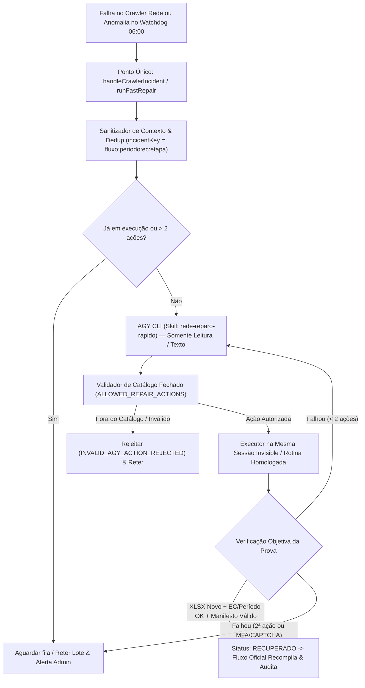

# Design Técnico — Spec 079: Reparo Rápido da Rede dentro do Watchdog

## 1. Arquitetura e Fluxo de Dados



---

## 2. Contratos e Interfaces Reais

### 2.1 Catálogo Fechado de Ações (`projects/hydra-rede/src/rede_fast_repair_catalog.js`)

```javascript
const ALLOWED_REPAIR_ACTIONS = Object.freeze({
  DISMISS_TUTORIAL_AND_RETRY_CLICK: {
    id: 'DISMISS_TUTORIAL_AND_RETRY_CLICK',
    description: 'Fecha tutorial/overlay conhecido (joyride-backdrop, coachmark), confirma no DOM que o seletor está acessível e repete o clique.',
    requiresBrowserSession: true,
    allowedStages: ['SELECT_STORE', 'OPEN_SALES_REPORT', 'EXPORT_EXCEL']
  },
  INSPECT_AND_CLICK_CANDIDATE: {
    id: 'INSPECT_AND_CLICK_CANDIDATE',
    description: 'Inspeciona controles visíveis por função e rótulo, clica se houver candidato único compatível e confirma o EC no cabeçalho.',
    requiresBrowserSession: true,
    allowedStages: ['SELECT_STORE', 'OPEN_SALES_REPORT', 'EXPORT_EXCEL']
  },
  POLL_QUEUE_OR_RESUME_EXPORT: {
    id: 'POLL_QUEUE_OR_RESUME_EXPORT',
    description: 'Consulta a fila S3 (/api/fl2/prd/v1/downloads/queue) antes de nova exportação; retoma apenas o EC pendente exigindo arquivo novo.',
    requiresBrowserSession: true,
    allowedStages: ['EXPORT_EXCEL', 'POLL_DOWNLOAD_QUEUE']
  },
  RECOVER_SESSION_INVISIBLE: {
    id: 'RECOVER_SESSION_INVISIBLE',
    description: 'Executa recuperação de sessão no perfil persistente do Invisible e confirma acesso ao relatório (escala para admin se exigir CAPTCHA/MFA).',
    requiresBrowserSession: true,
    allowedStages: ['AUTH_SESSION', 'SELECT_STORE', 'OPEN_SALES_REPORT']
  },
  RUN_HOMOLOGATED_CONTINGENCY: {
    id: 'RUN_HOMOLOGATED_CONTINGENCY',
    description: 'Aciona a rotina de contingência previamente homologada em staging quando há SyntaxError, módulo ausente ou arquivo sintético.',
    requiresBrowserSession: false,
    allowedStages: ['SCRAPER_BOOTSTRAP', 'BATCH_EXPORT', 'SYNTHETIC_DETECTED']
  },
  ESCALATE_ADMIN_AUTH_REQUIRED: {
    id: 'ESCALATE_ADMIN_AUTH_REQUIRED',
    description: 'Retém o lote e notifica o administrador quando há desafio MFA/CAPTCHA ou falha irrecuperável após o teto de ações.',
    requiresBrowserSession: false,
    allowedStages: ['ANY']
  }
});
```

### 2.2 Contrato de Entrada Sanitizado para a Skill `rede-reparo-rapido`

O payload enviado ao AGY CLI é estritamente textual e filtrado por `sanitizeIncidentPayload()`:
- Remove cookies, headers `Authorization`, tokens Bearer, senhas, CPFs/cartões e imagens base64.
- Estrutura:
```json
{
  "incidentKey": "MATINAL_REDE:2026-11-06..2026-11-08:47712201:SELECT_STORE",
  "fluxo": "MATINAL_REDE",
  "etapa": "SELECT_STORE",
  "ec": "47712201",
  "lojaNome": "Piraporinha",
  "periodo": "2026-11-06..2026-11-08",
  "tentativa": 1,
  "maxAcoes": 2,
  "erroSanitizado": "ElementClickInterceptedError: Element <a id=\"nav-config\"> is not clickable because another element <div class=\"joyride-backdrop\"> obscures it",
  "sessionStatus": {
    "authenticated": true,
    "status": "SESSION_ACTIVE",
    "activeEcCode": "63034336",
    "url": "https://meu.userede.com.br/home"
  },
  "visibleControls": [
    { "tag": "A", "id": "nav-config", "className": "dropdown-toggle icon_usuario_perfil", "text": "Matriz 63034336" },
    { "tag": "DIV", "id": "", "className": "joyride-backdrop", "text": "" }
  ]
}
```

### 2.3 Contrato de Resposta do AGY CLI

```json
{
  "actionId": "DISMISS_TUTORIAL_AND_RETRY_CLICK",
  "evidence": "O log e a lista de controles visíveis confirmam que div.joyride-backdrop está interceptando o clique em #nav-config.",
  "targetControl": "#nav-config",
  "expectedPostCondition": "Overlay .joyride-backdrop invisível e modal de seleção de estabelecimentos aberto para o EC 47712201."
}
```

### 2.4 Extensão RPC no Daemon Invisible (`projects/hydra-rede/src/invisible/rede_invisible_worker.py`)

Novas ações RPC determinísticas executadas na mesma sessão (`self.page`) do daemon:
1. `INSPECT_VISIBLE_CONTROLS`: Retorna lista textual sanitizada de controles interativos (`tag`, `id`, `className`, `ariaLabel`, `text`) e overlays visíveis, sem expor cookies ou tokens.
2. `EXECUTE_REPAIR_ACTION`: Executa exclusivamente uma das ações de UI do catálogo fechado (`DISMISS_TUTORIAL_AND_RETRY_CLICK`, `INSPECT_AND_CLICK_CANDIDATE`, `POLL_QUEUE_OR_RESUME_EXPORT`, `RECOVER_SESSION_INVISIBLE`) sobre `self.page` e retorna `{ status: 'OK' | 'FAILED', postCheckPassed: boolean, detail: string, filePath?: string, fileSha256?: string }`.
3. Remoção do fallback sintético silencioso em produção: `EXPORT_STORES_BATCH` em modo de produção (`NODE_ENV === 'production'` e sem flag `--allow-synthetic-test`) **nunca** gera arquivo sintético via `generate_binary_rede_xlsx` quando uma loja falha; em vez disso, reporta o erro real para acionar o Reparo Rápido ou a Rotina de Contingência Homologada.

### 2.5 Rotina de Contingência Homologada (`src/invisible/homologated_contingency_collector.py` & `src/homologated_contingency_promoter.js`)

Baseada diretamente nos scripts homologados em operação real hoje (`09/11/2026` às `07:36–07:41 AM`):
1. Coleta real via `InvisiblePlaywright` em diretório de staging isolado (`/tmp/rede-contingency-<dateTag>`), neutralizando overlays (`.joyride-backdrop`, `.filter-coachmark__overlay`), selecionando cada um dos 10 ECs oficiais (ou o EC individual pendente), confirmando o EC no cabeçalho e baixando o `.xlsx` real da fila S3 (`/api/fl2/prd/v1/downloads/queue`).
2. O promotor valida:
   - Assinatura binária ZIP (`PK\x03\x04`) e tamanho `> 1000` bytes;
   - Ausência de marcador sintético;
   - Pertinência do EC e do período dentro da planilha via `processarRelatorioRede` e `validarLojaContraRede`;
   - Selagem criptográfica via `BatchAuditGuard` (`batch_manifest.json` + `batch_audit_receipt.json`) quando 10/10 lojas estão presentes.

---

## 3. Mapeamento de Arquivos Afetados

| Caminho do Arquivo | Operação | Responsabilidade |
|---|---|---|
| `.agents/skills/rede-reparo-rapido/SKILL.md` | Criar | Skill versionada de diagnóstico e escolha de ação no catálogo fechado sem permissão de edição de código. |
| `projects/hydra-rede/src/rede_fast_repair_catalog.js` | Criar | Catálogo fechado (`ALLOWED_REPAIR_ACTIONS`), sanitizador de logs/DOM, validador de resposta do AGY e gerador de `incidentKey`. |
| `projects/hydra-rede/src/rede_fast_repair_engine.js` | Criar | Orquestrador do Reparo Rápido: deduplicação de incidente, lock de sessão única, limite de 2 ações por incidente, invocação isolada do AGY CLI e verificação da prova física (`.xlsx` novo + EC + período + manifesto). |
| `projects/hydra-rede/src/invisible/homologated_contingency_collector.py` | Criar | Coletor real homologado (baseado na contingência de 09/11 `collect_live_v2.py`) com neutralização de Joyride, confirmação de EC no cabeçalho e download real da fila S3. |
| `projects/hydra-rede/src/homologated_contingency_promoter.js` | Criar | Validador e promotor de staging para produção (baseado em `validate_live.cjs` de 09/11), validando 10/10 ECs reais, `state_manager` e selo `BatchAuditGuard`. |
| `projects/hydra-rede/src/invisible/session_guard.py` | Modificar | Adicionar neutralização de `.joyride-backdrop` e `.filter-coachmark__overlay` e inspeção textual sanitizada de controles visíveis. |
| `projects/hydra-rede/src/invisible/rede_invisible_worker.py` | Modificar | Adicionar handlers RPC `INSPECT_VISIBLE_CONTROLS` e `EXECUTE_REPAIR_ACTION`, e bloquear fallback sintético silencioso em produção. |
| `projects/hydra-rede/src/invisible_bridge_client.js` | Modificar | Expor métodos `inspectVisibleControls()` e `executeRepairAction(payload)`. |
| `projects/hydra-rede/src/ai_crawler_healing_hook.js` | Modificar | Encaixar o ponto único de decisão do Reparo Rápido quando `modulo === 'REDE'` antes de dar o reparo como falho. |
| `projects/hydra-rede/src/sanity_gate_patio_rede.js` | Modificar | Integrar `autoHealLojaZerada` ao motor de Reparo Rápido com prova de arquivo novo. |
| `projects/hydra-rede/src/run_morning_watchdog_0600.js` | Modificar | Acionar o Reparo Rápido / Contingência Homologada quando relatórios da Rede faltarem ou falharem no Sanity Gate às 06:00 AM, recompilando e validando antes das 08:00 AM. |
| `projects/hydra-rede/src/scraper.js` | Modificar | Sincronizar remoção do bloco residual de sintaxe da linha 921 (aplicado na VPS em 09/11) e reportar falhas reais ao `handleCrawlerIncident`. |
| `projects/hydra-rede/tests/test_rede_fast_repair_suite.js` | Criar | Bateria completa de testes cobrindo as 3 fases do rollout (simulação com logs de 09/11, teste isolado de 1 loja com casos adversariais, e homologação 10/10 gates). |
