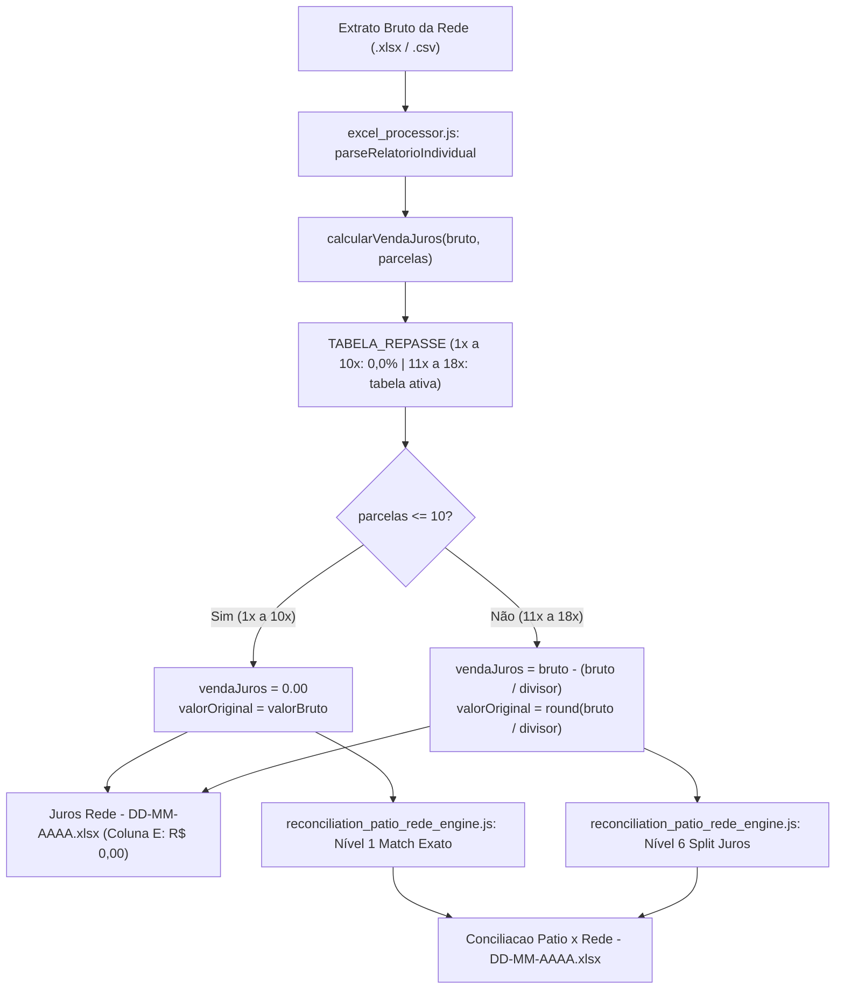

# Design Técnico — Spec 080: Matriz de Repasse da Rede (10x Sem Juros)

## 1. Arquitetura e Fluxo de Dados



---

## 2. Contratos e Interfaces Reais

### 2.1 Matriz de Parâmetros (`TABELA_REPASSE`)
Origem: `projects/hydra-rede/src/excel_processor.js:45` e `projects/hydra-rede/src/reconciliation_patio_rede_engine.js:210`

```javascript
const TABELA_REPASSE = {
  1:  { taxa: 0.000, divisor: 1.000, label: '0,0%' },
  2:  { taxa: 0.000, divisor: 1.000, label: '0,0%' },
  3:  { taxa: 0.000, divisor: 1.000, label: '0,0%' },
  4:  { taxa: 0.000, divisor: 1.000, label: '0,0%' },
  5:  { taxa: 0.000, divisor: 1.000, label: '0,0%' },
  6:  { taxa: 0.000, divisor: 1.000, label: '0,0%' },
  7:  { taxa: 0.000, divisor: 1.000, label: '0,0%' },
  8:  { taxa: 0.000, divisor: 1.000, label: '0,0%' },
  9:  { taxa: 0.000, divisor: 1.000, label: '0,0%' },
  10: { taxa: 0.000, divisor: 1.000, label: '0,0%' },
  11: { taxa: 0.135, divisor: 1.135, label: '13,5%' },
  12: { taxa: 0.140, divisor: 1.140, label: '14,0%' },
  13: { taxa: 0.145, divisor: 1.145, label: '14,5%' },
  14: { taxa: 0.150, divisor: 1.150, label: '15,0%' },
  15: { taxa: 0.155, divisor: 1.155, label: '15,5%' },
  16: { taxa: 0.160, divisor: 1.160, label: '16,0%' },
  17: { taxa: 0.175, divisor: 1.175, label: '17,5%' },
  18: { taxa: 0.180, divisor: 1.180, label: '18,0%' }
};
```

### 2.2 Função do Cálculo Reverso (`calcularVendaJuros`)
```javascript
function calcularVendaJuros(valorBruto, parcelas) {
  const p = Math.max(1, Math.min(18, parcelas || 1));
  const cfg = TABELA_REPASSE[p] || { taxa: 0, divisor: 1, label: '0,0%' };
  const valorOriginal = Math.round((valorBruto / cfg.divisor) * 100) / 100;
  const vendaJuros = Math.round((valorBruto - valorOriginal) * 100) / 100;
  return {
    parcelas: p,
    taxaRepasse: cfg.taxa,
    taxaRepasseLabel: cfg.label,
    divisor: cfg.divisor,
    valorOriginal,
    vendaJuros
  };
}
```

### 2.3 Rótulo de Contingência em Conciliação
Origem: `projects/hydra-rede/src/reconciliation_patio_rede_engine.js:23`

```javascript
match.taxaRepasse = (jurosInfo && jurosInfo.taxaPercentualStr) 
  ? jurosInfo.taxaPercentualStr 
  : (cand.parcelas <= 10 ? '0,00% (≤10x)' : '0,00%');
```

---

## 3. Mapeamento de Arquivos Afetados

| Arquivo | Componente | Papel da Alteração |
|---|---|---|
| `projects/hydra-rede/src/excel_processor.js` | Geração da planilha oficial `Juros Rede` | Atualização de `TABELA_REPASSE` para 1x a 10x = 0,0%. |
| `projects/hydra-rede/src/reconciliation_patio_rede_engine.js` | Motor de Conciliação Pátio x Rede | Atualização de `TABELA_REPASSE` e `enrichMatchRecord`. |
| `projects/hydra-rede/src/generate_7col_demo.js` | Utilitário de layout demo | Sincronização de `TABELA_REPASSE`. |
| `projects/hydra-rede/src/generate_juros_options_demo.js` | Utilitário de layout demo | Sincronização de `TABELA_REPASSE`. |
| `projects/hydra-rede/tests/test_tabela_repasse_10x.js` | Suíte de testes da Spec 080 | Testes unitários para validar 10x sem juros e cálculo a partir de 11x. |
