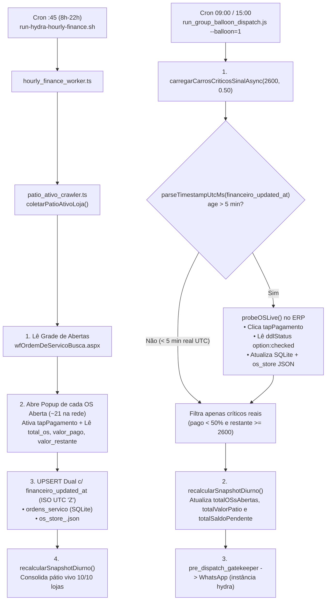

# Design Técnico — Spec 081: Sincronização Horária de Pagamentos no Pátio Ativo e Correção da Sonda Live

## 1. Arquitetura e Fluxo de Dados



## 2. Contratos e Interfaces Reais

### 2.1 Normalizador Determinístico de Timestamp UTC (`os_live_probe.js` e `whatsapp_patio_dispatcher.js`)

O SQLite persiste `CURRENT_TIMESTAMP` no formato `"YYYY-MM-DD HH:MM:SS"` em UTC sem indicador de fuso. O parser normaliza qualquer string sem offset explícito para ISO-8601 UTC antes do `Date.parse`:

```javascript
/**
 * Converte timestamps ISO-8601 ou SQLite CURRENT_TIMESTAMP (UTC sem 'Z') para epoch ms real.
 * @param {string | number | Date | null | undefined} rawTs
 * @returns {number} Epoch ms ou NaN se inválido
 */
function parseTimestampUtcMs(rawTs) {
  if (!rawTs) return NaN;
  if (rawTs instanceof Date) return rawTs.getTime();
  if (typeof rawTs === 'number') return rawTs;
  const s = String(rawTs).trim();
  if (!s) return NaN;
  // Formato SQLite UTC: "2026-11-09 17:46:36" ou "2026-11-09 17:46:36.123"
  if (/^\d{4}-\d{2}-\d{2}\s+\d{2}:\d{2}:\d{2}(?:\.\d+)?$/.test(s)) {
    return Date.parse(s.replace(/\s+/, 'T') + 'Z');
  }
  // ISO sem Z nem offset (+/-HH:MM)
  if (/^\d{4}-\d{2}-\d{2}T\d{2}:\d{2}:\d{2}(?:\.\d+)?$/.test(s)) {
    return Date.parse(s + 'Z');
  }
  return Date.parse(s);
}
```

### 2.2 Schema Incremental Resiliente em `ordens_servico`

Adição idempotente (`ALTER TABLE ordens_servico ADD COLUMN financeiro_updated_at TEXT` ignorando erro se já existir) para separar carimbo de atualização cadastral de grade (`updated_at`) do carimbo de auditoria financeira real (`financeiro_updated_at` gravado sempre em ISO UTC `new Date().toISOString()`).

### 2.3 Extração Financeira de OS Aberta em `src/hydra-sync/patio_ativo_crawler.ts`

Compatível com `OSStore` (`src/hydra-sync/delta_storage.ts:5`) e `DocumentoAberto` (`src/workers/oficina-agent/playwright/actions/os_deep_inspector.ts:68`):

```typescript
export interface ResumoPatioAtivoLoja {
  slugLoja: string;
  totalAbertasNativo: number;
  openOsIds: string[];
  inspecionadasFinanceiro: number;
  duracaoMs: number;
}
```

Para cada linha aberta na grade de `wfOrdemDeServicoBusca.aspx`:
1. Captura `osId`, `dataAbertura`, `horaInicio`, `veiculo`, `placa`, `cliente`, `responsavel`, `statusGrid`.
2. Abre o popup clicando em `[id*="lkbOrdemDeServicoID"]` (`context.waitForEvent('page', { timeout: 12000 })`).
3. No popup:
   - Clica em `a:has-text("Pagamentos"), span:has-text("Pagamentos"), [id*="tapPagamento"]` (se visível, aguarda 350ms).
   - Extrai via `detailPage.evaluate` os mesmos seletores homologados em `os_deep_inspector.ts:286-337`:
     - `total_os`: `#tab_tapItem_ucOrdemDeServicoItem_txtTotalValor` (fallback soma de `table[id*="ucOrdemDeServicoItem_grd"] tr`).
     - `pagamentos` e `somaParcelas`: linhas de `table[id*="ucOrdemDeServicoPagamento_grd"] tr`.
     - `valor_pago`: `#tab_tapPagamento_ucOrdemDeServicoPagamento_txtTotalValor, input[id*="Pagamento_txtTotalValor"]` (fallback `somaParcelas`).
     - `valor_restante`: se `txtRestante !== ''`, usa `parseMoedaDOM(txtRestante)`; senão `Math.max(0, total_os - valor_pago)`.
     - `is_bloqueada_fechada` / `data_fim`: se encerrada no detalhe, respeita encerramento.
4. Persiste em `store.os_map[osId]` (com `financeiro_updated_at = nowIso`) e executa `INSERT INTO ordens_servico (...) VALUES (...) ON CONFLICT(os_id, loja_slug)` (ou `UPDATE` + `INSERT` compatível com a chave primária real de `ordens_servico` em `db_repository.ts`) atualizando `total_os`, `valor_pago`, `valor_restante`, `financeiro_updated_at` e `raw_payload`.

### 2.4 Correções Cirúrgicas em `projects/hydra-rede/src/os_live_probe.js`

1. `necessitaRevalidacao(candidato, toleranceMs = FIVE_MINUTES_MS)`:
   - Prioriza `candidato.financeiro_updated_at || candidato.updated_at || candidato.dataObservacaoIso || candidato.sourceCapturedAt`.
   - Calcula `const dtMs = parseTimestampUtcMs(ts); if (isNaN(dtMs)) return true; return (Date.now() - dtMs) > toleranceMs;`.
2. `probeOSLive(osId, lojaSlug, options)`:
   - Após abrir `detailPage`, clica em `a:has-text("Pagamentos"), span:has-text("Pagamentos"), [id*="tapPagamento"]` para garantir hidratação do UpdatePanel AJAX.
   - Lê `status_grid` via `select[id*="ddlStatus"] option:checked` (mantendo o `cells[10]` da grade caso vazio ou `"Selecione..."`), **nunca** concatenando todas as `<option>` do `<select>`.
   - Remove o fallback perigoso `if (totalOs > 0 && valorPago === 0 && valorRestante === 0) valorPago = totalOs;` e calcula `valorPago` via input + fallback de soma da tabela `ucOrdemDeServicoPagamento_grd`, e `valorRestante` apenas quando o input `txtRestante` estiver explicitamente preenchido (ex: `"0,00"`), senão `Math.max(0, totalOs - valorPago)`.
   - `atualizarOsNoBanco` grava `financeiro_updated_at = ?` (ISO UTC `'Z'`), `updated_at = CURRENT_TIMESTAMP`, e também sincroniza `total_os`, `valor_pago` e `valor_restante` em `/home/operacional/hydra-data/crawls/os_store_${lojaSlug}.json` quando presente.

### 2.5 Balão 1 com Totais Vivos (`projects/hydra-rede/src/run_group_balloon_dispatch.js`)

No bloco `if (balloonType === '1')`:
1. Executa `const carrosSemSinal = await carregarCarrosCriticosSinalAsync(2600, 0.50);` primeiro (atualizando no SQLite e `os_store_*.json` qualquer pagamento pago nos últimos minutos).
2. Carrega `summaryData = getConsolidatedExecutiveSummary(monthStr);` (para preservar `diaReferenciaD1` e `totalOSsFechadasOntem` D-1) e executa `const liveSnap = recalcularSnapshotDiurno();`.
3. Se `liveSnap && liveSnap.status === 'SUCCESS' && liveSnap.patioRede`, atualiza `summaryData.totalOSsAbertas = liveSnap.patioRede.totalVeiculos`, `summaryData.totalValorPatio = liveSnap.patioRede.totalValorPatio` e `summaryData.totalSaldoPendente = liveSnap.patioRede.totalSaldoPendente`.

## 3. Mapeamento de Arquivos Afetados

| Arquivo | Repositório | Ação |
|---|---|---|
| `src/hydra-sync/patio_ativo_crawler.ts` | `hydra-bot` (root) | Criar/versionar no Git a partir da base da VPS + adicionar inspeção financeira por popup das OSs abertas e UPSERT completo em SQLite + `os_store_<slug>.json`. |
| `src/hydra-sync/hourly_finance_worker.ts` | `hydra-bot` (root) | Sincronizar chamada a `coletarPatioAtivoLoja` e hook `recalcularSnapshotDiurno()` eliminando drift com a VPS. |
| `projects/hydra-rede/src/os_live_probe.js` | Submódulo `hydra-rede` | Corrigir `parseTimestampUtcMs`, ativar aba `tapPagamento`, corrigir leitura de `ddlStatus option:checked`, remover inferência cega de quitação e sincronizar `os_store_<slug>.json`. |
| `projects/hydra-rede/src/whatsapp_patio_dispatcher.js` | Submódulo `hydra-rede` | Selecionar `financeiro_updated_at` em `carregarCarrosCriticosSinal` e usar `parseTimestampUtcMs` no Circuit Breaker. |
| `projects/hydra-rede/src/run_group_balloon_dispatch.js` | Submódulo `hydra-rede` | Reordenar Balão 1 para revalidar candidatos críticos antes e injetar totais vivos de `recalcularSnapshotDiurno()` em `summaryData`. |
| `projects/hydra-rede/tests/test_patio_live_probe_and_balloon1.js` | Submódulo `hydra-rede` | Suíte de testes cobrindo regressão UTC sem `'Z'`, `financeiro_updated_at`, filtro da OS `#1159` e atualização do saldo pendente no Balão 1. |
