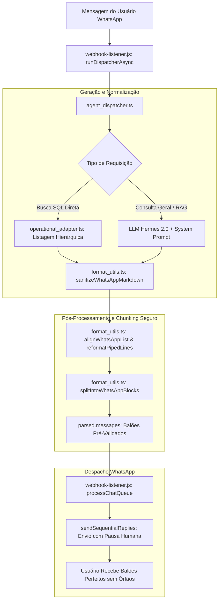

# Design Técnico: Hierarquia Visual Hermes 2.0 & Blindagem Anti-Orphan Card

## 1. Fluxo de Dados Arquitetural



---

## 2. Especificação das Modificações por Módulo

### 2.1. `src/hydra-sync/format_utils.ts`

#### A. Atualização de `reformatPipedLinesToHermesCards`
Substituição dos templates legados que geravam `> *OS...*` e `- *Status:* ...`:

```typescript
// De:
output.push('----------------------------------------');
output.push(`> *OS #${osId} — ${model} (${plate})*`);
output.push(`- *Status:* ${status} • *Pátio:* ${patio}`);
output.push(`- *Cliente:* ${client}`);
output.push(`- *Valor:* ${valor}`);

// Para (Hermes 2.0 Árvore com Joelho):
output.push(`*OS #${osId} — ${model} (${plate})*`);
output.push(`  └ Status: *${status}* · *${patio}*`);
output.push(`  └ Financeiro: *${valor}*`);
if (client && client !== 'Não informado') {
  output.push(`  └ Operação: Cliente: ${client}`);
}
output.push(''); // Linha em branco garantida entre OSs
```

#### B. Normalização em `sanitizeWhatsAppMarkdown`
- Converter qualquer ocorrência de `> *OS #...*` ou `> OS #...` para `*OS #...*` puro.
- Eliminar separadores residuais excessivos (`----------------------------------------`) entre OSs consecutivas, substituindo por espaçamento duplo limpo (`\n\n`).
- Se houver bloco de OS com linhas no formato `- Status:`, `- Cliente:`, `- Valor:`, converter deterministicamente para:
  `  └ Status: ...`
  `  └ Financeiro: ...`
  `  └ Operação: ...`

#### C. Prevenção de Títulos Órfãos em `splitIntoWhatsAppBlocks`
- Tratar cada card de OS como um bloco atômico composto por:
  - Linha do cabeçalho: `*OS #XXXX — ...*`
  - Linhas subordinadas de joelho: `  └ ...`
- Adicionar regra no agrupador de chunks:
  Se o próximo parágrafo a ser adicionado for um card de OS que não cabe por inteiro no balão atual (`currentChunk.length + cardLength > maxBlockLength`), fechar o balão atual imediatamente e iniciar o card de OS na primeira linha do próximo balão.
  **Nunca permitir que o cabeçalho fique no final de um balão e os joelhos fiquem no início do seguinte.**

---

### 2.2. `src/hydra-sync/balloon_composer.ts`

#### Atualização de `splitIntoAtomicItems`
Reconhecer o caractere de joelho `└` como indicador de filhos de card:

```typescript
export function splitIntoAtomicItems(detailsText: string): string[] {
  if (!detailsText) return [];

  const blocks = detailsText
    .split(/\n\s*\n/)
    .map(b => b.trim())
    .filter(b => b.length > 0);

  const items: string[] = [];

  for (const block of blocks) {
    const lines = block.split('\n').map(l => l.trimEnd()).filter(l => l.length > 0);
    if (lines.length === 0) continue;

    const firstLine = lines[0].trim();
    const isCardHeader = 
      firstLine.startsWith('>') || 
      /^\*[^*]+\*$/.test(firstLine) || 
      /^\*[^*]+:\*$/.test(firstLine) ||
      /^\*OS\s*#?\d+/i.test(firstLine);

    // Reconhece tanto bullets (-) quanto joelhos (└) como linhas filhas de card atômico
    const hasFieldBullets = lines.slice(1).some(l => /^\s*(?:[-•]|└)\s+/.test(l));

    if (isCardHeader && hasFieldBullets) {
      items.push(block.trim());
    } else {
      items.push(block.trim());
    }
  }

  return items;
}
```

---

### 2.3. `webhook-listener.js`

#### Deduplicação de Chunking (Linha 1116)
Atualmente:
```javascript
const rawText = parsed.replyText || (Array.isArray(parsed.messages) ? parsed.messages.join("\n\n") : parsed.messages);
if (rawText) {
  const composed = composeSemanticBalloons(rawText);
  return resolve({
    messages: composed
  });
}
```

Correção Segura:
Se `parsed.messages` já for um array validado de balões entregue pelo `agent_dispatcher.ts`, respeitar diretamente esses balões sem reagrupá-los e refatiá-los:

```javascript
if (Array.isArray(parsed.messages) && parsed.messages.length > 0) {
  return resolve({
    messages: parsed.messages.map(m => sanitizeWhatsAppMarkdown(m)).filter(Boolean)
  });
}

const rawText = parsed.replyText || parsed.messages;
if (rawText) {
  const composed = composeSemanticBalloons(rawText);
  return resolve({
    messages: composed
  });
}
```

---

### 2.4. `src/hydra-sync/agent_dispatcher.ts` & `system_prompt.md`

#### Reforço das Diretrizes Operacionais (Anti-Listagem Desnecessária de Finalizadas)
Nas diretrizes `HERMES_DIRECTIVES` e no `safePrompt`:
- Ao responder sobre "OSs de [loja]" ou "pátio de [loja]", a IA deve listar com cards individuais **estritamente as OSs em atendimento ativo no pátio físico**.
- As OSs finalizadas/entregues (com 0 dias no pátio) devem ser apresentadas de forma resumida e agregada (ex: `14 OSs faturadas/finalizadas no mês totalizando R$ 35.541,90`), a menos que o operador peça explicitamente "quais são as ordens finalizadas?".
- Toda e qualquer OS listada individualmente deve seguir a árvore com joelho `  └ ` e linha em branco entre cada ordem.

---

## 3. Interfaces TypeScript Reais

```typescript
export interface OSAtomicCardProps {
  osId: number | string;
  model: string;
  plate: string;
  statusGrid: string;
  diasNoPatio: number;
  totalOS: number;
  valorRestante: number;
  responsavel?: string;
  clienteNome?: string;
}

export function formatHierarchicalOSCard(props: OSAtomicCardProps): string {
  const modelStr = props.model.toUpperCase();
  const plateStr = props.plate.toUpperCase();
  const saldoStr = props.valorRestante > 0 ? `*${fmtMoeda(props.valorRestante)}*` : '*Quitado*';
  const diasStr = props.diasNoPatio > 0 ? `· *${props.diasNoPatio} dias* no pátio` : '· *0 dias* no pátio';
  
  const lines = [
    `*OS #${props.osId} — ${modelStr} (${plateStr})*`,
    `  └ Status: *${props.statusGrid}* ${diasStr}`,
    `  └ Financeiro: Total *${fmtMoeda(props.totalOS)}* · Saldo: ${saldoStr}`
  ];

  const opParts: string[] = [];
  if (props.responsavel && props.responsavel !== 'Não informado') {
    opParts.push(`Resp: ${props.responsavel}`);
  }
  if (props.clienteNome && props.clienteNome !== 'Não informado') {
    opParts.push(`Cliente: ${props.clienteNome}`);
  }
  if (opParts.length > 0) {
    lines.push(`  └ Operação: ${opParts.join(' · ')}`);
  }

  return lines.join('\n');
}
```
