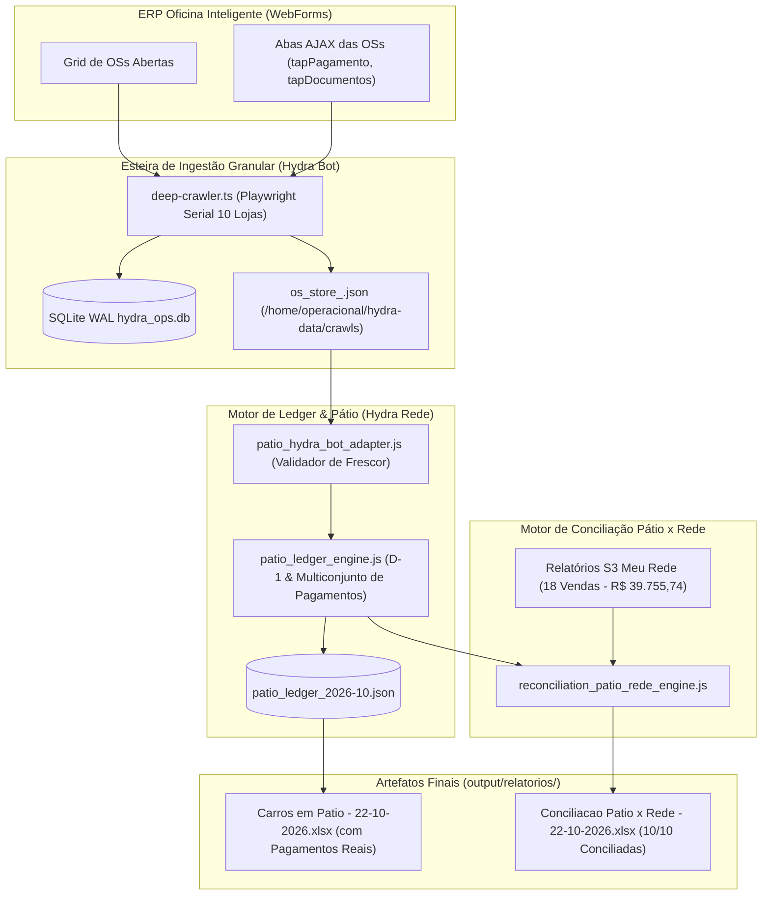

# Design Técnico: Recuperação dos Dados de Pátio Zerados & Blindagem de Frescor do Deep Crawler

**Spec ID:** `fix-patio-stale-crawler-and-zero-balance`  
**Data:** 22/10/2026  

---

## 1. Arquitetura e Fluxo de Dados



---

## 2. Interfaces TypeScript Estritas (Zero `any`)

### 2.1. Contrato de Frescor e Integridade dos Stores

```typescript
export interface StoreFreshnessCheck {
  readonly lojaSlug: string;
  readonly filePath: string;
  readonly fileExists: boolean;
  readonly mtimeISO: string | null;
  readonly ageInHours: number;
  readonly isFresh: boolean; // ageInHours <= 8
  readonly totalOSCount: number;
  readonly totalAbertasCount: number;
  readonly totalPagamentosOntem: number;
}

export interface NetworkFreshnessReport {
  readonly evaluatedAt: string;
  readonly maxAllowedAgeHours: number;
  readonly isNetworkFresh: boolean;
  readonly freshStores: readonly string[];
  readonly staleStores: readonly string[];
  readonly missingStores: readonly string[];
  readonly storesReport: Record<string, StoreFreshnessCheck>;
}
```

### 2.2. Contrato de Detecção de Anomalia de Conciliação (Anti-Zero Guard)

```typescript
export interface ReconciliationAnomalyGuardResult {
  readonly passesGuard: boolean;
  readonly redeTotalBruto: number;
  readonly patioTotalConciliado: number;
  readonly ratioConciliado: number;
  readonly zeroPaymentStoresInPatio: readonly string[];
  readonly lojasComVendaRedeSemPatio: readonly string[];
  readonly requiresEmergencyCrawl: boolean;
  readonly reason: string;
}
```

---

## 3. Módulos a Modificar e Intervenções Técnicas

### 3.1. `scripts/run-hydra-daily-full.sh` (Desacoplamento de Locks)
- **Problema:** Lock compartilhado `/tmp/hydra-data-refresh.lock` gerava colisão direta com o worker financeiro horário de metas (`run-hydra-hourly-finance.sh`).
- **Solução:** Atribuir lock exclusivo para extração profunda `/tmp/hydra-deep-crawler.lock` com espera inteligente de até 60 segundos caso haja operação atômica no banco, e lock de arquivo por loja caso necessário.

### 3.2. `src/hydra-sync/deep-crawler.ts` (Execução e Ingestão Factual)
- Executar extração completa das 10 lojas ativas:
  - `brasicar_planalto` (Planalto)
  - `emporio_piraporinha` (Piraporinha)
  - `mhe_maua` (Mauá)
  - `mp_kennedy` (Kennedy)
  - `cap_rudge_ramos` (Rudge Ramos)
  - `hd_santo_andre` (Santo André)
  - `mp_rei_modulo` (Rei do Módulo)
  - `dhjv_jorge_beretta` (Jorge Beretta)
  - `dp_dom_pedro` (Dom Pedro I)
  - `jab_jabaquara` (Jabaquara)
- Garantir a ativação das abas AJAX (`tapPagamento`) para extrair os pagamentos com data de referência `21/10/2026`.
- Sincronizar tabelas `ordens_servico` e gerar arquivos `os_store_<slug>.json` com mtime atualizado.

### 3.3. `projects/hydra-rede/src/patio_ledger_engine.js` (Reset de Snapshot Stale)
- Como o snapshot de 22/10 foi processado incorretamente às 08:20 com dados vazios, o `patio_ledger_engine.js` deve ser executado para reprocessar o dia de referência `21/10/2026`, atualizando os campos `pagamentosOntem`, `tevePagamentoOntem`, `pagamentosExibicaoPlanilha` e `saidaOntem`.

### 3.4. `projects/hydra-rede/src/run_unified_morning_dispatch.js` (Trava de Conciliação)
- Implementar checagem pré-despacho: se o valor total de Pátio for `< 25%` do valor total da Rede em um dia útil com vendas comprovadas, o despacho do quinteto é retido e classificado como `DIVERGENCIA_ESTRUTURAL_PATIO_STALE`, disparando aviso ao Dev antes de entregar relatórios inconsistentes à diretoria.

---

## 4. Plano de Verificação Pós-Execução

1. **Validação de Ingestão:** Consultar `ordens_servico` em `hydra_ops.db` e confirmar `max(updated_at)` em 22/10/2026 com pagamentos registrados no dia 21/10.
2. **Inspeção de `Carros em Patio - 22-10-2026.xlsx`:**
   - Confirmar que na aba `Resumo Pátio` as lojas (Kennedy, Planalto, Mauá, Rudge, etc.) possuem valores reais em `Recebido Ontem (R$)`.
   - Na aba `OS`, verificar preenchimento das formas de pagamento (Crédito, Débito, PIX) na coluna `PAGAMENTOS:`.
3. **Inspeção de `Conciliacao Patio x Rede - 22-10-2026.xlsx`:**
   - Confirmar que as transações de Kennedy (R$ 9.400,00 e R$ 3.017,63), Dom Pedro (R$ 3.500,00 e R$ 2.084,90), Jorge Beretta, Planalto e Piraporinha agora casam com as OSs correspondentes.
   - O índice de acurácia deve saltar de **14% para > 80%**.
