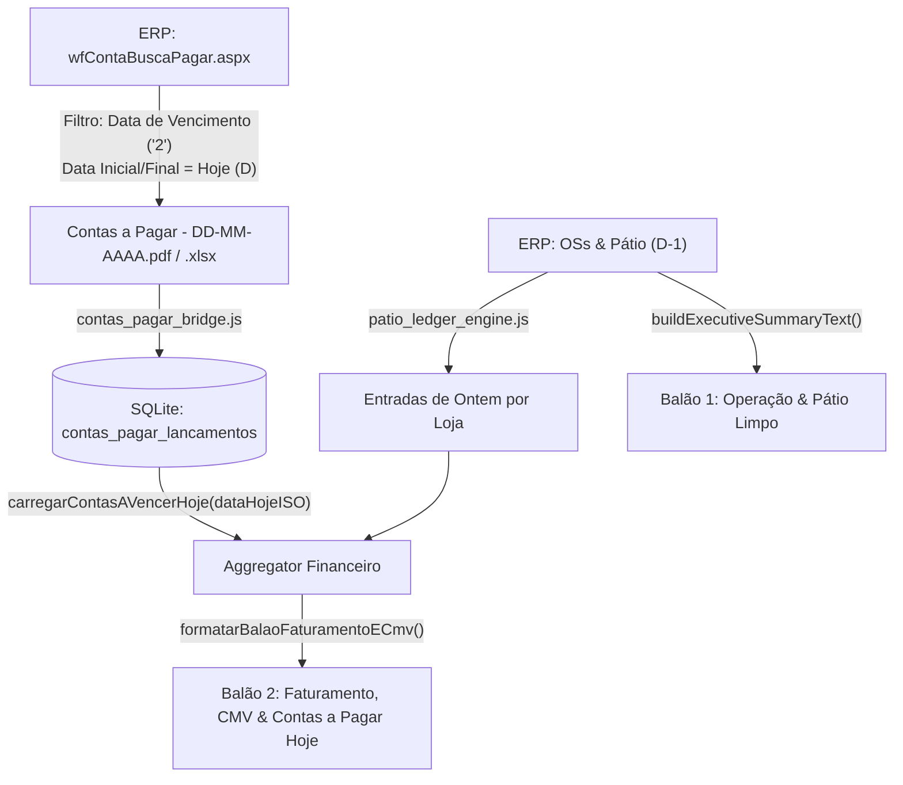

# Design Técnico: Contas a Vencer Hoje x Entradas de Ontem no Balão 2

**Spec ID:** `hydra-daily-financial-cashflow-balance`  
**Data:** 09/10/2026  
**Status:** Design Técnico Atualizado (SDD Design)  

---

## 1. Arquitetura e Pipeline de Dados



---

## 2. Ajustes nos Módulos

### 2.1. Crawler de Contas a Pagar (`exportar_contas_pagar_cli.js` & `contas_pagar_crawler.ts`)
1. **Filtro de Data no Formulário:**
   - Modificar de:
     `await selectFiltroData.selectOption('3'); // Data de Pagamento`
   - Para:
     `await selectFiltroData.selectOption('2'); // Data de Vencimento (Contas a Vencer)`
2. **Período de Extração:**
   - Preencher `txtDataInicial` e `txtDataFinal` com a **Data de Hoje** ($D$, dia da execução, formato `DD/MM/AAAA`).
   - Nas segundas-feiras, caso configurado período estendido, estende de hoje ou cobre as datas da janela.
3. **Download e Salvamento:**
   - Salva `Contas a Pagar - DD-MM-AAAA.pdf` e `Contas a Pagar - DD-MM-AAAA.xlsx`.
   - Ingestão no SQLite em `contas_pagar_lancamentos` com `data_vencimento = ?` e `status = 'ABERTO'` / `'PAG'`.

### 2.2. Aggregator de Contas a Vencer (`whatsapp_patio_dispatcher.js`)
```javascript
function carregarContasAVencerHoje(dataHojeISO) {
  const dbPath = process.env.HYDRA_DB_PATH || '/home/operacional/hydra-data/hydra_ops.db';
  if (!Database || !fs.existsSync(dbPath)) {
    return { totalGeralAPagar: 0, totalLancamentos: 0, lojas: {} };
  }

  try {
    const db = new Database(dbPath, { readonly: true });
    // Consulta lançamentos com vencimento na data de hoje
    const rows = db.prepare(`
      SELECT 
        loja_slug, 
        loja_original,
        COUNT(*) as qtd, 
        ROUND(SUM(valor_a_pagar), 2) as total_a_pagar 
      FROM contas_pagar_lancamentos 
      WHERE data_vencimento = ? AND loja_slug != 'master'
      GROUP BY loja_slug
      ORDER BY total_a_pagar DESC
    `).all(dataHojeISO);
    db.close();

    let totalGeralAPagar = 0;
    let totalLancamentos = 0;
    const lojas = {};

    for (const r of rows) {
      const cs = matchStore(r.loja_slug) || matchStore(r.loja_original);
      const slugCanon = cs ? cs.slug : r.loja_slug;
      const nomeCanon = cs ? cs.displayName : r.loja_original;

      lojas[slugCanon] = {
        lojaSlug: slugCanon,
        lojaNome: nomeCanon,
        qtdLancamentos: r.qtd,
        totalAPagar: Number(r.total_a_pagar || 0)
      };

      totalGeralAPagar += Number(r.total_a_pagar || 0);
      totalLancamentos += Number(r.qtd || 0);
    }

    return { totalGeralAPagar, totalLancamentos, lojas };
  } catch (err) {
    console.warn('[Contas Pagar Aggregator] Erro ao carregar contas a vencer:', err.message);
    return { totalGeralAPagar: 0, totalLancamentos: 0, lojas: {} };
  }
}
```

### 2.3. Formatação do Balão 2 (`formatarBalaoFaturamentoECmv`)
```javascript
function formatarBalaoFaturamentoECmv({
  dataReferencia,
  lojas = [],
  faturamentoTotal = 0,
  cmvMedioRede = null,
  contasAVencerSummary = null,
  summaryData = null
}) {
  const blocos = [];
  const dataStr = dataReferencia || new Date().toLocaleDateString('pt-BR');
  blocos.push(`*HYDRA | Faturamento, CMV & Contas do Dia*\n\n${dataStr} · Posição Mês & Previsão Hoje`);

  // Mapeia entradas de ontem por loja a partir do summaryData
  const entradasMap = {};
  if (summaryData && summaryData.lojas) {
    summaryData.lojas.forEach(sl => {
      entradasMap[sl.storeKey] = sl.recebidoOntem || 0;
    });
  }

  // Prepara itens de cada loja com faturamento, entradas e contas a pagar hoje
  const lojasFormatadas = lojas.map(l => {
    const entrou = entradasMap[l.slug] || 0;
    const aPagar = (contasAVencerSummary?.lojas?.[l.slug]?.totalAPagar) || 0;
    const saldo = entrou - aPagar;
    const isNoVermelho = saldo < 0;
    return {
      ...l,
      entrouOntem: entrou,
      aPagarHoje: aPagar,
      saldoPrevisto: saldo,
      isNoVermelho
    };
  });

  // Ordena lojas (ex: pelo saldo mais positivo ou faturamento)
  lojasFormatadas.sort((a, b) => b.saldoPrevisto - a.saldoPrevisto);

  const lojasBlocos = [];
  lojasFormatadas.forEach((l, idx) => {
    const cmvTxt = (l.cmvPercentual !== null && l.cmvPercentual !== undefined)
      ? `${Number(l.cmvPercentual).toFixed(1).replace('.', ',')}%`
      : 'N/D';
    const statusTxt = l.isNoVermelho ? '🔴 (No vermelho)' : '🟢 (Positivo)';
    
    lojasBlocos.push(
      `${idx + 1}. *${l.nome}*\n` +
      `- Faturamento Mês: *${formatBRL(l.faturamento || 0)}* | CMV: *${cmvTxt}*\n` +
      `- Entrou ontem: *${formatBRL(l.entrouOntem)}* | A pagar hoje: *${formatBRL(l.aPagarHoje)}*\n` +
      `- Saldo previsto: *${formatBRL(l.saldoPrevisto)}* ${statusTxt}`
    );
  });

  blocos.push(`*Desempenho por unidade*\n\n` + lojasBlocos.join('\n\n'));

  // Consolidado da rede
  const totalEntradas = summaryData?.totalRecebidoOntem || 0;
  const totalImediato = summaryData?.liquidacaoPrevistaHoje?.totalDisponivelManha || 0;
  const totalContas = contasAVencerSummary?.totalGeralAPagar || 0;
  const saldoRede = totalEntradas - totalContas;
  const statusRede = saldoRede < 0 ? '🔴 (No vermelho)' : '🟢 (Positivo)';

  const consolidadoLinhas = [
    `*Consolidado da rede*`,
    `- Faturamento acumulado no mês: *${formatBRL(faturamentoTotal)}*`,
    `- CMV médio da rede: *${cmvMedioRede ? Number(cmvMedioRede).toFixed(1).replace('.', ',') + '%' : 'N/D'}*`,
    `- Entradas de ontem: *${formatBRL(totalEntradas)}* (Imediato: ${formatBRL(totalImediato)})`,
    `- Contas a pagar hoje: *${formatBRL(totalContas)}*`,
    `- Saldo previsto hoje: *${formatBRL(saldoRede)}* ${statusRede}`
  ];
  blocos.push(consolidadoLinhas.join('\n'));

  // Destaques da diretoria
  const maiorSuperavit = [...lojasFormatadas].sort((a, b) => b.saldoPrevisto - a.saldoPrevisto)[0];
  const maiorCompromisso = [...lojasFormatadas].sort((a, b) => b.aPagarHoje - a.aPagarHoje)[0];
  const destaquesLinhas = [];
  if (maiorSuperavit) destaquesLinhas.push(`> Maior superávit de hoje: *${maiorSuperavit.nome}* (${formatBRL(maiorSuperavit.saldoPrevisto)}).`);
  if (maiorCompromisso && maiorCompromisso.aPagarHoje > 0) destaquesLinhas.push(`> Maior compromisso a pagar hoje: *${maiorCompromisso.nome}* (${formatBRL(maiorCompromisso.aPagarHoje)}).`);
  if (destaquesLinhas.length > 0) blocos.push(destaquesLinhas.join('\n'));

  return blocos.join('\n\n');
}
```

### 2.4. Balão 1 (`buildExecutiveSummaryText`)
- Mantido limpo e inalterado: Pátio Ativo + 6 Carros Críticos sem sinal de 60%.
- Zero poluição com fluxo de contas.
