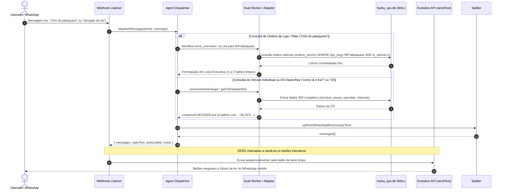

# Design Técnico: Expurgo de Botões Interativos e Restauração da Formatação Executiva Hermes

**Spec ID:** `revert-buttons-restore-hermes-format`  
**Data:** 09/10/2026  
**Status:** Proposta  

---

## 1. Fluxo de Dados e Roteamento



---

## 2. Padrões Visuais Restaurados

### 2.1. Formato 1: Listagem Hierárquica de Ordens de Serviço por Loja
Disparado para: `"OSs do jabaquara"`, `"ordens de jabaquara"`, `"carros no pátio de jabaquara"`, `"quais OSs abertas em jabaquara"`.

**Exemplo do balão de resposta (com hierarquia em "joelho" `└` e espaçamento entre parágrafos):**
```text
> *Ordens de Serviço Abertas: Jabaquara*
- *Veículos no pátio:* 2 veículos
- *Saldo a receber:* R$ 2.738,90

*OS #465 — FORD KA SE (BXD6F52)*
  └ Status: *Na Fila para Execução* · *4 dias* no pátio
  └ Financeiro: Total *R$ 2.600,00* · Saldo: *R$ 2.600,00*
  └ Responsável: Vanessa · Cliente: Francisco Carlos Alves

*OS #445 — CROSSFOX (DTT2E56)*
  └ Status: *Em Teste* · *0 dias* no pátio
  └ Financeiro: Total *R$ 138,90* · Saldo: *Quitado*
  └ Responsável: Vanessa · Cliente: Mauro Cogo
```

**Regras de Apresentação:**
- Cabeçalho limpo com `> *Ordens de Serviço Abertas: [Nome da Loja]*`.
- Resumo executivo de quantidade de veículos e saldo total a receber no topo.
- Cada OS possui seu próprio bloco destacado com espaçamento entre parágrafos (linha em branco).
- Sub-itens organizados em árvore com o caractere "joelho" (`  └ `) para leitura rápida sem parecer tabela corrida.
- Sem poluição de rodapés, sem comandos de URA e sem texto prolixo.

---

### 2.2. Formato 2: Ficha Hermes 360 Completa da OS
Disparado para: `"como tá o Ka?"`, `"detalhes do Ka"`, `"OS #465"`, `"situação da OS 465"`, `"placa BXD6F52"`.

**Estrutura dos 4 balões (`---BLOCK---`):**

#### Balão 1: Cabeçalho Executivo e Atendimento
```text
> *OS #465 — FORD KA SE (BXD6F52) | Ficha Operacional 360*
- *Loja:* MPJabaquara
- *Status:* *Na Fila para Execução* (Em Aberto)
- *Permanência:* 4 dia(s) no pátio
- *Cliente:* Francisco Carlos Alves
- *Telefone:* (11) 98765-4321
- *Responsável:* Vanessa
- *Total da OS:* *R$ 2.600,00* (Saldo: *R$ 2.600,00*)
- *Situação:* Sem início de execução ou mecânico apontado.
```

#### Balão 2: Serviços Discriminados
```text
> *Serviços Discriminados (1 item)*
- Total em Mão de Obra: *R$ 800,00*

- *Remoção do Câmbio Manual:* *R$ 800,00* (Qtd: 1) · Executor: Mecânico não atribuído
```

#### Balão 3: Peças e Materiais Aplicados
```text
> *Peças e Materiais (1 item)*
- Total em Peças: *R$ 1.800,00*

- *Troca de Correia Dentada - Banhada a Óleo:* *R$ 1.800,00* (Qtd: 1)
```

#### Balão 4: Formas de Pagamento e Vistorias
```text
> *Formas de Pagamento e Vistorias*
- *Total da OS:* *R$ 2.600,00* • *Pago:* *R$ 0,00* • *Saldo Devedor:* *R$ 2.600,00*
- *Parcelas:* Nenhuma parcela cadastrada no ERP; pendente de liquidação ou sinal.
- *Checklist de Entrada:* Concluído (Técnico em 05/10/2026)
- *Checklist do Mecânico:* Pendente
- *Nota Fiscal:* Não emitida para esta OS.
- *Anexos:* 2 documento(s) arquivado(s).
```

---

## 3. Modificações Estruturais por Módulo

### 3.1. `src/hydra-sync/agent_dispatcher.ts`
- **Remover** o bloco de anexo de `interactiveList`.
- **Restaurar** o tipo de saída `DispatcherOutput` removendo `interactiveList`.
- **Roteamento de Loja**: Quando a query for uma consulta de ordens de loja ("OSs do jabaquara"), invocar a rota de listagem de ordens de serviço (`executeOperationalQuery` / `retrieveOperationalData`) em vez de cair em veículo individual.
- **Roteamento de Veículo**: Quando a consulta for sobre um veículo ou OS individual, retornar `composeFullOS360Card(os360Params)` particionado com `---BLOCK---`.

### 3.2. `src/hydra-sync/os_situation_composer.ts`
- Reativar `composeFullOS360Card` como a função principal para detalhamento integral de OS.
- Descontinuar a emissão de `composeExecutiveOSSummary` com comandos de URA ("MÓDULOS DISPONÍVEIS", "Selecione uma opção no menu ou digite: SERVICOS...").
- Manter as funções focadas (`composeOSServicesCard`, `composeOSPartsCard`, `composeOSPaymentsCard`) apenas para quando o usuário perguntar especificamente sobre aquele aspecto ("quais os serviços da OS 465?").

### 3.3. `webhook-listener.js`
- Remover o bloco:
  ```javascript
  if (interactiveList) {
    await sendWhatsAppList(job.phone, interactiveList);
  }
  ```
- O webhook agora despacha única e exclusivamente balões de texto limpos via `sendSequentialReplies`.

### 3.4. `src/hydra-sync/types/evo_interactive_contract.ts`
- Deprecar/remover contratos de listas e botões (`EvoListPayload`, `sendList`).
- Preservar funções de sanitização de texto caso usuários ainda digitem comandos antigos.
