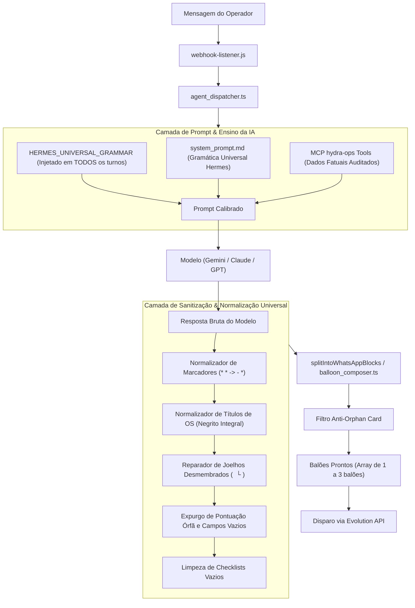

# Design Técnico: Gramática Visual Universal do Hydra & Calibração de Formatação da IA

## 1. Fluxo de Dados e Pipeline de Resposta



---

## 2. Modificações Estruturais por Módulo

### 2.1 Prompt do Sistema e Diretrizes Universais (`system_prompt.md` & `agent_dispatcher.ts`)
1. **Injeção em Todos os Turnos:**
   No `agent_dispatcher.ts`, a constante `HERMES_UNIVERSAL_GRAMMAR` passa a ser injetada **obrigatoriamente** em todas as interações, mesmo quando `agyConvId` já existe na sessão, eliminando o esquecimento de contexto da IA.
2. **Especificação das 6 Primitivas Visuais no Prompt:**
   - **Super Cabeçalho:**
     `*HYDRA | [Tema] | [Loja ou Rede]*` seguido de `*[DD/MM/AAAA] · [HH:mm]*`.
   - **Títulos de Seção:**
     Sempre `> *[Nome da Seção]*` (com `>` e `*`).
   - **Narrativa Executiva:**
     Parágrafo corrido, sem bullet, objetivo e limpo.
   - **Listas Chave-Valor:**
     `- *[Chave]:* [Valor]` (hífen simples, sem `* *`, chave em negrito com dois-pontos dentro do negrito).
   - **Cards de OS (Árvore Indivisível):**
     ```markdown
     *OS #XXXX — MODELO (PLACA)*
       └ Status: *[STATUS]* · *[X dias]* no pátio
       └ Financeiro: Total *R$ X.XXX,XX* · Saldo: *[R$ X.XXX,XX ou Quitado]*
       └ Operação: Resp: [Nome] · Cliente: [Nome Completo]
     ```
     - Linha em branco (`\n\n`) obrigatória entre OSs.
   - **Divisão de Balões:**
     Instrução explícita para usar `\n\n---BLOCK---\n\n` entre grandes blocos temáticos quando a resposta exceder 800 caracteres.
3. **Regras de Negócio Injetadas no Prompt:**
   - **Finalização:** Se houver data de fechamento, data fim ou se os serviços estiverem concluídos e o carro entregue, reportar como *Finalizada / Entregue*.
   - **Nome Completo:** Proibição estrita de truncar nomes (`...`).
   - **Checklists e Documentos:** Nunca emitir campos vazios (`*Checklist de Entrada:* `). Reportar o estado explícito (`Realizado` ou `Pendente`).

---

### 2.2 Camada de Normalização Determinística (`src/hydra-sync/format_utils.ts`)

Novos passos adicionados ao pipeline `sanitizeWhatsAppMarkdown` e `alignWhatsAppList`:

```typescript
// 1. Normalização de Marcadores Duplos de Lista (* *Chave:* -> - *Chave:*)
text = text.replace(/^[\t ]*\*[\t ]*\*\s+/gm, '- ');

// 2. Normalização de Títulos de OS com Negrito Parcial
// Transforma: "*OS #1129* — CORSA WIND (CYG2B02)" em "*OS #1129 — CORSA WIND (CYG2B02)*"
text = text.replace(
  /^[\t ]*\*?(OS\s*#?\d+[^*:\n]*)\*?\s*—\s*\*?([A-Za-zÀ-ÿ0-9\s/—–-]+\s*\([^)\n]+\))\*?$/gm,
  '*$1 — $2*'
);

// 3. Normalização de Campos Vazios e Pontuação Órfã
// Remove '·' solto no final de linha de joelho (ex: "└ Total da OS R$ 905,00 ·")
text = text.replace(/^(\s*└[^\n]+?)\s*[•·]\s*$/gm, '$1');

// Se "Saldo:" estiver no final de uma linha de joelho sem valor:
text = text.replace(/^(\s*└\s*\*?Saldo\*?:?\s*)$/gim, '$1*Quitado*');

// 4. Reparação de Joelhos Desmembrados
// Converte:
//   └ *AGUARDANDO RETIRADA*
//   └ *8 dias* no pátio
// Em:
//   └ Status: *AGUARDANDO RETIRADA* · *8 dias* no pátio
function repairFragmentedKnees(lines: string[]): string[] {
  // Lógica determinística de agregação de linhas filhas de card de OS
}

// 5. Preenchimento de Checklists Vazios
// Converte:
//   - *Checklist de Entrada:*
// Em:
//   - *Checklist de Entrada:* Pendente / Não realizado
text = text.replace(/^([\t ]*-\s+\*[^*:\n]+:\*)\s*$/gm, '$1 Não informado / Pendente');
```

---

### 2.3 Camada de Dados Operacionais (`db_repository.ts` & `operational_data_repository.ts`)

Aprimoramento da determinação de status da Ordem de Serviço:

```typescript
export function determineCanonicalOSStatus(
  statusGridRaw?: string | null,
  dataFimRaw?: string | null,
  horaFimRaw?: string | null,
  finalizadoEmRaw?: string | null,
  isAbertaRaw?: number | boolean | null
): { statusExibicao: string; isEfetivamenteAberta: boolean } {
  const normStatus = String(statusGridRaw || '').trim().toUpperCase();
  const hasDataFim = Boolean(dataFimRaw || horaFimRaw || finalizadoEmRaw);
  
  if (
    hasDataFim ||
    isAbertaRaw === 0 ||
    isAbertaRaw === false ||
    normStatus.includes('FINALIZ') ||
    normStatus.includes('ENTREG') ||
    normStatus.includes('FATURAD')
  ) {
    return {
      statusExibicao: normStatus.includes('ENTREG') ? 'Finalizada / Entregue' : 'Finalizada',
      isEfetivamenteAberta: false
    };
  }

  return {
    statusExibicao: normStatus || 'Em Aberto',
    isEfetivamenteAberta: true
  };
}
```

Essa função é integrada em `parseOSDetailRow` e em `formatVehicleSituation`, garantindo que:
- Qualquer OS com hora/data de finalização seja classificada como Finalizada.
- `clienteNome` nunca seja recortado com `.slice()` ou reticências na camada de dados.

---

### 2.4 Compositor Semântico de Balões (`balloon_composer.ts`)

- `splitIntoWhatsAppBlocks` continua garantindo que nenhum card de OS ou seção `> *Seção*` seja fracionado internamente.
- O limite máximo seguro de caracteres por balão é calibrado para **750 caracteres**, garantindo visualização ideal no celular sem disparar "... Ler mais" e sem balões órfãos.
