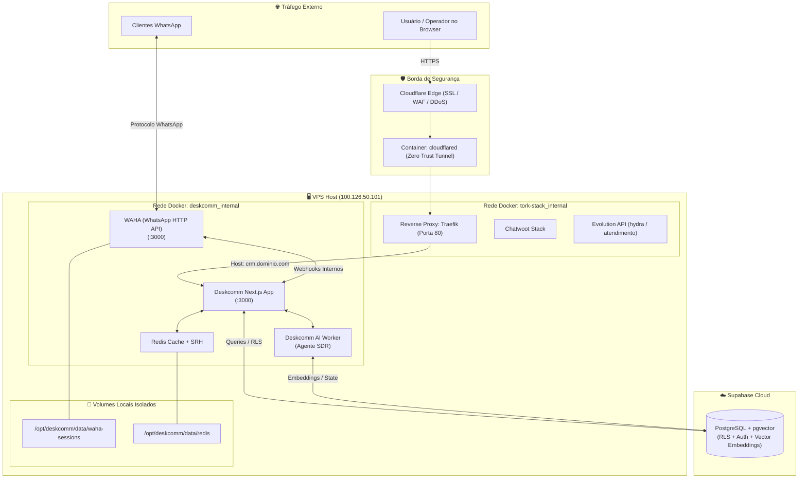

# Design Técnico: Arquitetura Isolada do DeskcommCRM na VPS

**Spec ID:** `deploy-deskcomm-crm-isolated-vps`  
**Data:** 22/10/2026  
**Status:** Planejamento (SDD Proposal)  

---

## 1. Topologia de Redes e Containers

O DeskcommCRM operará no padrão **Dual-Network Isolation**:
- **Rede `deskcomm_internal` (Bridge Privada):** Conecta exclusivamente os serviços do CRM (`app`, `worker`, `waha`, `redis`, `srh`). Nenhum serviço fora do Deskcomm tem acesso a essa rede. O Redis opera com segurança máxima sem bind de portas no host.
- **Rede `tork-stack_internal` (Bridge do Traefik da VPS):** O container `app` é o **único** membro do Deskcomm que ingressa nessa rede externa para receber o tráfego HTTP roteado pelo Traefik.



---

## 2. Especificação do Docker Compose Overlay

O deploy na VPS utilizará o compose oficial da Deskcomm com o override do Traefik ajustado para a nossa rede:

### Arquivo `/opt/deskcomm/docker-compose.override.yml`:
```yaml
version: '3.8'

services:
  app:
    networks:
      - internal
      - proxy
    labels:
      - "traefik.enable=true"
      - "traefik.docker.network=tork-stack_internal"
      # Roteamento Multi-Domínio (Aceita crm.tork.services ou qualquer domínio customizado)
      - "traefik.http.routers.deskcomm.rule=Host(`${DOMAIN}`)"
      - "traefik.http.routers.deskcomm.entrypoints=web"
      - "traefik.http.services.deskcomm.loadbalancer.server.port=3000"
      - "traefik.http.middlewares.deskcomm-compress.compress=true"
      - "traefik.http.routers.deskcomm.middlewares=deskcomm-compress"

      # Bloqueio de Segurança: Webhook Global do WAHA fechado para a internet
      - "traefik.http.routers.deskcomm-waha-block.rule=Host(`${DOMAIN}`) && PathPrefix(`/api/v1/webhooks/waha`)"
      - "traefik.http.routers.deskcomm-waha-block.entrypoints=web"
      - "traefik.http.routers.deskcomm-waha-block.priority=1000"
      - "traefik.http.routers.deskcomm-waha-block.service=deskcomm"
      - "traefik.http.routers.deskcomm-waha-block.middlewares=deskcomm-deny"
      - "traefik.http.middlewares.deskcomm-deny.ipallowlist.sourcerange=192.0.2.1/32"

  # Desativa o Caddy nativo para eliminar qualquer conflito com as portas 80/443
  caddy:
    profiles:
      - caddy-desativado-proxy-existente

networks:
  proxy:
    external: true
    name: tork-stack_internal
  internal:
    name: deskcomm_internal
```

---

## 3. Gestão e Configuração de Domínio

### Cenário A: Subdomínio no ecossistema atual (`crm.tork.services`)
1. No Cloudflare Zero Trust (Tunnels > `40d59b8e-f384-4c36-9c7f-b8657572b8d9`):
   - Adicionar Public Hostname: `crm.tork.services`.
   - Serviço de Destino: `http://traefik:80` (com HTTP Host Header: `crm.tork.services`).
2. O Traefik recebe a requisição, casa com o `Host("crm.tork.services")` e despacha para `deskcomm-app:3000`.

### Cenário B: Domínio Independente / Cliente (`atendimento.outrocliente.com.br`)
1. No DNS do outro domínio:
   - Apontar CNAME ou A para a borda da Cloudflare (ou registrar no Cloudflare Zero Trust como rota pública).
2. No `.env` do Deskcomm:
   - Configurar `DOMAIN=atendimento.outrocliente.com.br`.
3. O Traefik ou Cloudflare roteará para a mesma stack Deskcomm sem nenhuma modificação nos bots da Hydra.

---

## 4. Alocação de Recursos & Cgroups

| Container | Imagem | Mem Limit | CPU Limit | Função |
| :--- | :--- | :---: | :---: | :--- |
| **`deskcomm-app`** | `ghcr.io/melgarafael/deskcommcrm:stable` | 768 MB | 1.0 core | Frontend Next.js + APIs REST |
| **`deskcomm-worker`** | `ghcr.io/melgarafael/deskcomm-worker:stable` | 512 MB | 0.8 core | Cérebro dos Agentes de IA |
| **`deskcomm-waha`** | `devlikeapro/waha:latest-2026.7.2` | 1024 MB | 1.0 core | Sessões WhatsApp (NOWEB engine) |
| **`deskcomm-redis`** | `redis:7-alpine` | 128 MB | 0.2 core | Cache e filas de mensagens |
| **`deskcomm-srh`** | `hirosystems/serverless-redis-http:v0.4.0` | 64 MB | 0.1 core | Adaptador HTTP REST para Redis |
| **TOTAL** | — | **~2.5 GB (teto máx)** | — | Consumo real típico: **~450 a 650 MB** |

> [!NOTE]
> A VPS dispõe de **4,8 GB livres** de RAM no momento da inspeção. O consumo médio de ~500 MB do Deskcomm ocupará apenas ~10% da margem disponível, deixando mais de 4,2 GB de sobra para picos operacionais dos robôs Hydra.

---

## 5. Diretriz de Isolamento de Mensageria (WhatsApp)

Conforme as regras institucionais incondicionais do projeto:
- ⛔ **PROIBIÇÃO ABSOLUTA:** Nenhum número de gerente de loja pode ser cadastrado ou vinculado no Deskcomm ou no WAHA.
- ✅ **Isolamento de Stack:**
  - A Evolution API existente continuará atendendo exclusivamente o Hydra Bot e o Watchdog nas instâncias `hydra` e `atendimento`.
  - O WAHA operará com sessões locais em `/opt/deskcomm/data/waha-sessions/`. Os números pareados no Deskcomm devem ser chips dedicados ao CRM (ex: televendas, SAC ou suporte da marca).
