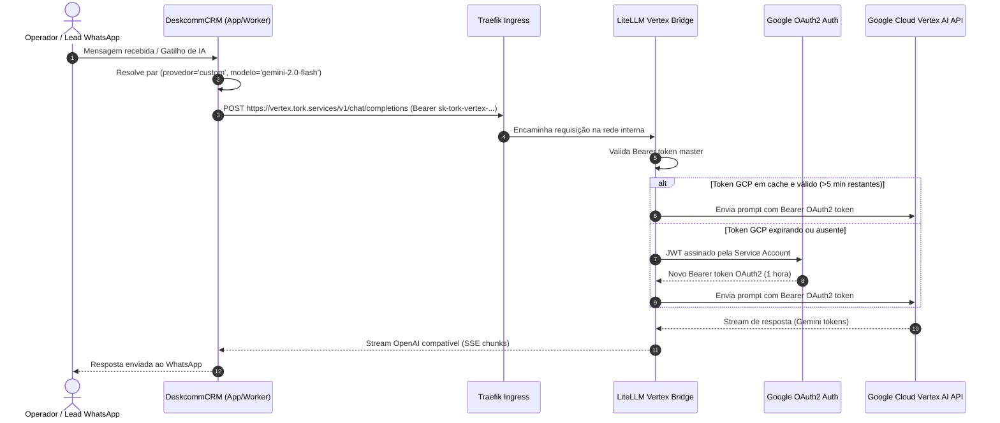

# Design Técnico: Vertex AI OpenAI-Compatible Bridge para DeskcommCRM

**Spec ID:** `vertex-ai-provider-deskcomm`  
**Data:** 22/10/2026  
**Status:** Planejamento (SDD Proposal)  

---

## 1. Fluxo de Execução da IA



---

## 2. Especificação do Container Docker (`docker-compose.vertex.yml`)

O serviço será adicionado como um override opcional ou serviço conectado à stack existente:

```yaml
services:
  vertex-bridge:
    image: ghcr.io/berriai/litellm:main-v1.61.0
    container_name: deskcomm-vertex-bridge
    restart: unless-stopped
    mem_limit: 256m
    environment:
      - PORT=4000
      - LITELLM_MASTER_KEY=${VERTEX_BRIDGE_MASTER_KEY}
      - STORE_MODEL_IN_DB=False
    volumes:
      - /opt/deskcomm/vertex/config.yaml:/app/config.yaml:ro
      - /opt/deskcomm/vertex/service-account.json:/app/service-account.json:ro
    command: ["--config", "/app/config.yaml", "--port", "4000"]
    networks:
      - tork-stack_internal
      - deskcomm_internal
    labels:
      - "traefik.enable=true"
      - "traefik.docker.network=tork-stack_internal"
      - "traefik.http.routers.vertex.rule=Host(`vertex.tork.services`)"
      - "traefik.http.routers.vertex.entrypoints=web"
      - "traefik.http.services.vertex.loadbalancer.server.port=4000"
      - "traefik.http.middlewares.vertex-compress.compress=true"
      - "traefik.http.routers.vertex.middlewares=vertex-compress"

networks:
  tork-stack_internal:
    external: true
  deskcomm_internal:
    external: true
```

---

## 3. Validação do Endpoint `/v1/models` pelo DeskcommCRM

O validador nativo do Deskcomm (`lib/ai/provider-validators.ts:354-375`) executa:
```typescript
const res = await timedFetch(`${base}/models`, {
  method: "GET",
  headers: { Authorization: `Bearer ${apiKey}` },
  redirect: "manual",
}, TIMEOUT_MS_CUSTOM);

const json = await res.json();
const modelos = json.data ?? json.models ?? [];
const models = modelos.map((m) => m.id ?? "").filter(Boolean);
```

### Contrato de Resposta Retornado pelo Bridge:
```json
{
  "object": "list",
  "data": [
    {
      "id": "gemini-2.0-flash",
      "object": "model",
      "created": 1792700000,
      "owned_by": "google-vertex"
    },
    {
      "id": "gemini-1.5-pro",
      "object": "model",
      "created": 1792700000,
      "owned_by": "google-vertex"
    },
    {
      "id": "gemini-1.5-flash",
      "object": "model",
      "created": 1792700000,
      "owned_by": "google-vertex"
    }
  ]
}
```
Isso garante compatibilidade de 100% com o validador nativo do DeskcommCRM sem nenhum falso-positivo ou rejeição.

---

## 4. Roteamento de Rede e Resolução de Domínio

Para respeitar as diretrizes de segurança SSRF do Deskcomm (`lib/automation/destinos-internos-autorizados.ts`), a URL fornecida na interface do CRM será pública (`https://vertex.tork.services/v1`):
1. **Cloudflare Zero Trust Tunnel:** Adicionar hostname público `vertex.tork.services` apontando para `http://traefik:80`.
2. **Traefik Router:** Encaminha a requisição com base no header `Host: vertex.tork.services` direto para o container `deskcomm-vertex-bridge` na porta 4000.
3. **Deskcomm Client:** Conecta-se de forma segura e padronizada via HTTPS, recebendo certificado SSL automático da Cloudflare.
